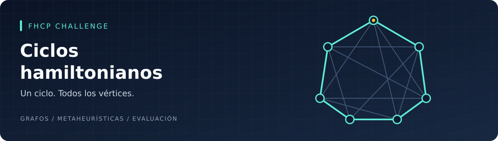

# Ciclos Hamiltonianos · FHCP Challenge

**Práctica de algoritmos heurísticos · Aula invertida**

Encontrar una ruta cerrada que visite cada vértice de un grafo exactamente una vez y regrese al origen. Este proyecto busca implementar y comparar metaheurísticas sobre las instancias del **Flinders Hamiltonian Cycle Project (FHCP)**.

[El reto](#el-reto) · [Algoritmos](#algoritmos) · [Evaluación](#evaluación) · [Entregables](#entregables) · [Equipo](#equipo)

> **Estado:** M1–M5 integrados; las seis familias están disponibles por CLI. La campaña M6 v3 completó sus 1,044 procesos y está integrada mediante la PR #77, con cinco respaldos en Drive. El contraste externo y la auditoría de cierre del #71 se presentan para revisión; M6 sigue abierto.

## El reto

Dado un grafo de **n vértices**, encontrar un ciclo de **n aristas** que recorra todos los vértices sin repetirlos, salvo el retorno al origen. Cada par consecutivo de la ruta, incluido el cierre, debe corresponder a una arista del grafo.

Se trabajará con el [FHCP Challenge Set](https://sites.flinders.edu.au/flinders-hamiltonian-cycle-project/fhcp-challenge-set/), el conjunto público indicado en la práctica. La representación de las soluciones y los operadores deberán conservar permutaciones válidas; además, se comprobará que la ruta encontrada constituya un ciclo del grafo.

## Ruta de trabajo


1. **Investigar.** Fundamentar teoría de grafos, ciclos hamiltonianos, representación por permutaciones, heurísticas y funciones de evaluación. Revisar costo computacional, iteraciones, precisión, recall y F1-score, así como los formatos y criterios de benchmarking del FHCP.
2. **Definir.** Establecer la representación del grafo y de las rutas, la función de costo o fitness y la selección de instancias del dataset.
3. **Implementar.** Desarrollar las metaheurísticas y validar las soluciones propuestas.
4. **Evaluar.** Comparar desempeño, contrastar con referencias del FHCP y documentar conclusiones.

## Algoritmos

| Metaheurística | Enfoque de la implementación |
| --- | --- |
| **Algoritmos genéticos (GA)** | Base de control: población de rutas, cruza y mutación. |
| **Recocido simulado (SA)** | Intercambios de vértices y aceptación probabilística de soluciones peores durante el enfriamiento. |
| **Colonia de hormigas (ACO)** | Construcción de rutas guiada por feromonas y heurísticas. |
| **Colonia de abejas (Bee Colony)** | Exploración y búsqueda local mediante cooperación de agentes. |
| **Evolución diferencial (DE)** | Adaptación de sus operadores al espacio discreto de permutaciones. |
| **Enjambre de partículas (PSO)** | Búsqueda colectiva adaptada a la representación de rutas. |

## Evaluación

La comparación se centrará en la **tasa de éxito al encontrar un ciclo completo** y el **tiempo computacional**, acompañados de iteraciones y validación de las rutas.

El informe incluirá tablas y gráficos por algoritmo, un contraste con resultados oficiales o algoritmos reportados en el FHCP y un análisis de las dificultades de las instancias. Se documentarán las condiciones experimentales para interpretar la comparación.

**Precisión, recall y F1-score** forman parte de la investigación solicitada. Su uso experimental deberá justificarse definiendo qué constituye un caso positivo; no se asumirán como equivalentes a la tasa de éxito.

## Entregables

- [ ] Código ejecutable que cargue grafos del FHCP, ejecute las metaheurísticas y devuelva un arreglo de vértices como solución propuesta.
- [ ] Fundamentación del grafo, sus vértices y el ciclo hamiltoniano.
- [ ] Descripción de la representación y de la función de evaluación.
- [ ] Tablas y gráficos comparativos de tasa de éxito y tiempo computacional.
- [ ] Benchmarking frente a referencias del FHCP.
- [ ] Conclusiones sobre las metaheurísticas y los cuellos de botella encontrados.
- [ ] Informe técnico en LaTeX, con la plantilla que se incorporará posteriormente.

## Equipo

- Diego Eduardo Zapata Aguilar
- Junior Arturo Vázquez Leonel
- César Euresti
- Eder Omar Zúñiga Zavala
- Elías de Jesús Zúñiga de León

La [fase de investigación del roadmap](ROADMAP.md#investigación) detalla los temas asignados, las cuentas de GitHub y los issues de seguimiento.

## Desarrollo con agentes

Las instrucciones del proyecto están en [AGENTS.md](AGENTS.md) y las etapas con sus issues de seguimiento en [ROADMAP.md](ROADMAP.md). Las skills locales se encuentran en `.agents/skills/`. Los commits siguen la [convención Conventional Commits](AGENTS.md#commit-convention).

La [guía de contribución](CONTRIBUTING.md) explica el flujo de ramas, commits y pull requests, además del seguimiento de issues y revisiones desde la interfaz web o GitHub CLI.

El [contrato del solver y su resultado](docs/decisions/solver-and-result-contracts.md), issue #19, se integró mediante la [PR #25](https://github.com/ZapataFrame/FHCP-Challenge/pull/25). Define la interfaz de una ejecución, sus presupuestos y la evidencia mínima; su primera implementación de solver es el [GA generacional base](#ga-generacional-base) del #40.

El entorno mínimo del [issue #15](https://github.com/ZapataFrame/FHCP-Challenge/issues/15), integrado mediante la [PR #24](https://github.com/ZapataFrame/FHCP-Challenge/pull/24), usa Python, NumPy, venv, pip y pytest. La [decisión de stack](docs/decisions/stack-and-tooling.md) compara alternativas, registra versiones, fuentes y limitaciones. Los operadores GA están disponibles y el solver base se presenta para revisión; la CLI y los benchmarks siguen pendientes.

## Núcleo de grafos y rutas

El [issue #26](https://github.com/ZapataFrame/FHCP-Challenge/issues/26) implementa el grafo CSR inmutable y las conversiones, legalidad y canonicalización de rutas. La [adaptación a Python del contrato](docs/decisions/graph-and-route-contracts.md#adaptación-a-python-del-núcleo-26) describe la API, los tipos y los errores disponibles para las siguientes entregas de M3. Desde la raíz del checkout y con el entorno instalado:

```bash
.venv/bin/python -m pytest -q tests/test_graph.py tests/test_routes.py
```

En Windows, el comando equivalente es `.\.venv\Scripts\python.exe -m pytest -q tests/test_graph.py tests/test_routes.py`. Las pruebas usan grafos sintéticos en memoria, sin leer ni descargar FHCP. Comprueban CSR, mapeo, entradas inválidas, aislamiento de alias y simetrías de rutas. Una ruta legal todavía necesita la certificación independiente de aristas y cierre del #28. La comprobación original del núcleo se realizó en Linux; la ejecución actual de la suite completa en Windows se registra en la [integración del #30](#integración-fhcp-de-extremo-a-extremo).

## Lectores HCP y TOUR

El [issue #27](https://github.com/ZapataFrame/FHCP-Challenge/issues/27) añade lectores del perfil cerrado FHCP, con errores `ReaderError` que exponen `code`, `line` y `detail`. La [adaptación del contrato](docs/decisions/graph-and-route-contracts.md#adaptación-a-python-de-los-lectores-27) define las firmas y el orden de errores. Aceptan rutas o flujos binarios, conservan los vértices aislados y no reparan entradas inválidas.

Este ejemplo sintético se puede ejecutar desde la raíz con `.venv/bin/python`:

```python
from io import BytesIO
from src.graphs import read_hcp, read_tour, route_to_internal

hcp = b"TYPE:HCP\nDIMENSION:3\nEDGE_DATA_FORMAT:EDGE_LIST\nEDGE_DATA_SECTION\n1 2\n2 3\n3 1\n-1\nEOF\n"
tour = b"TYPE:TOUR\nDIMENSION:3\nTOUR_SECTION\n1\n2\n3\n-1\nEOF\n"
graph = read_hcp(BytesIO(hcp))
labels = read_tour(BytesIO(tour), graph)       # (1, 2, 3), etiquetas externas
route = route_to_internal(graph, labels)      # (0, 1, 2), índices internos
assert route == (0, 1, 2)
```

Leer y convertir no certifica un ciclo: las comprobaciones independientes de aristas y cierre pertenecen al #28. La verificación de hashes y del manifiesto corresponde al #29; la integración sobre la selección real, al #30. El lector conserva las etiquetas de un TOUR aunque su longitud, pertenencia o unicidad sean incorrectas.

Comandos comprobados en Linux, con el entorno instalado:

```bash
.venv/bin/python -m pip check
.venv/bin/python -m pytest -q tests/test_readers.py -W error
.venv/bin/python -m pytest -q -W error
```

Las pruebas de lectores crean entradas sintéticas pequeñas con bytes LF y CRLF, sin descargas ni cambios en `data/raw/`. Comprueban rechazos, precedencia y líneas de error, metadatos y cierre de archivos. La comprobación original del #27 fue en Linux; la ejecución de Windows se registra por separado en la [integración del #30](#integración-fhcp-de-extremo-a-extremo). No son resultados de solvers.

## Validador independiente de ciclos

El [issue #28](https://github.com/ZapataFrame/FHCP-Challenge/issues/28) implementa `validate_cycle(graph, route)`, importable desde `src.evaluation`. Devuelve un `CycleValidationResult` inmutable con `valid`, `reason`, `position` y `vertices`. Una aceptación tiene `reason=None`, `position=None` y `vertices=()`; un rechazo conserva el primer fallo del contrato #17 y sus índices internos. Se rechazan primero grafos con menos de tres vértices, después rutas ilegales, aristas consecutivas ausentes y finalmente el cierre ausente. No modifica ni normaliza la ruta, ni consulta fitness, lectores, tours oficiales o solvers.

Desde la raíz del checkout, con el entorno instalado:

```bash
.venv/bin/python -m pytest -q tests/test_cycle_validation.py
```

Las pruebas usan el grafo didáctico del contrato, casos inválidos, un camino conocido sin ciclo hamiltoniano y todos los grafos simples de tres y cuatro vértices con sus permutaciones, contrastados con un conjunto de aristas independiente. Rechazar una ruta no demuestra inexistencia de ciclo. La comprobación original del #28 se ejecutó en Linux; la [integración del #30](#integración-fhcp-de-extremo-a-extremo) añade pruebas con archivos FHCP y ejecución de la suite en Windows. La suite completa se ejecuta con `.venv/bin/python -m pytest -q`.

## Carga FHCP con procedencia verificada

El [issue #29](https://github.com/ZapataFrame/FHCP-Challenge/issues/29) permite cargar la selección de M2 por ID desde la copia versionada. Desde la raíz del checkout, con el entorno instalado:

```python
from src.graphs import load_fhcp_certificate, load_fhcp_graph

graph = load_fhcp_graph("graph1")
assert (graph.vertex_count(), graph.edge_count()) == (66, 99)

# Paso separado y opcional para comprobación, no para alimentar el solver.
labels = load_fhcp_certificate(graph)
```

La carga conserva ID y SHA-256 en `graph.source` y comprueba dimensión y aristas. El certificado se verifica por separado y devuelve etiquetas externas. Para certificar un ciclo, el consumidor debe convertirlas y pasarlas al validador independiente. La [adaptación del contrato](docs/decisions/graph-and-route-contracts.md#carga-verificada-de-la-selección-fhcp-29) documenta errores y rutas.

Repite las pruebas con `.venv/bin/python -m pytest -q -W error tests/test_fhcp_selection.py`. Se usa `graph1` del checkout y copias temporales para los rechazos, sin descargas.

## Integración FHCP de extremo a extremo

El [issue #30](https://github.com/ZapataFrame/FHCP-Challenge/issues/30) comprueba la [selección del #16](docs/decisions/dataset-selection.md), su [manifiesto](docs/decisions/fhcp-instances.json) y el [contrato de grafo, lectores y certificación](docs/decisions/graph-and-route-contracts.md). Sus dependencias están integradas: validador #28 mediante [PR #33](https://github.com/ZapataFrame/FHCP-Challenge/pull/33) y carga verificada #29 mediante [PR #35](https://github.com/ZapataFrame/FHCP-Challenge/pull/35). La [evidencia de la PR #36](https://github.com/ZapataFrame/FHCP-Challenge/pull/36) registra el commit probado, plataforma, comandos, salidas y límites; el issue y M3 permanecen abiertos durante la revisión.

`tests/test_fhcp_integration.py` comprueba los **18 archivos** del checkout contra tamaño y SHA-256 del manifiesto, carga los **nueve grafos** y verifica sus certificados. La carga del grafo y la consulta del certificado son operaciones separadas: `load_fhcp_certificate` verifica el hash y llama a `read_tour`, después se ejecutan explícitamente `route_to_internal → validate_cycle`. También se contrasta la lectura directa con `read_tour` y el mapeo inverso con `route_to_external`.

La selección es `graph1`, `graph2`, `graph58`, `graph268`, `graph48`, `graph175`, `graph74`, `graph479` y `graph1001`. Una prueba carga `graph1` desde una copia temporal sin directorio de certificados, para comprobar la separación de entradas. Los casos controlados de `tests/fixtures/fhcp/` y los tours temporales cubren formato HCP/TOUR malformado, vértices faltantes o repetidos, etiqueta desconocida, arista interna ausente y cierre inválido, con sus códigos y posiciones. Un camino de cinco vértices se carga correctamente, pero su recorrido no se certifica como ciclo.

Desde la raíz del checkout, con el [entorno aprobado](#entorno-de-desarrollo) ya instalado, no se necesita redescargar el dataset ni activar el entorno. En PowerShell:

```powershell
git rev-parse HEAD
.\.venv\Scripts\python.exe -m pytest -q -W error tests/test_fhcp_integration.py
.\.venv\Scripts\python.exe -m pytest -q -W error
.\.venv\Scripts\python.exe -m pip check
```

La comprobación de esta entrega se ejecutó el **10 de noviembre de 2026 en Windows 11 x86_64**, compilación informada por Python `10.0.26300`, CPython 3.14.10 estándar con GIL, NumPy 2.5.4 y pytest 9.2.0: **38 pruebas de integración aprobadas**, **383 pruebas de la suite completa aprobadas** y `pip check` sin incompatibilidades, con todos los pines del #15. Los archivos originales y el manifiesto no se modifican. Los temporales de las pruebas se crean fuera del dataset.

Los comandos equivalentes para Linux son `.venv/bin/python -m pytest -q -W error tests/test_fhcp_integration.py`, `.venv/bin/python -m pytest -q -W error` y `.venv/bin/python -m pip check`; **las pruebas nuevas del #30 no se ejecutaron aquí en Linux**. La evidencia Linux de #28 y #29 corresponde a sus PR y commits, y no se atribuye a esta entrega.

Esta integración certifica tours conocidos y comprueba el flujo de datos. No implementa ni evalúa la capacidad de búsqueda de un solver, fitness, CLI o metaheurísticas; tampoco ejecuta benchmarks. El cierre de M3 requiere además aceptar e integrar la entrega del #30.

## Operadores de permutación del GA

El [issue #38](https://github.com/ZapataFrame/FHCP-Challenge/issues/38) añade `initialize_route`, `order_crossover` y `swap_mutation` en `src.algorithms`. Operan sobre rutas legales de al menos tres vértices, devuelven tuplas nuevas y reciben el RNG NumPy del intento o decisiones explícitas para cruce e intercambio. El [contrato de los operadores](docs/decisions/ga-permutation-operators.md) fija cortes semiabiertos, lectura y relleno circulares de OX, muestreo y errores.

Desde la raíz del checkout, con el entorno instalado:

```bash
.venv/bin/python -m pytest -q -W error tests/test_permutation_operators.py
```

Las pruebas son deterministas y sintéticas: comprueban invariantes, conservación de progenitores, cortes extremos, tamaño mínimo y repetición con igual semilla. Una permutación legal puede contener aristas ausentes; la certificación sigue separada. No se implementan población, bucle evolutivo, fitness ni acceso al dataset.

## Costo de búsqueda

El evaluador del [issue #37](https://github.com/ZapataFrame/FHCP-Challenge/issues/37) se importa como `from src.evaluation import evaluate_cost, CostEvaluationError`. `evaluate_cost(graph, route)` devuelve el número entero de conexiones ausentes, incluido el cierre, para minimizarlo. Rechaza primero grafos con menos de tres vértices y rutas ilegales, mediante una excepción con código, posición y vértices; no devuelve un costo ficticio. La [adaptación Python del contrato](docs/decisions/fitness.md#adaptación-a-python-del-evaluador-37) explica la API para el GA.

```bash
.venv/bin/python -m pytest -q tests/test_cost.py
```

Las pruebas comprueban ejemplos, rechazos anteriores a consultas de arista, conservación de entradas, simetrías y coincidencia de costo cero con certificación independiente. Incluyen todos los grafos simples de tres y cuatro vértices y sus permutaciones. El evaluador nunca llama al validador: el solver debe certificar por separado. Estas comprobaciones se ejecutaron en Linux; no prueban rendimiento de búsqueda ni completan el GA. Para toda la suite: `.venv/bin/python -m pytest -q`.

## GA generacional base

El [issue #40](https://github.com/ZapataFrame/FHCP-Challenge/issues/40) integra el solver `solve_ga` de `src.algorithms`, variante `generational_ox_swap_v1`. Reutiliza costo, operadores y presupuesto de #37–#39. La [decisión del GA](docs/decisions/ga-baseline.md) fija parámetros, empates, orden de RNG y fases completas/parciales. Población y torneo son obligatorios; los valores por defecto son cruce `0.8`, mutación por descendiente `0.010` y `max(1, population_size // 100)` élites. Un `elite_count` explícito puede ser cero. Son valores acordados, sin ajuste experimental.

Ejemplo sintético ejecutable con `.venv/bin/python` desde la raíz:

```python
from src.algorithms import resolve_ga_parameters, solve_ga
from src.algorithms.execution import Budget
from src.graphs import Graph

graph = Graph([1, 2, 3], [(1, 2), (2, 3), (3, 1)])
parameters = resolve_ga_parameters({"population_size": 50, "tournament_size": 3})
assert parameters["elite_count"] == 1
result = solve_ga(graph, parameters=parameters, seed=17, budget=Budget(max_evaluations=100))
assert result.status == "success" and result.validation.valid is True
```

El solver no lee archivos ni certificados oficiales. Los torneos muestrean sin reemplazo; cada descendiente se evalúa una vez y las élites conservan su costo. La inicialización consume presupuesto, sin contar como generación. Un costo cero se certifica independientemente y un certificado tardío conserva estado de agotamiento. Un agotamiento no demuestra inexistencia de ciclo.

Con el entorno instalado:

```bash
.venv/bin/python -m pip check
.venv/bin/python -m pytest -q tests/test_genetic.py -W error
.venv/bin/python -m pytest -q -W error
```

Las pruebas del #40 usan grafos sintéticos y reloj controlado. Comparan estado, ruta, costo y contadores con la misma semilla y presupuesto de evaluaciones. La [PR #46](https://github.com/ZapataFrame/FHCP-Challenge/pull/46) registra la verificación original en Linux. El #41 aporta la CLI y el #42 reúne la evidencia de integración de M4.

## Recocido simulado con intercambio

El [issue #50](https://github.com/ZapataFrame/FHCP-Challenge/issues/50) añade `solve_sa` en `src.algorithms`, variante `geometric_swap_v1`. Reutiliza inicialización, intercambio, costo entero y control de ejecución de M4. La [decisión de SA](docs/decisions/sa-baseline.md) fija los cuatro parámetros obligatorios, la aceptación térmica, el enfriamiento y las unidades de trabajo. Los valores del ejemplo son didácticos, sin ajuste experimental:

```python
from src.algorithms import resolve_sa_parameters, solve_sa
from src.algorithms.execution import Budget
from src.graphs import Graph

graph = Graph([1, 2, 3], [(1, 2), (2, 3), (3, 1)])
parameters = resolve_sa_parameters({
    "initial_temperature": 2, "cooling_factor": 0.5,
    "minimum_temperature": 0, "moves_per_temperature": 10,
})
result = solve_sa(graph, parameters=parameters, seed=50, budget=Budget(max_evaluations=100))
assert result.status == "success" and result.validation.valid is True
```

Con el entorno instalado, desde la raíz del checkout:

```bash
.venv/bin/python -m pytest -q -W error tests/test_annealing.py
.venv/bin/python -m pytest -q -W error
.venv/bin/python -m pip check
```

La inicialización consume presupuesto sin contar movimiento. Cada iteración requiere vecino evaluado y decisión terminada; el costo cero se certifica inmediatamente y conserva su fase parcial. Se devuelve el mejor histórico y se distinguen agotamiento, certificado tardío y error. Las pruebas usan grafos sintéticos y reloj controlado, sin acceso FHCP. Esta entrega se comprueba en Linux; no añade CLI de SA ni comparativas de M6.

## Evolución diferencial sobre claves reales

El [issue #53](https://github.com/ZapataFrame/FHCP-Challenge/issues/53) añade `solve_de`, variante `rand_1_bin_real_keys_v1`. Usa el decodificador compartido del #49 y el control de ejecución de M4. La [decisión de DE](docs/decisions/de-baseline.md) documenta población, parámetros, orden del RNG, política numérica y reemplazo sincrónico. Los tres parámetros son obligatorios; los valores siguientes son didácticos.

```python
from src.algorithms import resolve_de_parameters, solve_de
from src.algorithms.execution import Budget
from src.graphs import Graph

graph = Graph([1, 2, 3], [(1, 2), (2, 3), (3, 1)])
parameters = resolve_de_parameters({
    "population_size": 4, "differential_weight": 0.5, "crossover_rate": 0.8,
})
result = solve_de(graph, parameters=parameters, seed=53, budget=Budget(max_evaluations=100))
assert result.status == "success" and result.validation.valid is True
```

Desde la raíz del checkout, con el entorno instalado:

```bash
.venv/bin/python -m pytest -q -W error tests/test_differential.py
.venv/bin/python -m pytest -q -W error
.venv/bin/python -m pip check
```

Los donantes son distintos entre sí y del objetivo; el cruce toma al menos una coordenada del donante incluso con CR cero. Las claves iniciales son uniformes en `[0,1)` y las actualizaciones admiten claves finitas fuera de ese intervalo. Los desbordamientos producen `non_finite_state` antes de evaluar. Una generación completa requiere todas sus propuestas y el reemplazo. Cada costo cero se certifica independientemente. Las comprobaciones de esta entrega usan grafos sintéticos y reloj controlado en Linux. La integración de DE en la CLI corresponde al #55.

## PSO global sobre claves reales

El solver del [#54](https://github.com/ZapataFrame/FHCP-Challenge/issues/54) se importa desde `src.algorithms` como `solve_pso`. `PSO_VARIANT` identifica `global_real_keys_v1` y `resolve_pso_parameters` devuelve la configuración efectiva. El enjambre actualiza primero la velocidad y luego la posición, con el mejor global congelado durante la ronda. La [decisión de PSO](docs/decisions/pso-baseline.md) documenta el muestreo, los parámetros y los límites. La integración de PSO en la CLI corresponde al #55.

Ejemplo de API con un grafo sintético de cinco vértices:

```python
from src.algorithms import solve_pso
from src.algorithms.execution import Budget
from src.evaluation import validate_cycle
from src.graphs import Graph

graph = Graph(range(5), [(i, (i + 1) % 5) for i in range(5)])
parameters = {
    "swarm_size": 4,
    "inertia": 0.65,
    "cognitive_coefficient": 1.25,
    "social_coefficient": 1.25,
    "velocity_limit": 0.8,
}
result = solve_pso(graph, parameters=parameters, seed=54, budget=Budget(max_evaluations=100))
assert result.success_within_budget and validate_cycle(graph, result.best_route).valid
print(result.status, result.counters.evaluations_completed, result.counters.iterations_completed)
```

Comprobaciones ejecutadas en Windows con el entorno del proyecto:

```powershell
.\.venv\Scripts\python.exe -m pytest -q -W error tests/test_particle_swarm.py
.\.venv\Scripts\python.exe -m pytest -q
.\.venv\Scripts\python.exe -m pip check
```

En Linux, el intérprete del entorno virtual se invoca como `./.venv/bin/python`.

## Ant System con penalización de pares ausentes

El [issue #51](https://github.com/ZapataFrame/FHCP-Challenge/issues/51) integra `solve_as`, variante `ant_system_missing_pairs_v1`, exportada desde `src.algorithms` junto con `resolve_as_parameters` y `ASConfigurationError`. Construye permutaciones completas permitiendo pares ausentes con penalización `epsilon`; el costo y el validador independiente deciden su factibilidad. La [decisión de Ant System](docs/decisions/ant-system-baseline.md) fija todos los parámetros, la memoria compacta, probabilidades, orden del RNG y fases parciales.

Ejemplo sintético ejecutable con `.venv/bin/python` desde la raíz; sus valores son didácticos, sin ajuste experimental:

```python
from src.algorithms import solve_as
from src.algorithms.execution import Budget
from src.evaluation import validate_cycle
from src.graphs import Graph

graph = Graph(range(5), [(i, (i + 1) % 5) for i in range(5)])
parameters = {
    "ant_count": 3, "alpha": 1, "beta": 2, "rho": 0.5, "q": 1,
    "epsilon": 0.1, "initial_pheromone": 1,
    "pheromone_min": 0.01, "pheromone_max": 10,
}
result = solve_as(graph, parameters=parameters, seed=51, budget=Budget(max_evaluations=100))
assert result.success_within_budget and validate_cycle(graph, result.best_route).valid
```

Se guarda un `float64` por par no dirigido, sin diagonal: aproximadamente 346 MiB para 9,528 vértices, calculados y sin incluir temporales o recorridos. La inicialización y actualización usan bloques; un fallo de asignación devuelve `allocation_failed`. Las feromonas quedan congeladas durante la ronda y se actualizan solo al terminar todos los recorridos y admitir ese trabajo. Si se agota la última reserva, la actualización queda pendiente y la ronda no se contabiliza. Los prefijos no reciben costo ni depósitos; todo costo cero se certifica de inmediato.

Comandos comprobados en Linux, con el entorno instalado:

```bash
.venv/bin/python -m pytest -q tests/test_ant_system.py -W error
.venv/bin/python -m pytest -q -W error
.venv/bin/python -m pip check
```

Las pruebas son sintéticas e incluyen reloj controlado, probabilidades conocidas, simetría, cierre, cotas, interrupciones dentro de construcción/actualización y reproducción con igual semilla y presupuesto de evaluaciones. La evidencia de plataforma y resultados se registra en la PR; esta entrega no acredita Windows ni resultados experimentales sobre FHCP. La integración de Ant System en CLI corresponde al #55 y la verificación de M5 al #56.

## CLI individual del GA

El [issue #41](https://github.com/ZapataFrame/FHCP-Challenge/issues/41) conecta la carga FHCP verificada con el GA generacional y emite un `RunRecord` por ejecución. Usa el entorno de desarrollo indicado abajo y ejecuta desde la raíz del checkout.

```powershell
.\.venv\Scripts\python.exe -m src.cli --instance graph1 --seed 17 --population-size 8 --tournament-size 3 --max-evaluations 20 --output-dir .tools/ga-runs
```

Para Linux, la invocación equivalente es:

```bash
.venv/bin/python -m src.cli --instance graph1 --seed 17 --population-size 8 --tournament-size 3 --max-evaluations 20 --output-dir .tools/ga-runs
```

`--instance` acepta un ID de la selección FHCP. `--seed` recibe un entero entre `0` y `2**64 - 1`. Son obligatorios `--population-size` y `--tournament-size`. Las opciones `--crossover-rate`, `--mutation-rate` y `--elite-count` sustituyen los valores por defecto del GA. Los límites positivos `--max-evaluations`, `--max-iterations` y `--max-elapsed-ns` cuentan evaluaciones de costo, generaciones completas y nanosegundos del solver, respectivamente. Indica al menos un límite. Consulta los parámetros efectivos en `procedure.parameters` y la ayuda con `python -m src.cli --help` usando el intérprete del entorno.

El ejemplo terminó en Windows con `result.status = "exhausted"`, `result.stop_reason = "evaluation_limit"` y 20 evaluaciones completadas. Un agotamiento se registra como un resultado del intento. La CLI imprime el JSON en stdout. Con `--output-dir` también publica una copia en `<directorio>/<run_id>/run.json`, con un UUID distinto por intento. Los diagnósticos salen por stderr.

| Código de salida | Resultado |
| --- | --- |
| `0` | Éxito certificado o presupuesto agotado. Consulta `result.status`. |
| `2` | Argumentos o configuración inválidos. La configuración rechazada tras el análisis de argumentos genera un registro con diagnóstico. Los errores de sintaxis muestran el uso de la CLI. |
| `1` | Fallo de carga, ejecución o guardado. Si falla el guardado, stdout conserva el resultado del solver. |
| `130` | Interrupción del GA detectada por la CLI. El registro identifica la telemetría que faltó recuperar. |

Para comprobar un fallo controlado, repite el comando con `--instance unselected-instance`. El cargador devuelve `manifest_mismatch`, la CLI emite un `RunRecord` de error y termina con código `1`. Las pruebas de CLI comprueban también un grafo sintético con éxito certificado, un hash alterado y la conservación de archivos de intentos anteriores. [Contrato de `RunRecord` y detalles de la CLI](docs/decisions/solver-and-result-contracts.md#coordinación-por-cli-41).

```powershell
.\.venv\Scripts\python.exe -m pytest -q -W error tests/test_ga_cli.py
.\.venv\Scripts\python.exe -m pytest -q -W error
.\.venv\Scripts\python.exe -m pip check
```

La verificación del #41 corresponde a Windows 11 x86_64 con CPython 3.14.10, NumPy 2.5.4 y pytest 9.2.0. La PR del #41 registra el commit y las salidas. Los comandos equivalentes para Linux usan `.venv/bin/python`.

## CLI de metaheurísticas adicionales

El [issue #55](https://github.com/ZapataFrame/FHCP-Challenge/issues/55) extiende la misma CLI de ejecución individual. Se elige con `--algorithm {ga,sa,as,abc,de,pso}`. Si se omite, se usa GA con sus parámetros y valores por defecto documentados arriba. `--variant` permite exigir el identificador exacto de la variante que corresponde a la familia elegida.

| Opción | Familia en RunRecord | Variante | Unidad de iteración |
| --- | --- | --- | --- |
| `sa` | SA | `geometric_swap_v1` | Movimiento |
| `as` | ACO | `ant_system_missing_pairs_v1` | Ronda |
| `abc` | ABC | `sequential_partner_swap_v1` | Ciclo ABC |
| `de` | DE | `rand_1_bin_real_keys_v1` | Generación |
| `pso` | PSO | `global_real_keys_v1` | Ronda |

Invocaciones verificadas en Linux con CPython 3.14.10. Todas usan la instancia oficial seleccionada `graph1`, semilla 17 y un máximo de nueve evaluaciones. Los parámetros sirven para comprobar la integración.

```bash
.venv/bin/python -m src.cli --instance graph1 --seed 17 --max-evaluations 9 --algorithm sa \
  --initial-temperature 2 --cooling-factor 0.8 --minimum-temperature 0 --moves-per-temperature 2

.venv/bin/python -m src.cli --instance graph1 --seed 17 --max-evaluations 9 --algorithm as \
  --ant-count 2 --alpha 1 --beta 2 --rho 0.3 --q 1 --epsilon 0.1 \
  --initial-pheromone 1 --pheromone-min 0.01 --pheromone-max 10

.venv/bin/python -m src.cli --instance graph1 --seed 17 --max-evaluations 9 --algorithm abc \
  --source-count 2 --limit 3

.venv/bin/python -m src.cli --instance graph1 --seed 17 --max-evaluations 9 --algorithm de \
  --population-size 4 --differential-weight 0.5 --crossover-rate 0.8

.venv/bin/python -m src.cli --instance graph1 --seed 17 --max-evaluations 9 --algorithm pso \
  --swarm-size 3 --inertia 0.7 --cognitive-coefficient 1 --social-coefficient 1
```

Cada RunRecord identifica parámetros efectivos, inicialización, desempates y unidad de iteración. Incluye hashes del solver, evaluación, certificación e instrumentación. DE y PSO registran también el hash del decodificador de claves reales. Los parámetros de otra familia, los valores fuera de rango y una variante incompatible producen un RunRecord con diagnóstico y código de salida 2 antes de cargar el grafo o iniciar el solver. Los errores de sintaxis de argumentos los reporta el analizador de la CLI.

```bash
.venv/bin/python -m pytest -q tests/test_solver_cli.py tests/test_ga_cli.py
```

Las pruebas comprueban integración y metadatos. Windows y las comparativas de rendimiento quedan pendientes de comprobación. Los casos sintéticos siguen separados de los archivos oficiales.

## Reproducción e integración del GA

El [issue #42](https://github.com/ZapataFrame/FHCP-Challenge/issues/42)
comprueba el flujo integrado de M4. Con el entorno instalado, ejecuta desde
la raíz del checkout:

```bash
.venv/bin/python -m pytest -q -W error tests/test_ga_reproducibility.py tests/test_genetic.py::test_real_evolution_finds_and_certifies_a_synthetic_cycle
.venv/bin/python -m pytest -q -W error
.venv/bin/python -m pip check
```

En Windows usa `.\.venv\Scripts\python.exe` con los mismos argumentos.
La comprobación nueva del #42 se ejecutó en Linux x86_64 con CPython 3.14.10,
NumPy 2.5.4 y pytest 9.2.0. El commit, los comandos y sus salidas se registran
en la PR de la entrega.

Las pruebas ejecutan dos procesos de la CLI sobre `graph1`, con semilla 17,
población 8, torneo 3 y presupuesto de 20 evaluaciones. Comparan procedimiento,
procedencia, entorno, versión, estado, candidato, costo y contadores. Cada
intento conserva sus propios tiempos, UUID y archivo JSON bajo el directorio
temporal de pytest. Para conservar registros manuales, repite dos veces el
comando de la [CLI individual](#cli-individual-del-ga) con `--output-dir`.

Ambos intentos FHCP agotan las 20 evaluaciones, con una generación completa
y cinco de siete descendientes de la siguiente. Se comprueba la permutación y
se recalculan las conexiones ausentes, incluido el cierre, desde las aristas.
La prueba sintética ejecuta el GA con operadores reales sobre un ciclo de cinco
vértices y certifica su resultado con `validate_cycle`. El agotamiento sobre
FHCP conserva su diagnóstico. Las instancias de la selección son hamiltonianas.
La aceptación e integración de esta entrega completa los criterios de M4.

## Artificial Bee Colony discreto

El solver del [#52](https://github.com/ZapataFrame/FHCP-Challenge/issues/52) se importa desde `src.algorithms` como `solve_abc`, junto con `ABC_VARIANT` y `resolve_abc_parameters`. Recibe grafo, `parameters={"source_count": S, "limit": L}`, semilla y `Budget`; devuelve el `SolverResult` común. S >= 2 y L >= 1 son enteros Python obligatorios. La [decisión de ABC](docs/decisions/abc-baseline.md) fija vecindad, fases, selección, empates, contadores y límites. Su integración en CLI corresponde al #55.

```bash
.venv/bin/python -m pytest -q tests/test_abc.py
```

Ejemplo sintético mínimo, separado de las entradas oficiales:

```bash
.venv/bin/python - <<'PYTHON'
from src.algorithms import solve_abc
from src.algorithms.execution import Budget
from src.graphs import Graph

graph = Graph(range(3), [(0, 1), (1, 2), (0, 2)])
result = solve_abc(graph, parameters={"source_count": 2, "limit": 5},
                   seed=7, budget=Budget(max_evaluations=10))
print(result.status, result.best_cost, result.validation.valid)
PYTHON
```

Comprobado en Linux con el stack acordado: el ejemplo produce `success 0 True`. Las pruebas cubren mecanismos ABC, fases parciales, presupuesto, certificación y reproducibilidad; no miden calidad de búsqueda sobre FHCP. Windows no se comprobó para esta entrega. La suite completa usa `.venv/bin/python -m pytest -q`.

## Decodificador de claves reales

El [issue #49](https://github.com/ZapataFrame/FHCP-Challenge/issues/49) añade
`decode_real_keys(n, keys)` y `KeyDecodingError` a `src.algorithms` para las
adaptaciones DE/PSO. Ordena por `(clave, índice interno)` y devuelve una
tupla legal, sin modificar las claves ni comprobar aristas. Admite claves
finitas fuera de `[0,1]` y resuelve empates por índice. La
[decisión de representación](docs/decisions/real-key-decoder.md) especifica
tipos, tamaños, rechazos y propagación de `non_finite_state` al solver.

Desde la raíz del checkout, con el entorno instalado:

```bash
.venv/bin/python -m pytest -q -W error tests/test_real_keys.py
```

En Windows usa `.\.venv\Scripts\python.exe` con los mismos argumentos.
Las pruebas son sintéticas, sin acceso al dataset, fitness o certificación.
La implementación del decodificador no incluye solvers DE/PSO ni demuestra
su rendimiento.

## Verificación de integración de M5

El [#56](https://github.com/ZapataFrame/FHCP-Challenge/issues/56) comprueba las
seis familias mediante sus puntos de entrada públicos. Desde la raíz, con el
entorno instalado:

```bash
.venv/bin/python -m pytest -q -W error tests/test_m5_integration.py
.venv/bin/python -m pytest -q -W error
.venv/bin/python -m pip check
```

En Windows usa el intérprete del entorno con los mismos argumentos. La evidencia
nueva del #56 corresponde a Linux x86_64, CPython 3.14.10, NumPy 2.5.4 y
pytest 9.2.0. El commit, las configuraciones y las salidas se registran en la PR.

Cada caso ejecuta dos procesos de CLI sobre `graph1`, con semilla 17 y 20
evaluaciones. Las configuraciones didácticas están en la fixture `cli_solver_case`
de `tests/conftest.py`. Se comparan procedimiento, procedencia, código, entorno,
semilla, presupuesto y resultado completo salvo tiempos. Cada intento conserva
su UUID y JSON propio. La auditoría comprueba cobertura y unicidad y recalcula
las conexiones faltantes, incluido el cierre, desde el grafo verificado.
Los contadores se contrastan con las unidades de cada familia, incluidas fases
parciales, propuestas, actualizaciones de feromona y renovaciones de ABC.

Las seis ejecuciones FHCP agotan su presupuesto. Un segundo grupo de casos
construye un triángulo sintético con etiquetas 10, 30 y 90, llama al solver
público con una evaluación y confirma cada éxito mediante el validador
independiente y el recálculo del costo. Los datos oficiales permanecen intactos.
Esta comprobación funcional reúne los criterios de integración de M5. Las
comparativas y las tasas de éxito se definirán en M6.

## Protocolo del benchmark M6

El [protocolo del #67](docs/decisions/benchmark-protocol.md) y la
[configuración versionada](experiments/configs/benchmark-v1.json) fijan las seis
variantes, partición FHCP, candidatos, semillas, límites, selección y evidencia.
El ajuste usa graph58/graph268; la evaluación reserva graph48/graph175/graph74/graph479
y presenta graph1001 por separado. Antes de evaluar, el #70 debe conservar el
ajuste y congelar una configuración ganadora por familia según la regla acordada.
Los valores del plan y sus costos estimados no son resultados medidos.

Desde la raíz, con el entorno instalado, se comprueba el plan con:

```bash
.venv/bin/python -m pytest -q -W error tests/test_benchmark_config.py
```

Las pruebas comprueban hashes de grafos, particiones, parámetros efectivos y
compatibilidad CLI de los doce candidatos, presupuestos, cantidades previstas
y cálculos de recursos. Cada candidato también certifica un triángulo sintético;
no se ejecuta el ajuste ni una comparativa FHCP. En Windows se usa
`.\.venv\Scripts\python.exe` con los mismos argumentos; esta entrega se comprobó
en Linux. El ejecutor (#68) y el agregador (#69) se describen a continuación;
la campaña v3 (#70) está medida y el contraste externo (#71) sigue pendiente.
El protocolo v2 conserva el equipo anterior; v3 registra la laptop de la campaña
actual. Véanse los [resultados y recuperación](docs/experiments/m6-results.md).

## Ejecución por lotes de M6

El coordinador del [issue #68](https://github.com/ZapataFrame/FHCP-Challenge/issues/68) consume el [protocolo v1](docs/decisions/benchmark-protocol.md). Valida la configuración aprobada, calcula las identidades y su orden antes de empezar y ejecuta los solvers a través de la CLI individual. Usa un checkout limpio en Linux, con `taskset` y al menos 4 GiB de RAM disponible. Elige un CPU lógico antes de iniciar el lote y conserva el mismo perfil al reanudar.

```bash
cpu=$(.venv/bin/python -c 'import os; print(min(os.sched_getaffinity(0)))')
.venv/bin/python -m src.cli.batch run --phase smoke --cpu "$cpu"
.venv/bin/python -m pytest -q tests/test_batch.py
```

El comando imprime la carpeta del lote. Para reanudarla, ejecuta `.venv/bin/python -m src.cli.batch resume experiments/results/<batch_id>` con el UUID correspondiente. El comando solo admite pendientes, repeticiones previstas de verificación y reintentos diagnósticos solicitados. `--close-interrupted ATTEMPT_ID` exige un diario terminal del supervisor recuperado; sin él la interrupción permanece sin resolver. `--retry ATTEMPT_ID` crea un intento vinculado sin cambiar el primario. Si falta memoria, el comando conserva los ensayos sin iniciar como pendientes y devuelve un estado incompleto. Evaluación, escala y verificación requieren `--freeze` con el artefacto de #70.

El manifiesto `fhcp-batch-manifest/1` conserva el commit, los hashes de módulos, las entradas originales y el perfil. Las rutas de evidencia se resuelven desde la raíz del repositorio. Cada intento tiene un UUID propio, salidas crudas y el RunRecord original cuando está disponible. El enlace entre lote, ensayo, intento y RunRecord vive en el manifiesto. Las revisiones anteriores se conservan con hashes encadenados en `manifest-history/`. Para mantener el árbol limpio se excluye únicamente la carpeta UUID de cada lote en `.git/info/exclude`. Esa regla es local.

El supervisor aplica la afinidad y los límites de hilos antes de importar NumPy. Conserva la salida parcial ante timeout o interrupción. Mide por separado el proceso CLI y la publicación de sus artefactos. Registra muestras de carga, RSS e hilos de `/proc`. Los campos que no puede observar conservan valor nulo y motivo. Las pruebas funcionales lanzan las seis familias sobre `graph1` y `graph2` con el plan de humo. Para aislar el comportamiento del coordinador en CI sustituyen solo la decisión del preflight de RAM. El comando público mantiene el preflight real. Estas comprobaciones no forman parte de la campaña.

El [humo oficial conservado](experiments/results/972e2ae0-f2f3-4375-91b7-ef10e9641b10/manifest.json)
completó los 12 ensayos sobre graph1/graph2, todos con agotamiento normal de
20 evaluaciones. Se ejecutó en Linux, CPython 3.14.10 y NumPy 2.5.4, commit
`5155b0a`, CPU lógico 2 del Intel Core i5-1334U, un hilo observado por proceso
y más de 7 GiB disponibles. No se sustituyó el preflight. El preflight anterior
`10beceef-8ed9-4dc9-9234-c85792d6cabe` se conserva incompleto como diagnóstico
histórico. Este humo acredita infraestructura; no mide calidad comparativa.

## Análisis reproducible de lotes M6

Instala las dependencias de análisis separadas del solver y genera tablas y
figuras desde un manifiesto guardado:

```bash
.venv/bin/python -m pip install -r requirements-analysis.txt
.venv/bin/python -m src.cli.benchmark_analysis experiments/results/972e2ae0-f2f3-4375-91b7-ef10e9641b10/manifest.json
.venv/bin/python -m pytest -q -W error tests/test_benchmark_analysis.py
```

Cada ejecución crea `analyses/<uuid>/` nuevo dentro del lote. `analysis.json`
identifica código, entorno y hashes de entradas/salidas. `summary.csv/json`,
`attempts.csv/json`, `durations.csv`, `counters.csv` y `outcomes.csv` permiten
seguir cada cifra hasta su intento. Hay figuras SVG y PNG por instancia; escala
permanece separada. La [decisión de análisis](docs/decisions/benchmark-analysis.md)
describe esquemas, dependencias, fórmulas y limitaciones.

El [análisis del humo conservado](experiments/results/972e2ae0-f2f3-4375-91b7-ef10e9641b10/analyses/ce931829-01db-4aaa-aa3f-be8e50cbb7f0/analysis.json)
identifica el commit `5c4972a`, 12 primarios auditados y cero éxitos en el humo.
Sus tablas y figuras se regeneran desde los crudos con el comando anterior.

El análisis rechaza inventarios incompatibles o duplicados. Detecta faltantes y
corrupción, audita candidatos y conserva fallos en N. En lotes incompletos informa
cobertura y cotas provisionales. Los tiempos desconocidos son ausencias; los
tiempos de éxito se separan de las duraciones de todos los intentos. Precisión,
recall y F1 son N/A para esta búsqueda. El humo acredita regeneración funcional,
sin sustituir ajuste ni evaluación final. Comandos comprobados en Linux; no se
verificó Windows.

## Preparación y campaña M6

La [revisión v2](docs/decisions/benchmark-protocol-v2.md) conserva todos los
parámetros y presupuestos de v1 y fija el Intel i5-1334U disponible, CPU 10 sin
hermano SMT. `experiments/configs/benchmark-v2.json` versiona ese cambio antes de
medir. La campaña requiere el mismo commit limpio y perfil durante ajuste y
evaluación, AC, 4 GiB disponibles y 10 GiB de disco libre. El preflight guarda
muestras de intercambio, gobernador y energía. Las incidencias se conservan y
pausan antes del siguiente intento; reanudar exige revisar y restaurar condiciones.

```bash
.venv/bin/python -m src.cli.benchmark_campaign prepare
.venv/bin/python -m pytest -q -W error tests/test_benchmark_campaign.py
```

`prepare` devuelve una carpeta UUID. Después de aceptar la revisión previa del
protocolo, `python -m src.cli.benchmark_campaign run experiments/results/<campaign_id>`
coordina humo, ajuste, congelación auditada, evaluación, escala y verificación.
El comando de ejecución se comprueba con fixtures de orquestación; la campaña
real v3 y sus resultados se conservan en la entrega de #70. Si se interrumpe, se usa
la misma carpeta y commit. No cambia primarios ni crea reintentos automáticos.
Las revisiones del manifiesto de campaña se conservan como las de cada lote.

La publicación durable usa `python -m src.cli.benchmark_archive pack
experiments/results/<campaign_id>` al completar la auditoría. Produce tar.gz de
cada lote con entradas, crudos, historial y análisis, y un índice SHA-256. Desde
un clon se recupera con `python -m src.cli.benchmark_archive restore <index_path>`;
el comando rechaza corrupción, escapes y sobrescrituras de evidencia distinta.
Los archivos recuperados mantienen sus bytes originales y rutas bajo
`experiments/results/`. Solo esas carpetas UUID se excluyen localmente de Git;
el índice, la congelación y el informe se versionan. Para la campaña v3, la
[decisión de almacenamiento](docs/decisions/campaign-evidence-storage.md) conserva
los archivos comprimidos fuera de Git, en la carpeta
[FHCP-results de Drive](https://drive.google.com/drive/folders/1nRT-OhkU91qVaIR8cJDyFxrhinlCSLkZ).
La recuperación real se comprobó con copias locales de los cinco respaldos.
La carpeta permite lectura al dominio `upv.edu.mx`. La estimación temporal no
es un resultado; los tiempos medidos figuran en el resumen de campaña.

## Resultados medidos de M6 v3

La [campaña e390b61f](experiments/results/e390b61f-aae4-4248-ba71-4467920d7bac/campaign-summary.md)
completó 1,044 procesos sobre las nueve instancias seleccionadas. En evaluación
(720 intentos) y escala (180) no se obtuvo ningún ciclo certificado: 270 intentos
agotaron evaluaciones y 630 alcanzaron el límite temporal cooperativo. No hubo
errores de ejecución ni timeouts externos. Los seis pares de reproducibilidad
coincidieron. La duración de pared, incluidas pausas, fue 7 h 01 min 36 s.

Se conservan los manifiestos, la congelación, auditorías, tablas y figuras. Dos
incidencias de swap en ajuste y dos de alimentación en evaluación limitan la
interpretación de tiempos; sus intentos permanecen en los denominadores.
Cero éxitos no demuestra no hamiltonicidad ni permite elegir una familia
ganadora por tasa de éxito. La selección de grafos no representa todo FHCP.

La [receta de recuperación y regeneración](docs/experiments/m6-results.md)
explica el contenido versionado y los cinco respaldos externos. Los enlaces de
Drive y el inventario con hashes figuran en `artifact-access.json`. La PR #77 integró
la entrega del #70 en `main`. El [contraste externo y auditoría de M6](docs/research/benchmark-comparison.md) del #71 registra fuentes, condiciones y reproducción.

## Campaña en esta laptop: M6 v3

La [revisión v3](docs/decisions/benchmark-protocol-v3.md) prepara una campaña nueva
en el **i5-12450H**, CPU lógico 2, con 33,293,524,992 bytes de RAM y kernel
7.2.9-2-cachyos. El responsable aceptó esta revisión y autorizó su commit local;
no se reutilizan los dos primarios de ajuste del otro equipo. Se mantienen las
instancias, parámetros, semillas, repeticiones y presupuestos de v1/v2.

Con el entorno fijado instalado, desde la raíz del repositorio, la comprobación
sin búsqueda es:

```bash
bash scripts/run_laptop_campaign.sh --check
```

Comprueba perfil, energía AC, memoria, disco, gobernador, actividad de swap y
disponibilidad del bloqueo de suspensión de systemd. No crea campaña ni exige
árbol limpio; no acredita condiciones sostenidas durante horas. La revisión del
protocolo y un commit limpio siguen siendo requisitos de ejecución.

Después de aceptar y registrar la preparación, inicia desde **tu terminal**:

```bash
bash scripts/run_laptop_campaign.sh
```

El script usa explícitamente `benchmark-v3.json`, comprueba recursos, crea una
carpeta UUID e imprime su ruta. Bloquea suspensión mientras coordina humo,
ajuste, auditoría, congelación, evaluación, escala y verificación. Guarda la
salida en `experiments/results/<campaign_id>/console.log`; los manifiestos y los
registros por intento se conservan en sus carpetas. El log informa al completar
cada fase, no cada ensayo; el manifiesto del lote activo se actualiza entre
intentos. Los algoritmos se ejecutan localmente sin llamadas a servicios de IA.

Mantén la terminal abierta, el cargador conectado, la tapa abierta y ventilación
adecuada; evita otras tareas intensivas, pruebas, instalaciones, builds o solvers.
No cambies código, paquetes, kernel, gobernador ni configuración durante la
campaña. Una incidencia puede detenerla antes del siguiente intento, conservando
lo realizado. Revisa su diagnóstico antes de continuar. Para reanudar, sustituye
`<campaign_id>` por el UUID **ya creado**:

```bash
bash scripts/run_laptop_campaign.sh experiments/results/<campaign_id>
```

No vuelvas a ejecutar el comando sin argumento para reanudar: crearía una campaña
nueva. La reanudación exige el mismo commit limpio y perfil; no reemplaza
primarios ni reintenta automáticamente. Al completar, archiva y verifica la
recuperación según [preparación y campaña](#preparación-y-campaña-m6).

Verificaciones de esta preparación:

```bash
bash -n scripts/run_laptop_campaign.sh
bash scripts/run_laptop_campaign.sh --help
.venv/bin/python -m pytest -q -W error tests/test_benchmark_campaign.py tests/test_benchmark_config.py tests/test_batch.py tests/test_benchmark_analysis.py
.venv/bin/python -m pip check
```

El `check` real y las pruebas verifican preparación y herramientas. El lanzamiento
completo corresponde al responsable, sobre un commit limpio; sus tiempos
y resultados no se presentan como medidos aquí.

**Tiempo y disponibilidad:** los plazos de búsqueda de las fases suman 28,260 s
(7 h 51 min) si se consumen por completo. No es una duración total predicha:
algunos intentos terminan antes por evaluaciones o éxito, y se añaden carga,
guardado de historiales, análisis y verificación. El supervisor dispone de un
cupo nominal de 34.8 h para todos los procesos, más coordinación y análisis.
Reserva una noche completa y disponibilidad durante el día siguiente; el plan
conservador contempla dos días. La pantalla puede apagarse o bloquearse; el
equipo y la terminal deben seguir funcionando. No suspendas, apagues ni cierres
la tapa durante la búsqueda. Una pausa por incidencia requiere revisar el motivo
antes de continuar con el mismo directorio.

## Entorno de desarrollo

Requisitos: Git y **CPython 3.14.10 estándar, con GIL, de 64 bits**. NumPy 2.5.4 es la única dependencia de ejecución; las dependencias de pruebas están fijadas en `requirements-dev.txt`. `.python-version` registra la versión elegida, pero este flujo no selecciona ni instala el intérprete automáticamente.

La [publicación oficial de Python](https://www.python.org/downloads/release/python-31410/) ofrece las fuentes y el instalador Windows de 64 bits; la decisión conserva [fuentes y capturas](docs/decisions/stack-and-tooling.md#fuentes-oficiales-y-capturas). Si el Python disponible en Linux tiene otra versión, consulta la [preparación del intérprete aislado](docs/decisions/stack-and-tooling.md#intérprete-aislado-utilizado-en-linux). No reemplaces el Python del sistema.

### Linux: instalación y comprobación ejecutadas

Desde la raíz del checkout y con `python3.14` apuntando a la versión indicada, comprueba primero el intérprete. Si falla la comprobación, detente y corrige la versión antes de crear el entorno.

```bash
python3.14 -c 'import platform, struct, sys, sysconfig; print(platform.python_implementation(), platform.python_version(), struct.calcsize("P") * 8); assert sys.implementation.name == "cpython" and sys.version_info[:3] == (3, 14, 10) and struct.calcsize("P") == 8 and not sysconfig.get_config_var("Py_GIL_DISABLED")'
```

Para una instalación limpia, `.venv` no debe existir; si ya trabajas en otro entorno, usa un checkout nuevo o conserva el anterior con otro nombre. No crees el entorno con `--system-site-packages`.

```bash
python3.14 -m venv .venv
.venv/bin/python -m pip --isolated install --only-binary=:all: pip==26.3
.venv/bin/python -m pip --isolated install --only-binary=:all: -r requirements-dev.txt
.venv/bin/python -m pip check
.venv/bin/python -m pytest -q
.venv/bin/python -m pip freeze --all
```

En el #15 se comprobó esta secuencia en dos entornos nuevos de Linux x86_64; la segunda instalación descargó los paquetes sin caché y produjo el mismo listado de versiones. Su suite original tenía tres pruebas del entorno numérico. En el checkout actual, `pip check` debe indicar que no hay requisitos incompatibles y pytest debe aprobar toda la suite, incluidas las pruebas del núcleo de grafos y rutas. Las verificaciones y limitaciones de cada entrega se registran en su PR; no hay aún comandos de solver ni resultados experimentales.

No hace falta activar el entorno: cada comando usa su propio Python. Para volver a ejecutar las pruebas durante el desarrollo basta con `.venv/bin/python -m pytest -q`.

### Windows: receta ejecutada por Elías

**Responsable: ELIAS DE JESUS ZUÑIGA DE LEON.** Comprobar manualmente significa ejecutar estos pasos en su equipo Windows y adjuntar la salida a la PR. La comprobación en Linux no acredita Windows. No se requiere configurar un servidor ni cambiar políticas de PowerShell.

Elías [reportó la ejecución satisfactoria de esta receta](https://github.com/ZapataFrame/FHCP-Challenge/pull/24#issuecomment-6744109184) sobre `e0976ac8884f0ceac1ac55d2dbd706f1cdb68a81`: tres pruebas aprobadas, `pip check` sin incompatibilidades y todos los pines exactos, incluido `colorama==0.4.6`. La salida completa de su comentario constituye la evidencia de esta comprobación. Los pasos siguientes permiten repetirla.

1. Instala CPython 3.14.10 con el instalador oficial **Windows installer (64-bit)**. Usa la edición estándar y su lanzador `py`.
2. Abre PowerShell en un checkout nuevo del repositorio. Para probar esta propuesta, selecciona la rama de la PR y registra el commit:

```powershell
git fetch origin
git switch --track origin/build/15-stack-and-tooling
git rev-parse HEAD
git status --short
py -3.14 -c "import platform, struct, sys, sysconfig; print(platform.python_implementation(), platform.python_version(), struct.calcsize('P') * 8); assert sys.implementation.name == 'cpython' and sys.version_info[:3] == (3, 14, 10) and struct.calcsize('P') == 8 and not sysconfig.get_config_var('Py_GIL_DISABLED')"
```

Si ya existe la rama local, usa `git switch build/15-stack-and-tooling` y actualízala con `git pull --ff-only`. La comprobación debe imprimir `CPython 3.14.10 64` sin error; si falla, detente. El alias `-3.14` puede seleccionar otro parche instalado: la comprobación exige el parche exacto. Tras integrar la PR, se utilizará `main` actualizado en lugar de la rama de propuesta.

3. Confirma que `.venv` no existe en ese checkout. Ejecuta los comandos siguientes uno por uno y detente ante cualquier error:

```powershell
py -3.14 -m venv .venv
.\.venv\Scripts\python.exe -m pip --isolated install --only-binary=:all: pip==26.3
.\.venv\Scripts\python.exe -m pip --isolated install --only-binary=:all: -r requirements-dev.txt
.\.venv\Scripts\python.exe -m pip check
.\.venv\Scripts\python.exe -m pytest -q
.\.venv\Scripts\python.exe -m pip freeze --all
.\.venv\Scripts\python.exe -c "import platform, sys; print(platform.platform()); print(sys.version); print('venv:', sys.prefix != sys.base_prefix)"
```

4. Adjunta a la PR el commit, versión de Windows, arquitectura y salidas completas de instalación, `pip check`, pytest y `freeze --all`. Debe pasar toda la suite del commit probado, sin incompatibilidades y con las versiones fijadas; Windows añade `colorama==0.4.6` al listado de Linux. La comprobación original del #15 tenía tres pruebas. Si algo falla, conserva la salida y reporta el error antes de modificar los pines.

Los entornos virtuales y sus cachés no se suben a Git. La ejecución de Windows fue reportada por Elías desde su equipo y aceptada como evidencia en la PR #24, integrada en `main`. El issue #15 está cerrado; las pruebas comprueban el entorno, sin certificar el comportamiento de futuros solvers.

---

**Documento base:** *Práctica - Aula invertida - Algoritmos heurísticos* ([assignment.pdf](docs/sources/assignment.pdf), proporcionado para este trabajo). La preparación del informe en LaTeX corresponde a la organización acordada por el equipo.

El [traspaso histórico de #70](docs/experiments/m6-handoff.md) conserva la campaña
parcial v2 del otro equipo. La campaña v3 posterior completó ajuste, congelación,
evaluación, escala y verificación con evidencia separada. Su
[entrega](docs/experiments/m6-results.md) incluye los enlaces al respaldo en Drive;
#70 está integrado mediante la PR #77; la comparación y auditoría de #71 se
entregan en PR #78, con la recuperación y los criterios científicos verificados.

## Comparación externa y auditoría de M6

La [entrega del #71](docs/research/benchmark-comparison.md) compara la campaña
aceptada con fuentes primarias FHCP, el oráculo de Cohen/Coudert y HybridHAM.
Los métodos, subconjuntos y condiciones difieren: no se afirma superioridad
temporal ni se extrapola el 0/900 a los 1001 grafos. Incluye
[72 celdas de campaña](docs/research/evidence/m6/campaign-cells.csv),
[contrastes publicados](docs/research/evidence/m6/published-contrast.csv) y
[reproducción comprobada desde main](docs/research/evidence/m6/reproduction-check.json).

Para regenerar las tablas del contraste desde los análisis versionados:

```bash
.venv/bin/python scripts/build_benchmark_comparison.py
```

La restauración y regeneración de las cinco fases, sin volver a buscar soluciones,
se describen en la entrega. Los respaldos están en Drive; se requiere cuenta
`upv.edu.mx` y colocar los originales en las rutas del índice SHA-256.
#67–#70 y sus PR están integrados. La recuperación se repitió el 17 de noviembre
sin nuevas búsquedas; #71 se cierra al integrar PR #78 y M6 tras comprobar las
cinco entregas aceptadas. La evaluación posterior de 14 grafos resueltos está
[documentada por separado](docs/experiments/distributed-evaluation.md).
La integración de plantilla, redacción y compilación del informe pertenecen a M7.

## Pruebas con inicialización voraz y movimientos guiados

Las variantes exploratorias incorporan información de las aristas del grafo.
La [decisión y contrato](docs/decisions/graph-guided-search.md) explica los
operadores y su separación de M6. Las opciones se activan explícitamente:

| Familia | Opciones |
| --- | --- |
| GA, SA, ABC | `--initialization greedy --guided-move-rate 0.5` |
| DE, PSO | `--initialization greedy` |
| AS (hormigas) | `--construction neighbor_guided` |

Ejemplo comprobado de una ejecución individual de ABC sobre graph2:

```bash
.venv/bin/python -m src.cli --instance graph2 --seed 1001 --algorithm abc \
  --source-count 20 --limit 200 --initialization greedy --guided-move-rate 0.5 \
  --max-evaluations 10000 --max-elapsed-ns 5000000000 \
  --output-dir .tools/graph-guided-v2-check/abc
```

La CLI imprime el RunRecord y conserva otra copia bajo un UUID nuevo. La variante
activa termina en `_graph_guided_v2` y registra los parámetros y el hash del
operador. El candidato solo cuenta como éxito si pasa el validador independiente
dentro del presupuesto. Una ruta construida de forma voraz puede conservar
aristas faltantes y no constituye por sí sola una solución.

Los [presets de las seis familias](experiments/configs/graph-guided-v2-presets.json)
conservan los parámetros numéricos de la selección M6 para aislar estas políticas;
son presets de pruebas individuales, no un nuevo plan de `benchmark_campaign`.
Sin las opciones nuevas se mantienen las políticas anteriores. Para restaurar o
analizar la campaña M6 se debe usar su checkout original, indicado en la receta.
Las pruebas de los nuevos operadores y los solvers se ejecutan con:

```bash
.venv/bin/python -m pytest -q -W error
```

## Costo incremental, recalentamiento y feromonas dispersas

Las [mejoras exploratorias v3](docs/decisions/search-enhancements.md) se pueden
activar por separado sobre las variantes guiadas:

| Familia | Opción | Efecto |
| --- | --- | --- |
| SA, ABC | `--cost-mode incremental --incremental-check-interval 1000` | Calcula deltas de movimientos; verifica mejoras y candidatos periódicos con recálculo completo. |
| SA | `--reheat-after 1000` | Vuelve al mejor candidato y restaura la temperatura tras estancamiento o al finalizar el enfriamiento. |
| AS | `--pheromone-storage edges` | Conserva feromonas únicamente en aristas reales, con espacio O(m). |

Ejemplo individual de SA con las dos extensiones y guía por aristas:

```bash
.venv/bin/python -m src.cli --instance graph2 --seed 1001 --algorithm sa \
  --initial-temperature 2 --cooling-factor 0.95 --minimum-temperature 0.000001 \
  --moves-per-temperature 50 --initialization greedy --guided-move-rate 0.5 \
  --cost-mode incremental --incremental-check-interval 1000 --reheat-after 1000 \
  --max-evaluations 10000 --max-elapsed-ns 5000000000 \
  --output-dir .tools/search-enhanced-v3-check/sa
```

Para ABC se añaden las opciones de costo al ejemplo anterior de su familia; para
hormigas se añade `--pheromone-storage edges` a los parámetros de AS. Los
[presets v3](experiments/configs/search-enhanced-v3-presets.json) conservan los
valores numéricos previos y activan estas políticas en sus familias aplicables.
La CLI registra variantes `_enhanced_v3`, sus parámetros, hashes y contadores
completos/incrementales. El recálculo de control no consume una reserva adicional;
un cero continúa requiriendo validación independiente dentro del presupuesto.
La legalidad y copia de la ruta siguen teniendo costo, y el diccionario disperso
consume memoria además del vector: no se promete tiempo constante ni un RSS
igual al tamaño del vector. Las opciones anteriores permanecen disponibles.

Para ejecutar solo con un presupuesto de 30 segundos, usar
`--max-elapsed-ns 30000000000` y omitir `--max-evaluations` y
`--max-iterations`. No se añade un corte de evaluaciones implícito; un éxito
certificado termina el intento antes. Los ejemplos anteriores son comprobaciones
de integración con presupuestos propios.

La [matriz de CI](.github/workflows/algorithms.yml) ejecuta pruebas de grafos,
operadores, los seis solvers y CLI en Linux y Windows con Python/NumPy fijados.
Incluye [pruebas de presupuesto solo temporal](tests/test_solver_time_only.py)
con reloj controlado: agotamiento, certificación anticipada, candidato tardío y
metadatos sin límites ocultos. Esa CI comprueba algoritmos y CLI; la verificación
del coordinador de campañas y de cada equipo de ejecución corresponde a su entrega.

### Prueba exploratoria de hasta 40 minutos

Con la laptop conectada, desde la raíz del repositorio:

```bash
.venv/bin/python scripts/run-search-exploration.py --check
systemd-inhibit --what=sleep:idle --mode=block --why="Prueba exploratoria FHCP" .venv/bin/python -u scripts/run-search-exploration.py
```

La [configuración](experiments/configs/search-exploration-40min.json) fija
graph2, graph48 y graph74, las seis familias y semillas 1001–1010. Cada intento
dispone de 10 s de solver o 1,000,000 evaluaciones; el proceso completo tiene
12 s como límite externo. El coordinador deja de admitir intentos al acercarse
a 38 minutos y conserva los no iniciados como pendientes. Revisa corriente y
4 GiB de RAM disponible antes de cada intento. No modificar el código durante
la ejecución. El bloqueo de suspensión dura mientras vive el comando.

Cada invocación crea un directorio nuevo `experiments/results/search-exploration-<UUID>/`,
con snapshot de fuentes, plan, RunRecords, salida y errores por intento, auditoría
independiente, `terminal.log` y tablas `summary.md`, `summary.csv` y `summary.json`.
La ruta más reciente queda en `.tools/latest-search-exploration.txt`.
Los resultados generados se excluyen de Git; no se sobrescriben ni se reanudan
automáticamente. El [protocolo](docs/decisions/search-exploration-40min.md)
documenta el alcance exploratorio y la interpretación de las tablas.

## Evaluación experimental FHCP

**Entrega cerrada con alcance parcial (17 de noviembre de 2026):**
[7,383 intentos y 14 grafos distintos certificados](docs/experiments/distributed-evaluation.md).
Se esperaban aproximadamente 20 al cierre; la meta original de 60 tampoco se
alcanzó. [Tablas por grafo, integrante y algoritmo](experiments/results/team-evaluation-20261117/tables.md).
La [decisión de cierre](docs/decisions/distributed-evaluation-cutoff.md) conserva
los pendientes sin lanzar más búsquedas. Las instrucciones siguientes describen
el plan original y permiten reproducir su funcionamiento.

El [plan compartido 10×60](experiments/configs/distributed-fhcp-10x60.json) define una cola de
1001 grafos candidatos, incluidas las instancias medidas anteriormente, con los seis
algoritmos actuales y 10 semillas (1001–1010). Cada intento dispone de **60 s de
solver, sin límite de evaluaciones**, o hasta un éxito certificado. El cupo
externo es 120 s por proceso, incluidos arranque y carga. La campaña anterior y
sus resultados se conservan separados. El
[protocolo](docs/decisions/distributed-campaigns.md) define recuperación,
certificación y límites de comparación entre equipos.

| Integrante | Grafos | Intentos | Techo de búsqueda, sin sobrecarga |
|---|---:|---:|---:|
| [@Arturo2430](docs/experiments/distributed-campaign-issues/Arturo2430.md) | 220 | 13,200 | 220 h |
| [@ZapataFrame](docs/experiments/distributed-campaign-issues/ZapataFrame.md) | 196 | 11,760 | 196 h |
| [@cesar-upv](docs/experiments/distributed-campaign-issues/cesar-upv.md) | 195 | 11,700 | 195 h |
| [@KirbyStone69](docs/experiments/distributed-campaign-issues/KirbyStone69.md) | 195 | 11,700 | 195 h |
| [@ELIASDEJESUSZUNIGADELEON](docs/experiments/distributed-campaign-issues/ELIASDEJESUSZUNIGADELEON.md) | 195 | 11,700 | 195 h |

Estos techos son presupuestos, no tiempos medidos ni estimaciones garantizadas.
Cada integrante ejecuta todos los algoritmos de sus grafos en un mismo equipo.
El conjunto suma 60,060 intentos y 1001 horas máximas de búsqueda, más
sobrecarga, solo si se recorre toda la cola. El objetivo compartido es **60
grafos distintos con ciclo certificado**, resueltos por cualquiera de los seis
algoritmos. Se trabaja por sesiones y se combinan resultados para revisar el
objetivo; el coordinador no sincroniza automáticamente una parada entre equipos.
No es necesario agotar la cola si se alcanza el objetivo. Se completan los seis
algoritmos de cada grafo iniciado, aunque uno ya haya encontrado ciclo.

Evaluar 60 grafos consume hasta 60 h de búsqueda acumulada (unas 12 h por equipo
con reparto igual), más sobrecarga. Conseguir 60 resueltos puede exigir probar
más de 60. Cada algoritmo tiene un intento por semilla: 10 intentos, cada uno
con hasta 60 s y sin límite de evaluaciones. Los pendientes no son fallos.

### Preparación y revisión de cada equipo

Usar la **misma revisión publicada del ejecutador**, Python/NumPy fijados en
[entorno de desarrollo](#entorno-de-desarrollo), y el mismo archivo de plan.
No regenerar el plan por integrante. La preparación corresponde al
[issue #81](https://github.com/ZapataFrame/FHCP-Challenge/issues/81) y la
[PR #82](https://github.com/ZapataFrame/FHCP-Challenge/pull/82), sobre los
algoritmos ya integrados de la [PR #80](https://github.com/ZapataFrame/FHCP-Challenge/pull/80).
El plan compartido **10×60** se ejecuta con la revisión publicada indicada
en los [issues por integrante](docs/experiments/distributed-campaign-issues/README.md).
Usar ese commit y el mismo archivo de plan durante toda la evaluación.
El seguimiento del ejecutador es el [issue #88](https://github.com/ZapataFrame/FHCP-Challenge/issues/88).
Cada responsable comprueba su instalación con `check` antes de medir FHCP.

Desde la raíz, reemplazar `Arturo2430` por el login del responsable. Linux:

```bash
.venv/bin/python -m src.cli.distributed_campaign check --plan experiments/configs/distributed-fhcp-10x60.json --member Arturo2430
systemd-inhibit --what=sleep:idle --mode=block --why="Evaluación experimental FHCP" .venv/bin/python -u -m src.cli.distributed_campaign run --plan experiments/configs/distributed-fhcp-10x60.json --member Arturo2430 --max-session-minutes 60
```

PowerShell:

```powershell
.\.venv\Scripts\python.exe -m src.cli.distributed_campaign check --plan experiments/configs/distributed-fhcp-10x60.json --member Arturo2430
.\.venv\Scripts\python.exe -u -m src.cli.distributed_campaign run --plan experiments/configs/distributed-fhcp-10x60.json --member Arturo2430 --max-session-minutes 60
```

`check` comprueba fuentes, runtime, catálogo y hashes asignados; muestra recursos
sin lanzar solvers. `run` pausa si detecta batería desconectada, poca RAM o poco
disco. Windows bloquea temporalmente la suspensión por inactividad; Linux usa
`systemd-inhibit`. Mantener la terminal abierta y evitar apagar o suspender el
equipo, o cerrar la tapa. No se cambian ajustes persistentes de energía ni swap.

Repetir **el mismo comando** reanuda el directorio
`experiments/results/distributed-<campaign_id>-<login>/`. No elimina ni repite
primarios, tampoco los interrumpidos: registra la incidencia y sigue con los
pendientes. Para sesiones limitadas se puede añadir `--max-session-minutes 60`
o `--max-attempts 10`; no cambia semillas ni presupuestos. La pausa con
pendientes devuelve código 3. Cambiar `--output` crea otro directorio, por lo
que debe conservarse la misma ruta si se eligió una ubicación personalizada.
El código 0 indica que se conciliaron todos los intentos; puede haber errores
registrados y no significa que se resolvieran todos los grafos.

Se guardan `plan.json`, perfil de máquina, snapshot, `terminal.log`, historial
de sesiones, tablas JSON/CSV/Markdown y, por intento, reserva, RunRecord original
con ruta, stderr, estado de salida y auditoría con hashes. Las tablas se
actualizan cada 25 intentos y al pausar/finalizar. `Ctrl+C` conserva el intento
activo como incidencia. No borrar carpetas para intentar repetirlo.

### Entrega y agregación

Para empaquetar, sustituir las rutas por las reales mostradas al iniciar:

```bash
.venv/bin/python -m src.cli.distributed_campaign pack --input experiments/results/distributed-ID-LOGIN --output /tmp/FHCP-LOGIN.zip
```

Se produce el ZIP y `FHCP-LOGIN.zip.sha256`, sin reemplazar archivos existentes.
En Windows usar el intérprete anterior y una ruta de salida propia, fuera del
directorio del lote. ZIP64 admite archivos grandes. Tras extraer los ZIP en
directorios separados, reunirlos con el plan original:

```bash
.venv/bin/python -m src.cli.distributed_campaign combine --plan experiments/configs/distributed-fhcp-10x60.json --inputs RUTA_LOTE_1 RUTA_LOTE_2 --output experiments/results/distributed-combined-1
```

La combinación recalcula candidatos, comprueba hashes/snapshots y rechaza
miembros repetidos o planes diferentes. Los integrantes o intentos ausentes
siguen pendientes y los errores permanecen en el denominador. No se mezclan
tiempos entre equipos como si fueran mediciones del mismo hardware.

Los [cinco issues de ejecución y sus carpetas de entrega](docs/experiments/distributed-campaign-issues/README.md)
contienen las listas exactas, instalación, comandos, reanudación y criterios.
Cada responsable debe subir **el ZIP final, su `.sha256` y las tablas
`summary.md`, `summary.csv` y `summary.json`** a su carpeta dentro de
[FHCP-evaluation](https://drive.google.com/drive/folders/1dUm3h-GP8go78XqCSwnCcCZWN9wtvgtb)
y enlazar la entrega en su issue. `pack` crea archivos locales; la subida a Drive
es manual. Los cinco destinos ya existen y tienen acceso de edición del equipo.
Los respaldos originales permanecen en `M6-original-prueba-inicial`.

Para otro reparto futuro,
la preparación central admite `prepare --members login1,login2 --output NUEVO_PLAN.json`
y `handoff --plan NUEVO_PLAN.json --output NUEVOS_BORRADORES`; no reemplaza planes.

`prepare --member-graphs Arturo2430=220` permite reservar una cantidad de grafos
para un integrante y balancear el resto. El plan actual aplica esa cuota por
solicitud del responsable.
