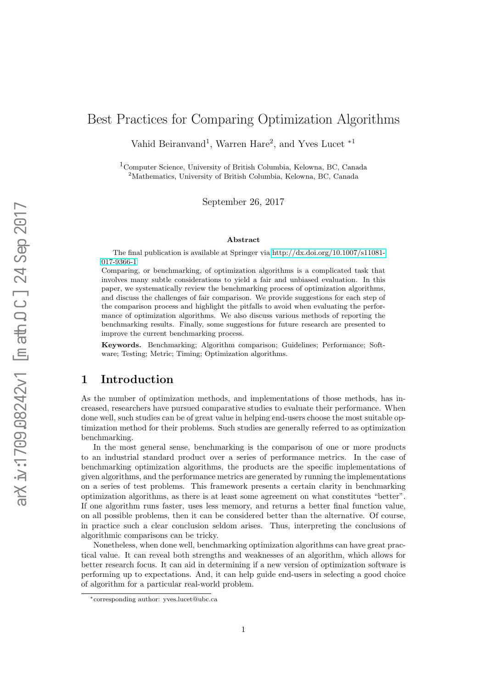
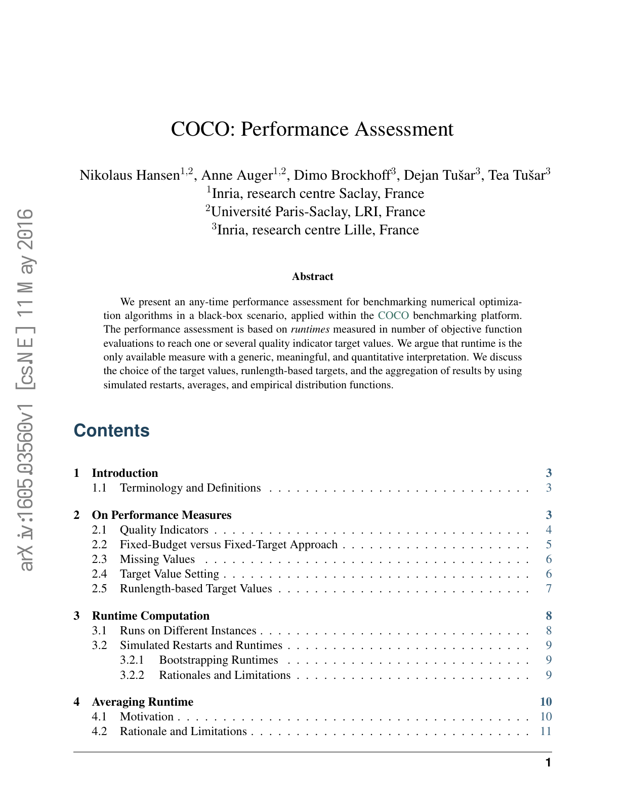
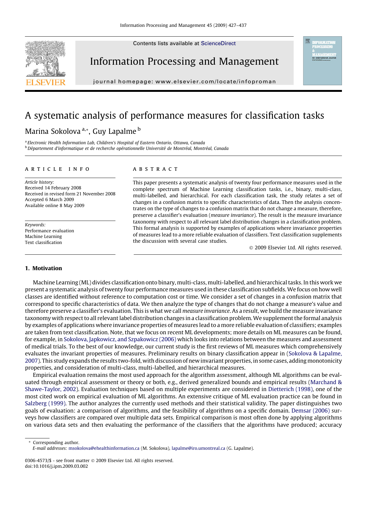
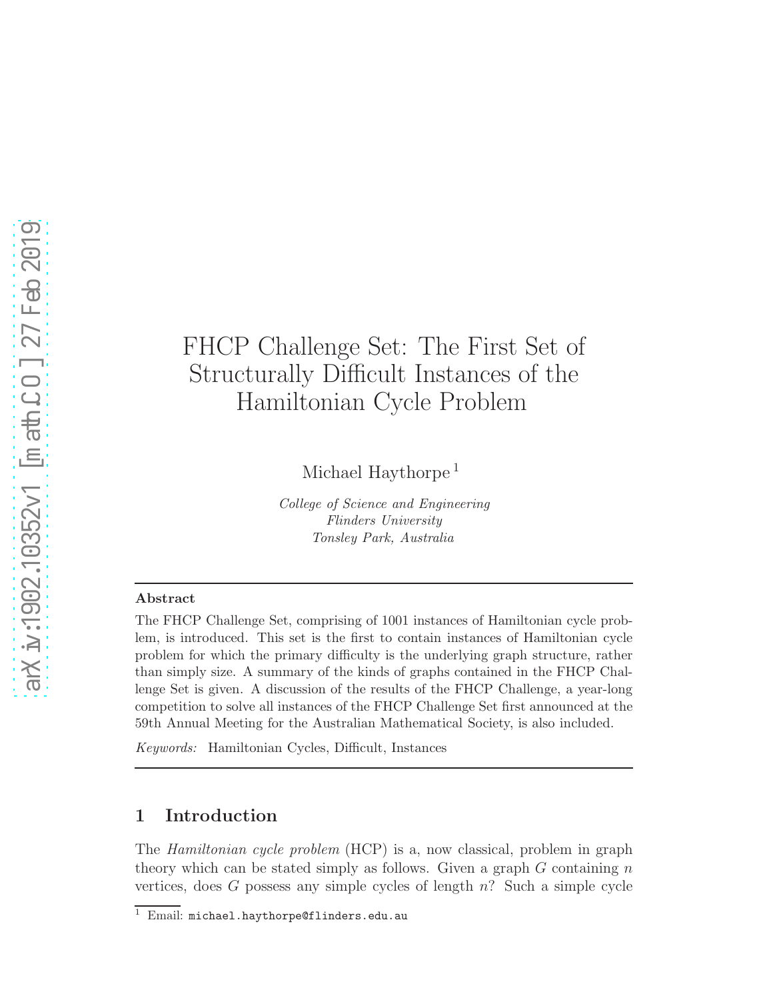
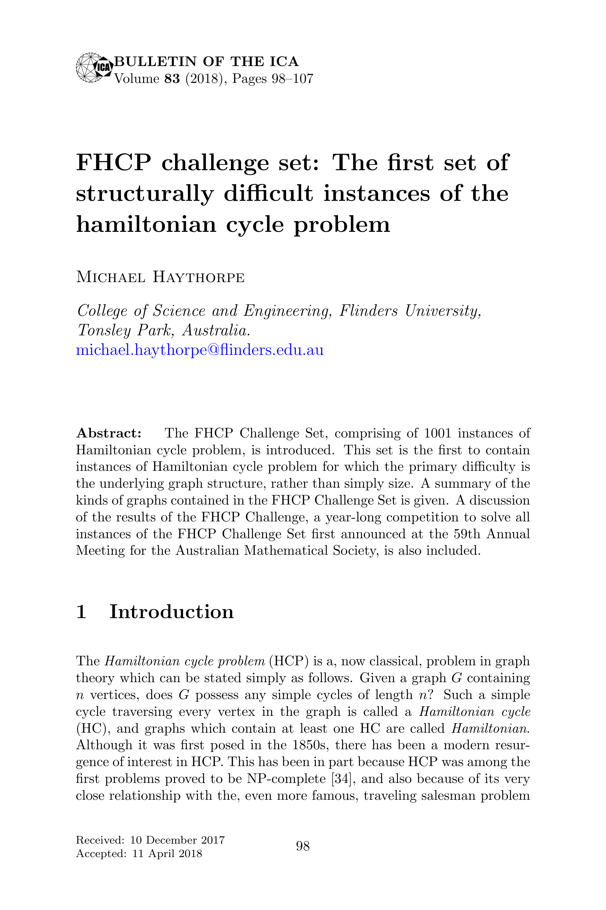

# Métricas de evaluación en IA para el proyecto FHCP

## Identificación

- **Responsable:** Elías de Jesús Zúñiga de León · @ELIASDEJESUSZUNIGADELEON.
- **Issue:** [#6 · Investigar las métricas de evaluación en IA](https://github.com/ZapataFrame/FHCP-Challenge/issues/6).
- **Hito:** M1 — Research.
- **Fecha de consulta:** 2026-11-02.
- **Dependencias de cierre:** #4 y #5, integrados mediante las [PR #9](https://github.com/ZapataFrame/FHCP-Challenge/pull/9) y [PR #14](https://github.com/ZapataFrame/FHCP-Challenge/pull/14). La consulta inicial de #5 usó `0265e655134deeb14704231cd00c5e4bce908f08`; su cotejo con la versión aceptada solo presenta actualizaciones de seguimiento, sin cambios en fórmulas, ejemplos ni evidencias.
- **Alcance:** investigación y propuestas de medición para discusión en M2/M6. No fija el protocolo experimental, implementa instrumentación ni presenta resultados medidos.

## Desarrollo

### 1. Qué se evalúa: búsqueda, fitness y certificado

La pregunta es cómo comparar GA, SA, ACO, Bee Colony, DE y PSO al buscar ciclos completos bajo recursos limitados. El [estudio FHCP del #4](fhcp-challenge.md) aporta formatos y límites de comparación. El [insumo de fitness del #5](https://github.com/ZapataFrame/FHCP-Challenge/blob/0265e655134deeb14704231cd00c5e4bce908f08/docs/research/evolution-and-fitness.md) aporta alternativas como contar pares ausentes, transformaciones de aptitud, penalizaciones y desempates; ninguna queda seleccionada por esta entrega. La [representación del #3](search-space.md) propone permutaciones y validación independiente.

| Concepto | Unidad de análisis y propósito | Lo que no acredita |
| --- | --- | --- |
| Fitness o costo de búsqueda | Candidato: guía selección, aceptación o actualización. | Probabilidad de éxito ni rendimiento de una ejecución. |
| Validación independiente | Grafo y ruta: comprueba dominio, visita única, cobertura, aristas y cierre. | Rapidez o robustez del solver. |
| Métrica de desempeño | Ejecuciones identificadas: cuantifica éxito, tiempo y trabajo. | Corrección del candidato sin validación. |

Por ejemplo, reducir de dos a un par ausente mejora el costo ilustrativo del #5; ambos candidatos siguen siendo no factibles. Incluso un costo almacenado igual a cero debe contrastarse con el validador, porque puede haber errores de dominio, cierre, instancia o actualización. Agotar un presupuesto informa sobre el procedimiento y sus recursos; **no demuestra que el grafo sea no hamiltoniano**.

### 2. Costo computacional, iteraciones y evaluaciones

Beiranvand, Hare y Lucet distinguen eficiencia, fiabilidad y calidad; incluyen evaluaciones, tiempo y memoria entre los indicadores de eficiencia y advierten que el tipo de algoritmo condiciona las unidades de trabajo [@beiranvand2017BestPractices, §4.1, pp. 8–9 de arXiv v1]. La siguiente operacionalización es una propuesta propia para FHCP.

| Métrica | Definición o unidad | Interpretación y limitación |
| --- | --- | --- |
| Complejidad temporal | Cota de operaciones, por ejemplo $O(n)$, con $n=\lvert V\rvert$, $m=\lvert E\rvert$ y supuestos explícitos. | Describe crecimiento analítico; no son segundos medidos ni una cota de toda la búsqueda por evaluar una ruta. |
| Complejidad espacial | Memoria en función de $n,m$ y tamaño de población; medición, si se instrumenta, en bytes o MiB. | Separar almacenamiento teórico de memoria residente del proceso; especificar pico, método y alcance. |
| Tiempo transcurrido | Diferencia de lecturas de un reloj monótono, en segundos. | Mide espera real e incluye efectos de planificación; depende de hardware, software y concurrencia. |
| Tiempo de CPU | Tiempo consumido por el proceso/hilos, en segundos de CPU. | Complementario; aclarar inclusión de subprocesos e hilos. No intercambiarlo con tiempo transcurrido. |
| Iteraciones | Contador entero de la unidad de actualización declarada por cada variante. | Una generación, un paso y un ciclo de colonia realizan distinto trabajo. No compararlos como unidades equivalentes. |
| Evaluaciones de calidad | Número entero de valoraciones efectivamente realizadas, incluida inicialización. | Separar recálculo completo, actualización incremental y acierto de caché; una llamada lógica no implica trabajo idéntico. |

En las propuestas del #3/#5, contar los $n$ pares cíclicos cuesta $O(n)$ con consulta de arista constante, u $O(n+m)$ con listas sin ordenar. Ordenar claves añade $O(n\log n)$. Son deducciones sobre esas estructuras, no mediciones: decodificar, construir, reparar, copiar, actualizar feromonas y validar también consume recursos.

#### 2.1 Cómo registrar las iteraciones

| Algoritmo | Unidad candidata de iteración | Contadores adicionales propuestos |
| --- | --- | --- |
| GA | Generación completada. | Individuos iniciales, descendientes evaluados y generación parcial al parar. |
| SA | Propuesta de movimiento evaluada. | Movimientos aceptados, rechazados y cambios de temperatura aparte. |
| ACO | Ronda de construcción y actualización de colonia completada. | Intentos de hormigas, rutas completas y construcciones bloqueadas. |
| Bee Colony | Ciclo completo de la variante acordada. | Si se elige ABC: fases empleadas, observadoras y exploradoras, con valoraciones realizadas. |
| DE | Generación completada. | Vectores de prueba evaluados y avance parcial. |
| PSO | Ronda de actualización y evaluación de partículas completada. | Partículas evaluadas y avance parcial. |

La definición final dependerá de la variante aceptada en M2. Si aparece un certificado en mitad de una generación, se conserva el contador de generaciones completas y el trabajo parcial; no se redondea a una generación artificial. La inicialización, reparaciones, reinicios internos y validaciones deben quedar contabilizados. Una semilla igual entre métodos no significa trayectorias o cantidades de trabajo equivalentes.

### 3. Éxito, fallos y denominadores explícitos

Para una instancia $i$, algoritmo/variante $a$ y configuración fija, sea $R_{ia}>0$ el número de intentos iniciados del lote predefinido. Se propone contar un éxito solo cuando la ruta es aceptada por el validador independiente **dentro del alcance de presupuesto previamente acordado**. Sea $s_{iar}\in\{0,1\}$ ese indicador para el intento $r$:

$$
S_{ia}=\sum_{r=1}^{R_{ia}}s_{iar},\qquad
\widehat p_{ia}=\frac{S_{ia}}{R_{ia}}.
$$

La tasa es adimensional, o $100\widehat p_{ia}$ en porcentaje. Estima éxito bajo esas condiciones, no una probabilidad universal del algoritmo. Un intento con candidato inválido, agotamiento o error vale cero en el numerador y permanece en el denominador. Si $R_{ia}=0$, el resultado es **N/A**, nunca cero por defecto.

| Terminación propuesta | ¿Éxito? | Tratamiento de la evidencia |
| --- | --- | --- |
| Certificado validado dentro del presupuesto | Sí. | Guardar ruta, validación y recursos hasta confirmación. |
| Tiempo o evaluaciones agotados sin certificado | No. | Registrar límite, recursos consumidos y motivo específico. |
| Terminación normal sin solución o candidato rechazado | No. | Conservar mejor candidato si existe y motivo de rechazo. |
| Error de ejecución o discrepancia fitness/validador | No. | Conservar diagnóstico; informar su frecuencia separada. |

Un resultado positivo del validador es necesario, pero no basta para contar éxito dentro de un límite si se obtuvo fuera de él. M6 debe definir el alcance y la tolerancia de sobrepaso. Un fallo de infraestructura tampoco se elimina selectivamente: se registra y cualquier repetición recibe otro ID, vinculada al original. Las tareas planificadas que nunca arrancaron se informan como faltantes, fuera de $R_{ia}$; si el lote está incompleto, no se presenta su tasa como si cubriera el diseño completo.

#### 3.1 Tasa por intento y cobertura de instancias

Para $K$ instancias predefinidas, la cobertura es:

$$
\mathrm{coverage}_a=\frac{1}{K}\sum_{i=1}^{K}\mathbf 1[S_{ia}>0].
$$

Cuenta instancias con al menos un éxito; no sustituye a la tasa de intentos. Resolver una instancia una vez y fallar otras nueve veces da cobertura 100 % de esa instancia y tasa 10 %. La media por instancia $K^{-1}\sum_i\widehat p_{ia}$ da igual peso a cada grafo; la tasa agrupada $\sum_i S_{ia}/\sum_i R_{ia}$ da mayor peso a los que tienen más intentos. Coinciden con igual cantidad de repeticiones. Para lotes incompletos, reportar la falta de observaciones antes de agregar.

Se propone mostrar tasas por instancia, tamaños muestrales y variación entre repeticiones. El número de semillas y el método para cuantificar incertidumbre quedan para M6; repetir una semilla idéntica en idénticas condiciones deterministas no añade observaciones independientes. No se inferirá superioridad poblacional a partir de una tasa puntual en un subconjunto elegido.

### 4. Tiempo: duración observada y tiempo hasta éxito

COCO estudia recursos hasta alcanzar una meta, distingue presupuesto fijo de objetivo fijo y deja sin tiempo de llegada observado las ejecuciones que no alcanzan el objetivo [@hansen2016PerformanceAssessment, §§2.1–2.3, pp. 4–6]. Su unidad principal son evaluaciones en optimización numérica continua. Aquí se toma esa distinción conceptual; no se adopta su plataforma ni se supone equivalencia experimental con FHCP.

Se propone usar reloj monótono para intervalos y una fecha UTC aparte para identificar el intento. Guardar al menos carga, búsqueda/inicialización, validación y total; indicar si son fases excluyentes o mediciones solapadas. La validación durante la búsqueda queda incluida en su tiempo y puede desglosarse sin sumarla dos veces. **M6 deberá acordar qué intervalo consume el presupuesto** y si carga, preprocesamiento, validación y escritura quedan incluidos.

Sean $d_r$ la duración total observada de un intento y $t_r^*$ el tiempo desde un origen declarado hasta confirmar el primer ciclo válido:

- $d_r$ existe también para fallos, timeouts y errores, si la telemetría se pudo recuperar. Si falta, registrar el dato ausente y su causa, sin inventar una duración.
- $t_r^*$ solo se observa cuando se confirma éxito. Guardarlo como ausente en otro caso, junto al estado y los recursos consumidos; no asignarle cero.
- En un timeout a $B$ sin certificado, la observación del tiempo hasta éxito está censurada por la derecha en el punto observado: no sabemos cuánto más habría requerido continuar. No es un éxito ocurrido exactamente en $B$.
- Un error que interrumpe la ejecución no es intercambiable con censura administrativa por límite. Debe separarse y no entrar automáticamente en un estimador de supervivencia que suponga censura no informativa.

Por separado pueden calcularse la duración media de todos los intentos con tiempo conocido, $\overline d=(\sum d_r)/N_d$, y la media condicionada al éxito, $\overline t_{\mathrm{success}}=(\sum_{r:s_r=1}t_r^*)/S$. Se declaran $N_d$, $S$ y el intervalo medido. La primera mide recursos consumidos; la segunda rapidez entre los éxitos observados. **Ninguna es el tiempo esperado incondicional para resolver**. Si $S=0$, el tiempo medio de éxito es N/A.

Mediana y dispersión deben acompañarse de su población. La mediana de duraciones incluye errores que terminan rápido; no significa mediana del tiempo hasta solución. Si más de la mitad de los intentos no alcanza éxito antes del límite, la mediana del tiempo hasta éxito no se obtiene tomando solo los éxitos. No se rellenan tiempos censurados con el límite para presentarlos como tiempos reales de solución.

#### 4.1 Ejemplo conceptual verificable

Los siguientes seis intentos son **datos didácticos inventados**, para una sola instancia y configuración. Se supone únicamente en este ejemplo un límite total de 10 s y parada inmediata tras confirmar el certificado. En los dos éxitos, duración y tiempo hasta confirmación coinciden.

| Intento | Estado | Duración observada (s) | Tiempo hasta éxito (s) | $s_r$ |
| --- | --- | ---: | --- | ---: |
| 1 | Éxito validado | 2 | 2 | 1 |
| 2 | Éxito validado | 6 | 6 | 1 |
| 3 | Timeout | 10 | No observado; censurado a 10. | 0 |
| 4 | Timeout | 10 | No observado; censurado a 10. | 0 |
| 5 | Termina con candidato inválido | 3 | No observado. | 0 |
| 6 | Error | 1 | No observado. | 0 |

La tasa es $2/6\approx33.33\%$, no $2/2=100\%$. Los tiempos de éxito tienen media 4 s; las seis duraciones suman 32 s y tienen media $32/6\approx5.33$ s y mediana 4.5 s. El error dura solo 1 s y reduce la media de duración sin aportar una solución: reportar tiempos sin estados permitiría una interpretación engañosa. No hay un tiempo hasta solución conocido para los otros cuatro intentos.

### 5. Precisión, recall y F1-score: definición y aplicabilidad

Sokolova y Lapalme presentan la matriz de confusión binaria y las fórmulas de precisión, recall y F-score [@sokolovaLapalme2009Classification, §3, tablas 1–2, pp. 429–430]. Se fijan primero una población de casos, una etiqueta verdadera $y\in\{0,1\}$ y una predicción $\widehat y\in\{0,1\}$; se declara qué significa positivo.

| Verdad del caso | Predicción positiva | Predicción negativa |
| --- | --- | --- |
| Positivo, $y=1$ | TP: positivo correctamente identificado. | FN: positivo omitido. |
| Negativo, $y=0$ | FP: negativo marcado como positivo. | TN: negativo correctamente identificado. |

$$
\mathrm{precision}=\frac{TP}{TP+FP},\qquad
\mathrm{recall}=\frac{TP}{TP+FN},\qquad
F_1=\frac{2TP}{2TP+FP+FN}.
$$

Son adimensionales, con valores en $[0,1]$ cuando el denominador es positivo. Precisión responde cuántas predicciones positivas son correctas; recall, qué proporción de positivos reales se detectó. F1 combina ambas mediante media armónica cuando esa expresión está definida. No considera TN ni mide costo o rapidez.

Se propone informar N/A cuando el denominador de la fórmula correspondiente es cero y conservar los conteos. Por ejemplo, con $TP=FP=0$ y $FN=3$, precisión es N/A, recall es 0 y la fórmula por conteos da $F_1=0$. Si $TP=FP=FN=0$, F1 es N/A. No sustituir esas situaciones por una convención de biblioteca sin declararla.

#### 5.1 Aplicación al solver FHCP

Haythorpe especifica que las 1001 instancias son hamiltonianas [@haythorpe2018Fhcp, §1, p. 3 de arXiv v1]. De ello se deduce que no existe una clase de grafos no hamiltonianos dentro de ese conjunto. Además, el solver produce un certificado o termina sin encontrarlo; **«sin certificado» es un resultado inconcluso, no una predicción justificada de inexistencia**.

Por eso se propone **no utilizar precisión, recall y F1 como métricas principales de la búsqueda**. La tasa de éxito validado conserva el significado operativo requerido. Tampoco se compara la ruta con un único tour oficial para contar aciertos de posiciones o aristas: podría existir otro ciclo igualmente válido, con otra orientación u origen.

Como comprobación algebraica, si se fuerza una tarea binaria auxiliar «encontró certificado / no encontró», tomando cada intento FHCP como caso verdaderamente positivo, entonces $TP=S$, $FN=R-S$ y $FP=TN=0$. Para $S>0$, precisión vale 1, recall coincide numéricamente con $S/R$ y $F_1=2S/(R+S)$: no aportan detección de negativos ni evidencia adicional de calidad. En el ejemplo anterior darían precisión 1, recall $1/3$ y F1 $1/2$. Esta recodificación no convierte los intentos fallidos en pruebas de no hamiltonicidad.

Un candidato inválido declarado «solución» tampoco define un FP de **clasificación de grafos**, pues el grafo puede seguir siendo positivo. Es una discrepancia de certificación. Para evaluarla hay que cambiar explícitamente la unidad de análisis.

#### 5.2 Aplicación posible al control de calidad del validador

En una auditoría separada, el caso podría ser un par **(grafo, ruta)** con verdad conocida por construcción o por un oráculo independiente. Positivo significa «la ruta es un ciclo hamiltoniano válido de ese grafo»; predicción positiva significa «el validador la acepta». Entonces:

- TP: acepta una ruta válida; FP: acepta una inválida.
- FN: rechaza una ruta válida; TN: rechaza una inválida.

Por ejemplo, con $TP=2$, $FP=1$, $FN=3$ y $TN=4$, precisión es $2/3$, recall es $2/5$ y F1 es $4/8=1/2$. Son conteos conceptuales, no resultados de pruebas del proyecto. Un FP evidencia un error de corrección que requiere diagnóstico aunque la métrica agregada parezca alta.

Esta auditoría necesitaría rutas positivas y negativas con cobertura de dominio, repetición, omisiones, aristas y cierre. No se crea ese dataset en #6 ni se supone que usar el propio validador como etiqueta verdadera permita auditarlo. Las proporciones dependen de los casos elegidos; no se presentan como tasa de éxito del solver. Un estudio de clasificación de **grafos** requeriría, por su parte, negativos demostrados por otro procedimiento; no se propone incorporarlo al experimento FHCP principal.

### 6. Evidencia mínima para reproducir e interpretar las métricas

La siguiente es una lista de campos propuestos, no un esquema implementado. Deben conservarse intentos y registros originales sin sobrescribirlos, de acuerdo con el #4 y las reglas del repositorio.

| Grupo | Campos mínimos propuestos | Propósito |
| --- | --- | --- |
| Identidad | ID único de intento, lote, fecha UTC y vínculo a una repetición si existe. | Distinguir observaciones y evitar sustituciones selectivas. |
| Instancia | ID/archivo, SHA-256, procedencia, $n,m$, transformación y mapeo usado. | Asegurar que se comparó el mismo grafo. |
| Algoritmo y configuración | Nombre/variante, parámetros efectivos, inicialización, fitness y decodificador con versión. | Identificar el procedimiento realmente ejecutado. |
| Aleatoriedad | Semilla, generador y versión; semillas derivadas si hay trabajadores. | Reproducir dentro de un entorno identificable. |
| Presupuesto | Límite temporal y su alcance, límite de evaluaciones si aplica, criterio de parada y recursos consumidos. | Interpretar éxito dentro del límite, timeout y sobrepaso. |
| Entorno | CPU, RAM, sistema, runtime/compilador, dependencias, hilos/procesos y concurrencia relevante. | Contextualizar tiempos y recursos. |
| Código | Commit o snapshot, cambios locales relevantes y versión de instrumentación/validador. | Identificar código distinto bajo el mismo nombre. |
| Trabajo y tiempos | Iteraciones completas/parciales con definición, evaluaciones completas/incrementales, caché, reinicios y tiempos de fases/total. | Evitar equiparar unidades de trabajo y tiempos distintos. |
| Resultado | Estado/motivo, error, candidato y su mapeo, resultado/motivo de validación, éxito dentro del límite y recursos al primer certificado. | Reconstruir numerador, denominador y tiempos observados. |

Ausencias reales se registrarán explícitamente, sin convertirlas en cero. Los certificados de referencia pueden emplearse para comprobar corrección; si se usan como inicialización o información del solver, debe declararse para no comparar experimentos con distinta información.

### 7. Qué queda para el protocolo de M6

Beiranvand y colaboradores recomiendan repetir los métodos no deterministas y conservar las ejecuciones individuales antes de resumir [@beiranvand2017BestPractices, §4.2, pp. 9–10]. La tabla delimita las decisiones pendientes; este issue no las aprueba.

| Decisión pendiente | Información que debe concretarse |
| --- | --- |
| Conjunto de evaluación | Instancias/familias, versión/hash y separación del ajuste de parámetros; declarar reutilización. |
| Repeticiones | Número de intentos, semillas y tratamiento de faltantes/repeticiones antes de ejecutar. |
| Condición de éxito y parada | Certificado independiente, origen del reloj, presupuesto, inclusión de validación y tolerancia a sobrepasos. |
| Instrumentación | Stack, reloj, contadores por variante, caché/incrementales, fases y registro ante errores o terminaciones forzadas. |
| Condiciones de ejecución | Hardware, hilos, aislamiento de carga y orden de ejecución. |
| Resúmenes e incertidumbre | Agregación por instancia, estados, dispersión e intervalos adecuados al diseño; no asumir independencia entre grafos de una familia. |
| Comparación publicada | Misma instancia, método, presupuesto, alcance temporal y entorno conocidos; si faltan, limitarla a contexto bibliográfico. |

El #4 documenta resultados históricos con hardware o presupuestos incompletos: sus segundos no permiten afirmar una aceleración frente a otra máquina. El mejor costo no factible puede conservarse como diagnóstico, separado de la tasa de certificados. Si en M6 se investigan curvas de llegada o estimadores con reinicios y censura, habrá que justificar sus supuestos; no se fijan aquí ni se confunden con la media de éxitos.

### 8. Método de investigación y límites

Se hizo una revisión documental acotada de métricas de clasificación y evaluación de optimizadores. Se buscaron «benchmarking stochastic optimization algorithms expected running time failures», «Best practices for comparing optimization algorithms» y «Sokolova Lapalme 2009 performance measures classification» en la web académica, arXiv y sitios institucionales. Se incluyeron textos con autoría identificable y contenido accesible sobre fórmulas, recursos o aplicabilidad; no se impuso ventana temporal ni se pretende exhaustividad sistemática.

Se leyeron las secciones citadas del artículo de clasificación alojado en el laboratorio de sus autores, del preprint metodológico COCO y de las fuentes ya registradas del #4. El DOI, autores, revista y páginas de Sokolova y Lapalme se cotejaron con Crossref. Las versiones arXiv y editorial del mismo trabajo se tratan como una fuente, no como replicaciones independientes. La revisión de clasificación aporta definiciones, COCO aporta distinciones metodológicas y FHCP delimita el dataset; ninguno demuestra el rendimiento de nuestros algoritmos.

El insumo del #5 se leyó en la rama publicada `docs/5-evolution-fitness`, commit fijo indicado arriba. Se cotejó con la versión aceptada mediante la PR #14: solo cambian el seguimiento de dependencias y los enlaces de entrega; el contenido de fitness utilizado aquí se conserva. El enlace fijo mantiene la trazabilidad de la consulta original. Se empleó IA como apoyo de búsqueda y organización; ejemplos y aplicaciones al proyecto son elaboraciones analíticas, sin experimentos del repositorio.

## Conclusiones

La evaluación principal propuesta combina tasa de éxito con certificados independientes, tiempo con alcance declarado y contadores de trabajo por variante. Los fallos, timeouts y errores permanecen visibles; un intento inconcluso no demuestra inexistencia de ciclo y una duración corta no implica éxito.

Precisión, recall y F1 se definen y fundamentan, pero su uso requiere una tarea de clasificación explícita. No aportan una evaluación principal adecuada a la búsqueda de certificados sobre FHCP; sí podrían servir en una auditoría separada del validador con etiquetas independientes. M2/M6 deberán acordar variantes, instrumentación, presupuestos y análisis antes del experimento. Esta entrega no completa la implementación ni el benchmarking.

## Referencias

[Bibliografía compartida](references.bib): dos entradas nuevas bajo el issue #6 y reutilización de dos entradas del #4.

- [@beiranvand2017BestPractices] Vahid Beiranvand, Warren Hare y Yves Lucet, “Best practices for comparing optimization algorithms”, *Optimization and Engineering*, 18, 815–848, 2017. [DOI](https://doi.org/10.1007/s11081-017-9366-1); [arXiv v1 consultada](https://arxiv.org/abs/1709.08242v1), §§4.1–4.2, pp. 8–10 de esa copia.
- [@hansen2016PerformanceAssessment] Nikolaus Hansen, Anne Auger, Dimo Brockhoff, Dejan Tušar y Tea Tušar, *COCO: Performance Assessment*, preprint arXiv:1605.03560v1, 2016. [Versión consultada](https://arxiv.org/abs/1605.03560v1), §§2.1–2.3, pp. 4–6. Se identifica como preprint, sin atribuirle una revista.
- [@sokolovaLapalme2009Classification] Marina Sokolova y Guy Lapalme, “A systematic analysis of performance measures for classification tasks”, *Information Processing & Management*, 45(4), 427–437, 2009. [DOI](https://doi.org/10.1016/j.ipm.2009.03.002); [copia institucional](https://rali.iro.umontreal.ca/rali/sites/default/files/publis/SokolovaLapalme-JIPM09.pdf), §3, tablas 1–2.
- [@haythorpe2018Fhcp] Michael Haythorpe, “FHCP Challenge Set: The First Set of Structurally Difficult Instances of the Hamiltonian Cycle Problem”, *Bulletin of the ICA*, 83, 98–107, 2018. [arXiv v1 depositada en 2019](https://arxiv.org/abs/1902.10352v1), §1, p. 3 de esa copia.

## Anexo de referencias

### beiranvand2017BestPractices

- **Fecha de captura:** 2026-10-30; imagen del issue #4 reutilizada sin cambios. Contenido consultado el 2026-11-02.
- **Descripción:** primera página de la versión arXiv v1, con título, autores y DOI editorial. Se conserva la entrada bibliográfica existente.
- **Fuente:** [PDF arXiv v1](https://arxiv.org/pdf/1709.08242v1).

### hansen2016PerformanceAssessment

- **Fecha de captura:** 2026-11-02.
- **Descripción:** primera página con título, autores, afiliaciones, identificador y fecha de arXiv v1.
- **Fuente:** [PDF arXiv v1](https://arxiv.org/pdf/1605.03560v1).

### sokolovaLapalme2009Classification

- **Fecha de captura:** 2026-11-02.
- **Descripción:** primera página editorial con título, autoras/autores, revista, volumen, páginas y DOI, desde la copia del laboratorio RALI de Université de Montréal.
- **Fuente:** [PDF institucional](https://rali.iro.umontreal.ca/rali/sites/default/files/publis/SokolovaLapalme-JIPM09.pdf).

### haythorpe2018Fhcp

- **Fecha de captura:** 2026-10-30; imágenes del issue #4 reutilizadas sin cambios. Contenido consultado el 2026-11-02.
- **Descripción:** primera página arXiv y registro institucional para distinguir publicación de 2018 y depósito de 2019.
- **Fuente:** [arXiv v1](https://arxiv.org/abs/1902.10352v1); procedencia completa en el [anexo FHCP](fhcp-challenge.md#haythorpe2018fhcp).

