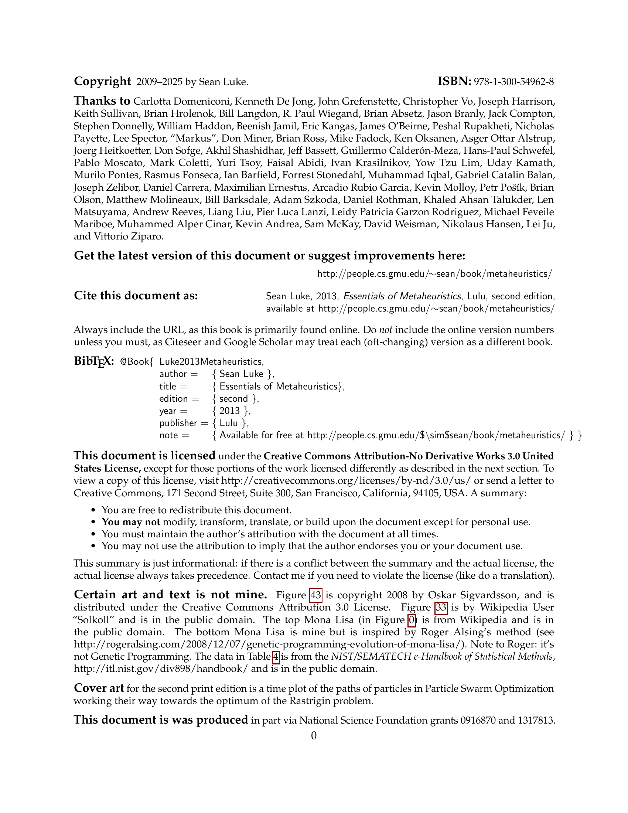
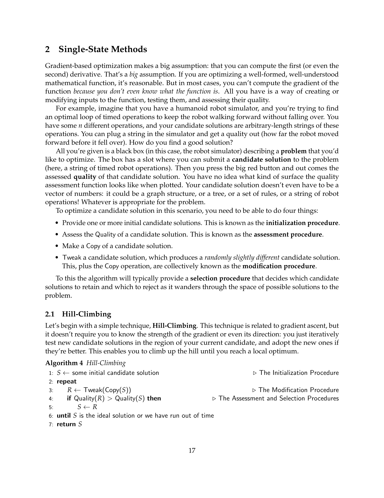
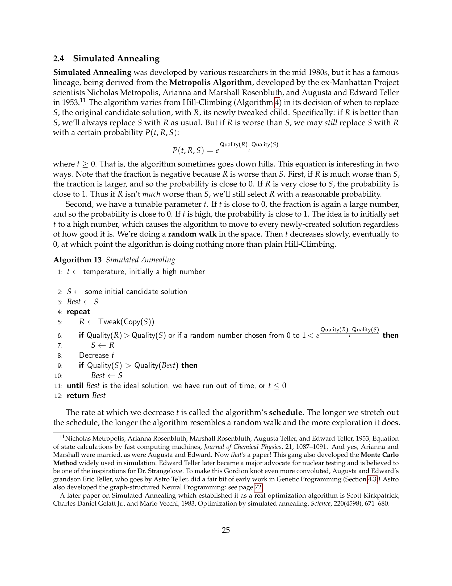
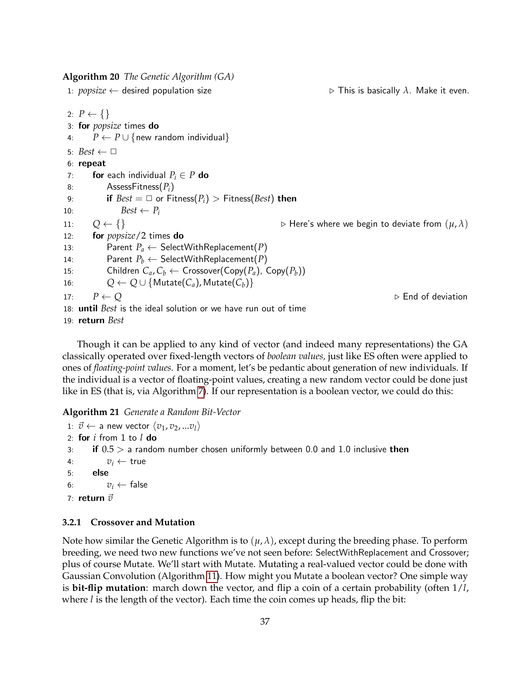
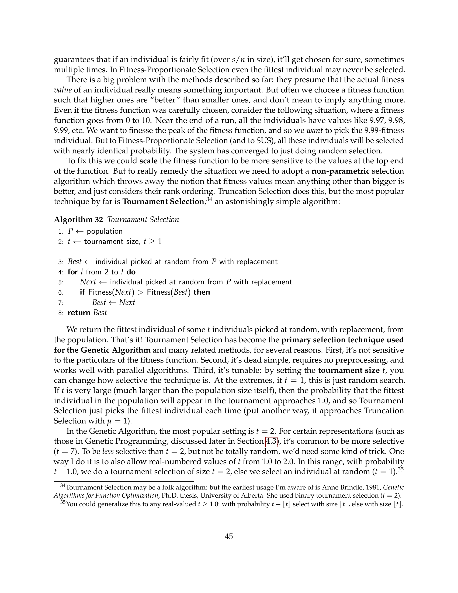
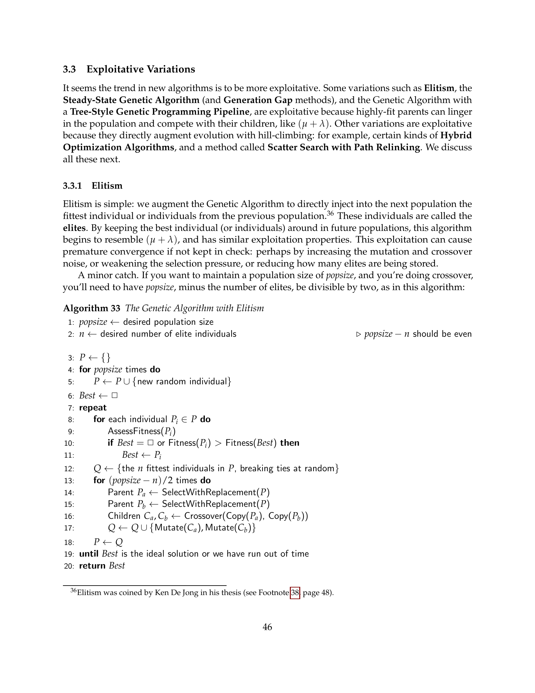
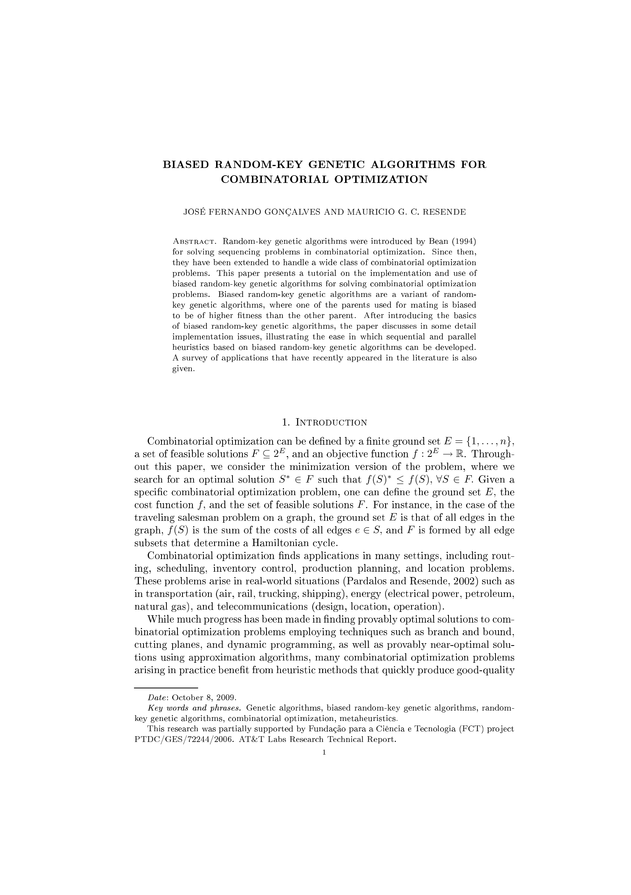
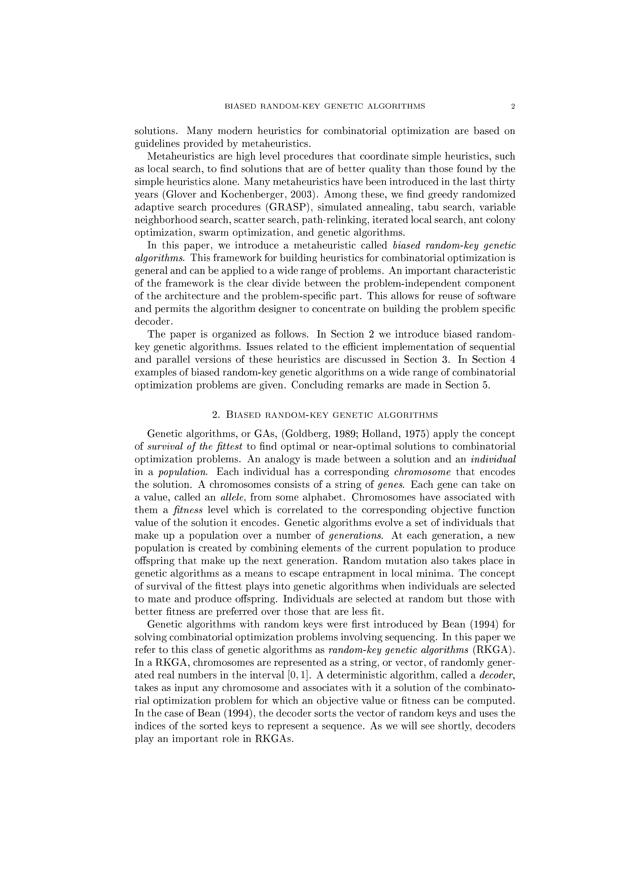
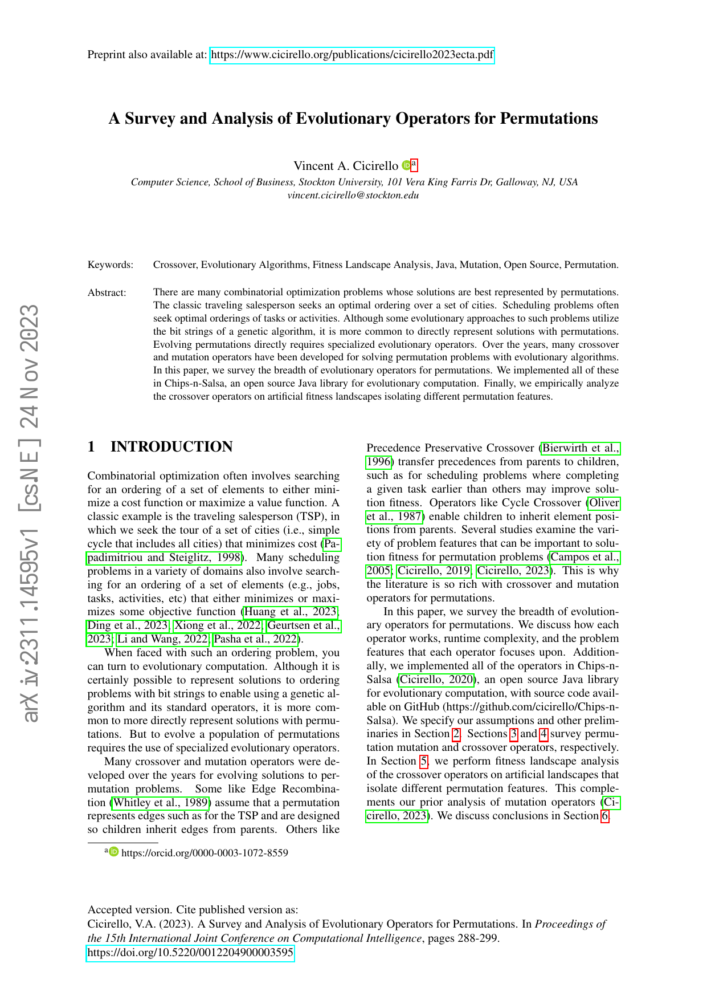
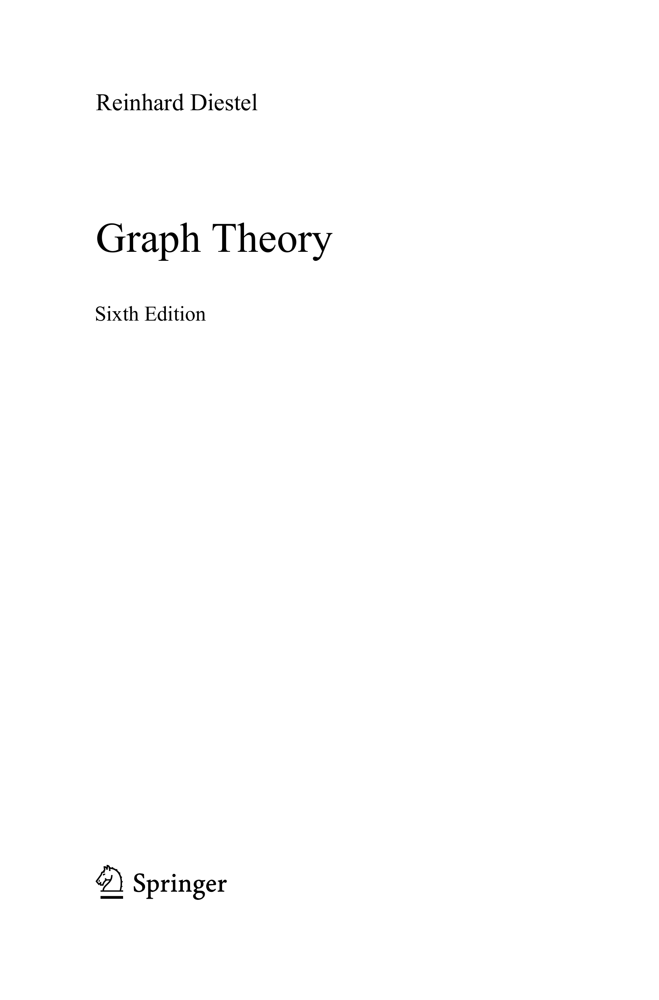

# Módulo evolutivo, heurísticas y fitness para ciclos hamiltonianos

## Identificación

- **Responsable:** Eder Omar Zúñiga Zavala · @KirbyStone69.
- **Issue:** [#5 · Investigar el módulo evolutivo, las heurísticas y el fitness](https://github.com/ZapataFrame/FHCP-Challenge/issues/5).
- **Hito:** M1 — Research.
- **Fecha de consulta:** 2026-11-01, zona America/Mexico_City.
- **Dependencias de cierre:** #3 y #2, integrados mediante las [PR #11](https://github.com/ZapataFrame/FHCP-Challenge/pull/11) y [PR #12](https://github.com/ZapataFrame/FHCP-Challenge/pull/12).
- **Alcance:** investigación documental y propuestas para M2. No se implementan algoritmos, no se ejecutan experimentos y no se selecciona un fitness definitivo.

## Desarrollo

### 1. Pregunta de investigación y relación con las otras entregas

¿Cómo transformar un candidato representable en una valoración que ayude a encontrar un ciclo hamiltoniano, sin confundir una mejora de esa valoración con una solución certificada?

La [teoría de grafos](graph-theory.md) establece qué constituye una solución y la [representación del espacio de búsqueda](search-space.md) propone cómo almacenarla. La investigación de [metaheurísticas del issue #2](https://github.com/ZapataFrame/FHCP-Challenge/blob/0642c4fcfbe6656cf53b6901a29af35e9db37252/docs/research/metaheuristics.md) describe cómo producir y modificar candidatos. Esta entrega conecta esas piezas mediante decodificación, evaluación y uso de la calidad durante la búsqueda.

Se consultó el #2 en la rama `origin/docs/2-metaheuristics`, commit `0642c4f`, antes de su integración en la base de esta entrega. Sus variantes —GA con OX, SA con intercambio, Ant System penalizado, ABC discreto, DE/rand/1/bin y PSO global con claves— son propuestas revisables. El enlace conserva el commit consultado como referencia histórica; el documento y su manifiesto coinciden con la versión aceptada mediante la PR #12.

La revisión utiliza fuentes académicas y primarias: un libro del autor, un informe técnico de sus autores, un artículo sobre operadores y un tratado de grafos. Se consultaron sus PDF originales y las versiones identificadas en Referencias. Es una revisión acotada, no sistemática. Las funciones de evaluación, pruebas de equivalencia, ejemplos y consecuencias específicas para FHCP que siguen son **elaboraciones propias**, salvo atribución expresa. No se presenta evidencia experimental de superioridad de una alternativa.

### 2. Estado interno, candidato y solución

Se conserva la propuesta del #3: grafo finito, simple, no dirigido y sin pesos $G=(V,E)$; $n=|V|\ge3$; índices internos $I=\{0,\ldots,n-1\}$ y biyección $\lambda:I\to V$ hacia las etiquetas originales. Para distinguir etiquetas e índices, se define:

$$
E_I=\{\{u,v\}:u,v\in I,\ \{\lambda(u),\lambda(v)\}\in E\}.
$$

El candidato común pertenece a:

$$
\mathcal P_n=\{p=(p_0,\ldots,p_{n-1}):p_i\in I,\ p_i\ne p_j\text{ si }i\ne j\}.
$$

Son permutaciones de exactamente $n$ posiciones con **cierre implícito**: el último par es $(p_{n-1},p_0)$. La teoría exige cubrir todos los vértices una vez y comprobar las $n$ aristas del recorrido; una permutación garantiza cobertura y unicidad, pero no adyacencia [@diestel2025GraphTheory6, cap. 10, p. 323].

| Concepto | Papel en esta investigación | Límite |
| --- | --- | --- |
| Codificación | Expresa decisiones mediante una permutación o un estado interno, como claves reales. | No certifica las aristas. |
| Decodificación | Convierte ese estado en una ruta interpretable. | Puede producir una permutación no factible. |
| Costo | Cuantifica qué se intenta minimizar. | Requiere dominio y escala explícitos. |
| Fitness o aptitud | Valor usado para favorecer candidatos; aquí se distingue aptitud a maximizar de costo a minimizar. | No es una probabilidad de éxito. |
| Heurística local | Orienta una elección o movimiento con información parcial. | No demuestra que la ruta pueda completarse. |
| Validación | Comprueba las condiciones del ciclo en el grafo original. | No mide la eficiencia de la búsqueda. |
| Métrica de desempeño | Resume ejecuciones: tiempo, evaluaciones o tasa de éxito. | Corresponde al #6 y al protocolo posterior. |

La terminología varía entre publicaciones: también puede llamarse «fitness» al propio costo de minimización. Lo indispensable es declarar el sentido de las comparaciones. Aquí $C$ designa costo y $F$ aptitud a maximizar.

### 3. De la codificación a la mejora de candidatos

Luke separa inicialización, evaluación, copia, modificación y selección [@luke2013Metaheuristics2, p. 17]. Aplicado al proyecto, el flujo conceptual es:

```text
Estado representable
    → decodificación a una ruta
    → comprobación de legalidad de la permutación
    → evaluación de costo / aptitud
    → selección, aceptación o actualización de memoria
    → operadores y nuevo estado

Candidato que satisface la condición objetivo
    → validador independiente → éxito confirmado o discrepancia
```

La inicialización también produce candidatos que deben evaluarse. Una ruta completa que cumple la condición objetivo puede validarse inmediatamente, sin esperar al final de una generación. Tamaños incorrectos, repetidos, índices ajenos o claves no finitas son errores de entrada o de producción del candidato; no deben ocultarse mediante un costo ordinario.

En representación directa, decodificar puede ser la identidad $D(p)=p$. Convertir índices a etiquetas mediante $\lambda$ es otra operación. En claves reales se distingue el vector $x$ de su ruta $D(x)$. Gonçalves y Resende separan cromosoma, decodificador y valoración, y describen la obtención de una secuencia por ordenación [@goncalvesResende2009RandomKeys, §2, p. 2].

Para las propuestas DE y PSO del #2, la adaptación conceptual del equipo es:

$$
D(x)=\operatorname{argsort}_{v\in I}(x_v,v),\qquad x\in\mathbb R^n,\quad x_v\text{ finito}.
$$

Ordenar por clave y desempatar por índice devuelve cada vértice exactamente una vez. El desempate y la extensión a claves finitas son propuestas del equipo; el informe estudia RKGA/BRKGA y no demuestra el comportamiento de DE o PSO en FHCP. Si la evaluación depende solo de la ruta, el costo sobre el estado es $C(D(x))$.

Seleccionar no siempre significa conservar exclusivamente al mejor. GA elige padres y reemplazos; SA puede aceptar empeoramientos; ACO usa información acumulada; ABC distribuye búsquedas; DE compara propuestas; PSO actualiza memorias. La evaluación orienta esas decisiones y los operadores determinan qué candidatos pueden producirse.

### 4. Alternativas de evaluación para M2

Para $p\in\mathcal P_n$, se define el indicador de conexión faltante:

$$
b_i(p)=\mathbf 1[\{p_i,p_{(i+1)\bmod n}\}\notin E_I],
\qquad i=0,\ldots,n-1.
$$

Todas las alternativas siguientes evalúan **rutas completas y legales**. Un prefijo constructivo no pertenece al dominio y no debe obtener mejor puntuación por haber comprobado menos pares. Las expresiones son propuestas analíticas, no funciones implementadas.

#### 4.1 Conteo de pares ausentes y transformaciones de escala

El costo ilustrativo del #2 es:

$$
C_{\mathrm{miss}}(p)=\sum_{i=0}^{n-1}b_i(p),
\qquad C_{\mathrm{miss}}:\mathcal P_n\to\{0,\ldots,n\}.
$$

Se **minimiza**. Cada par ausente aporta una unidad, incluido el cierre; la meta es cero. Sobre $\mathcal P_n$, $C_{\mathrm{miss}}=0$ equivale matemáticamente a un ciclo hamiltoniano: el dominio garantiza cobertura y unicidad, y los $n$ indicadores nulos garantizan adyacencia y cierre.

La equivalencia no determina qué búsqueda encontrará el cero ni elimina la necesidad de validación independiente en software. Un mejor costo positivo sigue describiendo una ruta con conexiones pendientes.

| Expresión, para $p\in\mathcal P_n$ | Sentido y condición objetivo | Interpretación y límite |
| --- | --- | --- |
| $C_{\mathrm{norm}}(p)=C_{\mathrm{miss}}(p)/n\in[0,1]$ | Minimizar; meta $0$. | Fracción de pares ausentes. No vuelve comparables instancias de distinta dificultad. |
| $F_{\mathrm{edges}}(p)=n-C_{\mathrm{miss}}(p)\in\{0,\ldots,n\}$ | Maximizar; meta $n$. | Pares cíclicos presentes. Puede valer cero y exigir una política especial en selección proporcional. |
| $F_{\mathrm{inv}}(p)=1/(1+C_{\mathrm{miss}}(p))\in[1/(n+1),1]$ | Maximizar; meta $1$. | Aptitud positiva utilizable como peso; evita la singularidad de $1/C_{\mathrm{miss}}$. |

Las tres transformaciones penalizan los mismos pares faltantes. En una instancia fija conservan el orden de calidad, con el sentido apropiado. **No son señales independientes** ni tienen necesariamente el mismo efecto en algoritmos sensibles a magnitudes. La condición objetivo se comprobaría mediante el conteo entero o el validador, sin depender de tolerancias arbitrarias sobre números reales.

#### 4.2 Evaluación binaria

$$
F_{\mathrm{binary}}(p)=\mathbf 1[C_{\mathrm{miss}}(p)=0],
\qquad F_{\mathrm{binary}}:\mathcal P_n\to\{0,1\}.
$$

Se maximiza; la meta es 1. Cualquier par ausente, incluido el cierre, deja el valor en cero. La interpretación es directa, pero todas las rutas no factibles empatan: una con un faltante y otra con cinco reciben el mismo valor. Puede servir como contraste conceptual, pero ofrece poca orientación antes del primer éxito. Se define mediante el conteo para analizar la señal; no sustituye al validador.

#### 4.3 Penalización ponderada

Para cada par no ordenado de índices distintos se fija un peso finito $w_{\{u,v\}}>0$:

$$
C_w(p)=\sum_{i=0}^{n-1}w_{\{p_i,p_{(i+1)\bmod n}\}}\,b_i(p).
$$

Se minimiza sobre $\mathcal P_n$. Si $w_{\max}$ es el mayor peso, $0\le C_w(p)\le n w_{\max}$; la meta es cero. La positividad estricta hace que $C_w=0$ equivalga a no tener conexiones faltantes. Pesos nulos podrían ignorar violaciones; pesos negativos podrían premiarlas.

Los pesos serían **artificiales para guiar la búsqueda**, no distancias suministradas por los grafos FHCP. Si son iguales, se recupera el conteo salvo escala. Si difieren, pueden priorizar violaciones, pero también preferir dos faltantes de poco peso a uno de mucho peso: $1+1<3$. Reducir $C_w$ no implica reducir $C_{\mathrm{miss}}$.

Elegirlos requiere una hipótesis sustentada y evaluación posterior; aquí no se fijan valores. Usar pares no ordenados con pesos independientes de la posición conserva invariancia ante rotación e inversión. Dar peso especial al «último par» podría cambiar la calidad al rotar el mismo recorrido: el cierre debe tratarse como cualquier otra arista.

#### 4.4 Desempate por continuidad

Sea $L(p)$ la longitud en **aristas** de la mayor racha cíclica de indicadores nulos. Si no hay faltantes, $L=n$; si todos los pares faltan, $L=0$. La racha puede cruzar del final al principio del arreglo.

Una alternativa propia es minimizar lexicográficamente:

$$
K(p)=\big(C_{\mathrm{miss}}(p),-L(p)\big).
$$

Primero se prefiere menos faltantes; solo ante igualdad se prefiere mayor continuidad. Una versión escalar, con $0<\alpha<1$, es:

$$
C_{\mathrm{run}}(p)=C_{\mathrm{miss}}(p)+\alpha\left(1-\frac{L(p)}n\right).
$$

Su dominio es $\mathcal P_n$; se minimiza; $0\le C_{\mathrm{run}}\le n+\alpha$ y la meta es cero. El término secundario está entre cero y $\alpha<1$, por lo que no compensa una unidad adicional de $C_{\mathrm{miss}}$. El cero exige que todos los pares estén presentes.

Puede discriminar algunos empates, pero no todos: con exactamente un faltante siempre $L=n-1$. Una racha larga tampoco demuestra que pueda cerrarse o repararse con pocos movimientos. Su utilidad no se ha medido. El orden lexicográfico sirve para comparar; SA o un depósito escalar necesitarían definir su conversión a magnitudes. No se inserta una tupla en una exponencial.

### 5. Ejemplos conceptuales

Se reutiliza el grafo interno del #3, equivalente al ejemplo del #1:

$$
I=\{0,1,2,3,4\},\qquad E_I=\{01,12,23,34,04,02,13\}.
$$

$uv$ abrevia $\{u,v\}$. En las etiquetas del #3, $\lambda(i)=10(i+1)$. **Son cálculos didácticos propios, ajenos al dataset; no son resultados de ejecuciones.**

#### 5.1 Aristas internas y cierre

| Caso | Permutación $p$ | Cuatro pares internos | Cierre | $C_{\mathrm{miss}}$ | $F_{\mathrm{edges}}$ | $F_{\mathrm{inv}}$ |
| --- | --- | --- | --- | ---: | ---: | ---: |
| Ciclo válido | $[0,1,2,3,4]$ | $01,12,23,34$: todos presentes. | $40$: presente. | 0 | 5 | 1 |
| Falta una arista interna | $[0,1,3,2,4]$ | $01,13,32$ presentes; $24$ ausente. | $40$: presente. | 1 | 4 | $1/2$ |
| Solo falla el cierre | $[1,0,2,3,4]$ | $10,02,23,34$: todos presentes. | $41$: ausente. | 1 | 4 | $1/2$ |
| Dos conexiones pendientes | $[1,3,0,4,2]$ | $13,04$ presentes; $30,42$ ausentes. | $21$: presente. | 2 | 3 | $1/3$ |

Omitir el cierre aceptaría falsamente la tercera fila. La segunda y la tercera empatan: el conteo no determina cuál será más fácil de mejorar.

En la cuarta fila, $b=(0,1,0,1,0)$ y $L=2$: la racha incluye las posiciones 4 y 0. Con $\alpha=1/2$ solo para ilustrar, $C_{\mathrm{run}}=2+(1/2)(1-2/5)=2.3$. En las filas con un faltante, $L=4$ y $C_{\mathrm{run}}=1.1$. Para el ciclo válido, $L=5$ y $C_{\mathrm{run}}=0$.

#### 5.2 Decodificar y mejorar

El ejemplo de claves del #3 es:

```text
keys = [0.40, 0.10, 0.80, 0.20, 0.60]
decoded_path = [1,3,0,4,2]
```

Corresponde a la cuarta fila: $C_{\mathrm{miss}}(D(x))=2$. Las claves $[0.45,0.15,0.85,0.25,0.65]$ mantienen el mismo orden y costo. Hay un cambio numérico sin cambio de candidato: una meseta inducida por la decodificación.

En $[0,1,3,2,4]$, intercambiar las posiciones 2 y 3 produce $[0,1,2,3,4]$ y reduce el costo de 1 a 0. Se conserva la permutación y, en este caso, comprobar todas las aristas, incluido $40$, confirma un ciclo.

#### 5.3 Por qué importa el dominio

La lista $[0,1,3,1,2]$ repite 1 y omite 4. Sus pares $01,13,31,12,20$ existen. Un programa que solo sumara conexiones ausentes devolvería engañosamente cero. **Las funciones de §4 no están definidas para esa lista:** se rechaza por ilegal antes de evaluarla.

$[0,1,3,4]$ forma un ciclo más corto, pero no cubre el grafo; una lista con un índice 5 contiene un vértice ajeno. $[0,1,2,3,4,0]$ usa cierre explícito y requeriría un adaptador declarado: no cumple la convención interna de cinco posiciones. El dominio es parte de la definición matemática del costo.

### 6. Cómo usan la evaluación las seis metaheurísticas

Se integran las propuestas del #2 sin repetir sus pseudocódigos ni aprobar sus variantes:

| Método propuesto en #2 | Candidato, evaluación y mejora | Coordinación necesaria |
| --- | --- | --- |
| GA con OX e intercambio | Evalúa permutaciones, selecciona padres y genera descendientes legales que pueden perder aristas. | Torneos pueden comparar costos menores; selección proporcional necesita pesos mayores para mejores rutas. |
| SA con intercambio | Evalúa un vecino y decide si sustituye el estado actual; puede conservar un mejor histórico distinto. | Diferencia de costo y temperatura con escalas compatibles; aceptar un empeoramiento no certifica éxito. |
| Ant System penalizado | Construye permutaciones; el #2 permite pares inexistentes y propone depósito $Q/(1+C)$ sobre rutas completas. | Separar atractivo local de calidad global; revisar el sesgo de reforzar pares ausentes. Restringir a aristas reales exige política de bloqueo y cierre. |
| ABC discreto | Empleadas y observadoras evalúan vecinos; exploradoras renuevan fuentes estancadas. | El #2 usa $1/(1+C)$ como peso; declarar empates y contadores de abandono. |
| DE/rand/1/bin con claves | Opera sobre vectores y compara rutas decodificadas. | Comparar $C(D(x))$, no claves ni identificadores redondeados; distintos vectores pueden empatar. |
| PSO global con claves | Actualiza posiciones y velocidades; evaluar rutas decide mejores memorias. | Declarar empates y copia del estado; normalizar una ruta no autoriza a alterar sus velocidades. |

El flujo general de evaluación y reproducción de GA se sustenta en Luke [@luke2013Metaheuristics2, p. 37]. Las adaptaciones de la tabla proceden del #2 y de la coordinación propuesta aquí.

#### 6.1 Conservar el orden no conserva toda la dinámica

Los torneos comparan candidatos [@luke2013Metaheuristics2, §3.2.3, p. 45]. Por ello, una transformación estrictamente monótona conserva sus preferencias si se adapta el sentido y se mantiene la política de empates.

En selección proporcional importan las razones entre pesos. Con costos 1 y 2 y $n=5$, $F_{\mathrm{edges}}$ da 4 y 3: las probabilidades proporcionales serían $4/7$ y $3/7$. Con $F_{\mathrm{inv}}$ da $1/2$ y $1/3$: serían $3/5$ y $2/5$. El orden es igual, la presión de selección no. Son cálculos conceptuales, no frecuencias medidas.

SA relaciona aceptación, diferencia de calidad y temperatura [@luke2013Metaheuristics2, §2.4, p. 25]. En minimización, para un empeoramiento $\Delta=C(q)-C(p)>0$ y $T>0$, la adaptación es $\exp(-\Delta/T)$. Al pasar a $C_{\mathrm{norm}}$, $\Delta$ se divide entre $n$; conservar la probabilidad requiere dividir también $T$ entre $n$. Con $\Delta=1$, $T=1$ se obtiene $e^{-1}\approx0.368$; con $n=5$, costo normalizado y la misma temperatura, $e^{-0.2}\approx0.819$. No son temperaturas recomendadas: muestran el efecto de la escala.

#### 6.2 Heurística local frente a evaluación global

El #2 propone para ACO atractivo local 1 en pares presentes y $\varepsilon\in(0,1)$ en ausentes. Orienta la siguiente elección; $C_{\mathrm{miss}}$ evalúa la ruta completa. Una arista atractiva no garantiza que un prefijo pueda completarse y cerrar.

Los grafos no proporcionan distancia geométrica: usar diferencias entre etiquetas como «distancias» introduce preferencias que cambian al renombrar vértices. Una estimación basada en vecinos restantes sería otra hipótesis por estudiar, sin garantía ni propiedad de admisibilidad de A* demostrada. La feromona es memoria del procedimiento, no un certificado del grafo.

### 7. Fitness y validación independiente

La equivalencia entre costo cero y ciclo es matemática **bajo el dominio correcto**. En software pueden fallar la decodificación, la inclusión del cierre, la instancia usada o la actualización del costo tras mutar. Certificar con el valor almacenado repetiría posibles errores.

El validador del #3 debe recibir grafo y ruta y comprobar por su cuenta: $n\ge3$, longitud, tipo y pertenencia de índices, unicidad/cobertura, aristas internas y cierre. Puede compartir el acceso al grafo, pero no aceptar porque el fitness diga «cero» ni confiar en el operador. Su pseudocódigo ya está en #3.

Se proponen resultados diferentes:

- **Éxito:** ruta completa aceptada por el validador independiente.
- **Presupuesto agotado:** no se obtuvo un certificado dentro del límite; puede conservarse el mejor candidato no factible para diagnóstico.
- **Error o discrepancia:** entrada ilegal, no finitos o desacuerdo entre evaluación y validación; requiere diagnóstico y no se cuenta como éxito.

No encontrar un ciclo no demuestra que el grafo sea no hamiltoniano. La interpretación del conjunto se desarrolla en [graph-theory.md](graph-theory.md) y [fhcp-challenge.md](fhcp-challenge.md). El fitness tampoco es precisión, recall, F1-score ni probabilidad calibrada: esas métricas requieren la definición de casos y resultados del #6.

### 8. Estancamiento, incentivos y costo de evaluar

Cicirello distingue posiciones, orden y adyacencias y relaciona esas propiedades con operadores [@cicirello2023PermutationOperators, §§2–3]. Para FHCP interesa la adyacencia cíclica; cambiar pocos elementos no asegura mejorarla. Luke advierte que la explotación excesiva por elitismo puede provocar convergencia prematura [@luke2013Metaheuristics2, §3.3.1, p. 46].

Los siguientes son riesgos deducidos de las propuestas, no observaciones experimentales:

| Riesgo | Cómo aparece | Alternativa por valorar en M2 |
| --- | --- | --- |
| Mesetas | Muchas rutas comparten el mismo número entero de faltantes. | Empates, movimientos neutrales, reinicios o desempates secundarios; sin garantía de éxito. |
| Óptimo local | Ningún vecino permitido mejora, aunque pudiera existir otro ciclo. | Cambiar vecindad o aceptar empeoramientos con presupuesto explícito. |
| Neutralidad de claves | Cambiar valores sin cambiar el orden deja la ruta intacta. | Examinar diversidad de rutas, no solo dispersión numérica. |
| Diversidad aparente | Rotaciones e inversiones representan el mismo recorrido. | Comparar adyacencias o formas canónicas al registrar; adaptar estados si se normalizan durante la búsqueda. |
| Premiar violaciones | Pesos nulos/negativos, sentido invertido o suma de etiquetas. | Comprobar significado y comportamiento ante renombrado. |
| Premiar prefijos | Se cuentan pocos faltantes porque no se visitaron todos los vértices. | Separar prefijos de candidatos completos y declarar bloqueos. |
| Falso cero | Una lista con repetidos tiene todos sus pares presentes. | Comprobar dominio y validar por separado. |
| Reparación oculta | Se evalúa otra ruta o se omite el trabajo adicional de repararla. | Registrar la ruta reparada y su costo de producción. |

**Cotas analíticas propias.** $C_{\mathrm{miss}}$ consulta $n$ pares: cuesta $O(n)$ con consulta constante de arista, o tiempo esperado $O(n)$ con hashing apropiado. Comprobar legalidad con marcas añade tiempo y memoria $O(n)$; ordenar claves por comparación añade $O(n\log n)$. Con listas de vecinos sin ordenar, evaluar una permutación completa cuesta a lo sumo $O(n+m)$ según las operaciones del #3. No son mediciones ni cotas universales para cualquier estructura.

Los pesos requieren consultas adicionales; su costo lineal supone acceso constante a ellos, sin justificar una matriz de tamaño $n^2$. La mayor racha puede calcularse en tiempo lineal recorriendo los indicadores desde después de un faltante; no debe cortarse artificialmente en la posición cero.

Una evaluación incremental de un intercambio podría reconsiderar solo los pares con índices iniciales en $\{i-1,i,j-1,j\}\bmod n$, eliminando duplicados cuando las posiciones son vecinas. Reduciría las consultas del conteo a un número constante, pero no el costo de copiar o comprobar la ruta, ni mantendría automáticamente $L$. M3–M5 deberán contrastarla con el recálculo completo, incluidos extremos y cierre. Aquí no se implementa ni prueba.

Las evaluaciones no son unidades de trabajo idénticas entre algoritmos: decodificar, construir, reparar, actualizar memorias y validar también consume tiempo. Su registro corresponde al #6 y al protocolo de M6.

### 9. Alternativas y decisiones pendientes para M2

| Decisión | Opciones y consecuencias aportadas |
| --- | --- |
| Función común | Conteo interpretable; binaria con poca orientación; ponderación con hipótesis sobre pesos; continuidad como desempate. Ninguna aprobada. |
| Escala | Costo menor frente a aptitud mayor; adaptar temperatura, selección proporcional y depósito. |
| Dominio | Ratificar índices desde cero, cierre implícito, rutas completas y rechazo de entradas ilegales/no finitos. |
| Empates y diversidad | Declarar aceptación, memorias, abandono y tratamiento de ciclos equivalentes. |
| Construcción y reparación | Revisar la política penalizada de ACO, bloqueos, prefijos y presupuesto adicional. |
| Evaluación incremental | Exigir equivalencia con recálculo y compatibilidad con el costo elegido. |
| Resultados | Separar mejor candidato, certificado, agotamiento y error; no convertir el mejor fitness en tasa de éxito. |
| Evidencia futura | Coordinar con #6 instancia, algoritmo, configuración, semilla, presupuesto, entorno y versión, sin fijar aquí el protocolo de M6. |

Las contribuciones #3 y #2 están integradas; el cotejo de #2 con su versión aceptada no presenta diferencias respecto a `0642c4f`. La [PR #14](https://github.com/ZapataFrame/FHCP-Challenge/pull/14) registra esta entrega y sus verificaciones. Las decisiones definitivas se registrarán en M2; esta entrega documental no completa M1 ni acredita implementación o resultados experimentales.

## Conclusiones

La evaluación debe actuar sobre una ruta de dominio definido, independientemente del estado interno del algoritmo. Contar conexiones faltantes, incluido el cierre, ofrece una señal interpretable; sus transformaciones conservan preferencias ordinales, pero pueden cambiar selección y aceptación. Ponderación y continuidad añaden sesgos que requieren justificación y evaluación posterior.

El fitness guía la búsqueda, los operadores delimitan los candidatos explorables y el validador certifica la solución. Separarlos evita falsos éxitos e incentivos hacia estructuras ilegales. Ninguna alternativa tiene superioridad experimental demostrada en este proyecto; agotar un presupuesto no demuestra inexistencia de ciclo.

## Referencias

[Bibliografía compartida](references.bib). Se reutilizan las claves del equipo. La entrada de Luke y las imágenes pertinentes se recuperan del #2 sin cambiar su identidad bibliográfica ni crear otra clave para la misma publicación.

- [@luke2013Metaheuristics2] Sean Luke, *Essentials of Metaheuristics*, 2.ª ed., Lulu, 2013. [Sitio del autor](https://people.cs.gmu.edu/~sean/book/metaheuristics/) y [PDF original](https://people.cs.gmu.edu/~sean/book/metaheuristics/Essentials.pdf). Versión en línea 2.4, enero de 2026; pp. 17, 25, 37, 45 y 46. El año bibliográfico 2013 sigue la indicación del autor.
- [@goncalvesResende2009RandomKeys] José Fernando Gonçalves y Mauricio G. C. Resende, *Biased Random-Key Genetic Algorithms for Combinatorial Optimization*, AT&T Labs Research, 8 de octubre de 2009. [Informe original](https://optimization-online.org/wp-content/uploads/2009/10/2423.pdf), §2, p. 2. No se confunde con la publicación posterior de 2011.
- [@cicirello2023PermutationOperators] Vincent A. Cicirello, “A Survey and Analysis of Evolutionary Operators for Permutations”, *Proceedings of the 15th International Joint Conference on Computational Intelligence*, pp. 288–299, 2023. [DOI](https://doi.org/10.5220/0012204900003595) y [arXiv v1 consultada](https://arxiv.org/pdf/2311.14595v1), §§2–3.
- [@diestel2025GraphTheory6] Reinhard Diestel, *Graph Theory*, 6.ª ed., Springer, 2025. [DOI editorial](https://doi.org/10.1007/978-3-662-70107-2) y [capítulo 10 del autor](https://www.math.uni-hamburg.de/home/diestel/books/graph.theory/preview/Ch10.pdf), p. 323.

## Anexo de referencias

Se reutilizan evidencias existentes y las pertinentes del #2, sin alterar las imágenes. El [registro de fuentes](evidence/evolution-and-fitness-sources.json) identifica PDF consultados, hashes y procedencia de las capturas. Los PDF completos permanecen fuera del repositorio. Las fechas siguientes corresponden a las capturas originales; la consulta para #5 fue el 2026-11-01 en America/Mexico_City.

### luke2013Metaheuristics2

- **Fecha original:** 2026-11-01, según el manifiesto de #2.
- **Procedencia:** PDF del autor enlazado en Referencias. Imágenes reutilizadas exactamente desde `0642c4f`, `docs/research/evidence/`, páginas completas a 200 ppp.
- **Identificación:** portada, PDF 1; página editorial, PDF 2, con ISBN y recomendación de cita.
- **Contenido:** p. 17 / PDF 19, componentes de búsqueda; p. 25 / PDF 27, SA; p. 37 / PDF 39, GA; p. 45 / PDF 47, torneos; p. 46 / PDF 48, elitismo.














### goncalvesResende2009RandomKeys

- **Fecha original:** 2026-11-01, según el manifiesto de #2.
- **Procedencia:** informe de Optimization Online. Se reutilizan desde `0642c4f` páginas completas a 200 ppp, sin modificar la evidencia anterior del #3.
- **Identificación y contenido:** PDF 1, autores, título y fecha; PDF 2, §2, cromosoma, decodificador y ordenación de claves.





### cicirello2023PermutationOperators

- **Fecha original:** 2026-10-31, según el anexo de #3.
- **Procedencia:** se reutiliza la evidencia del #3 que identifica arXiv v1. Se consultó además el texto original, §§2–3, sobre propiedades de permutaciones y mutaciones; no se extrapolan sus experimentos a FHCP.



### diestel2025GraphTheory6

- **Fecha original:** 2026-10-30, según el anexo de #1.
- **Procedencia:** portada interior y página editorial de Springer ya incorporadas en #1, PDF de preliminares, páginas 3–4, a 300 ppp. El capítulo 10 se consultó en el sitio del autor; su primera página es la p. 323 impresa.
- **Descripción:** las imágenes identifican la sexta edición de 2025; el pasaje citado define ciclo hamiltoniano.




