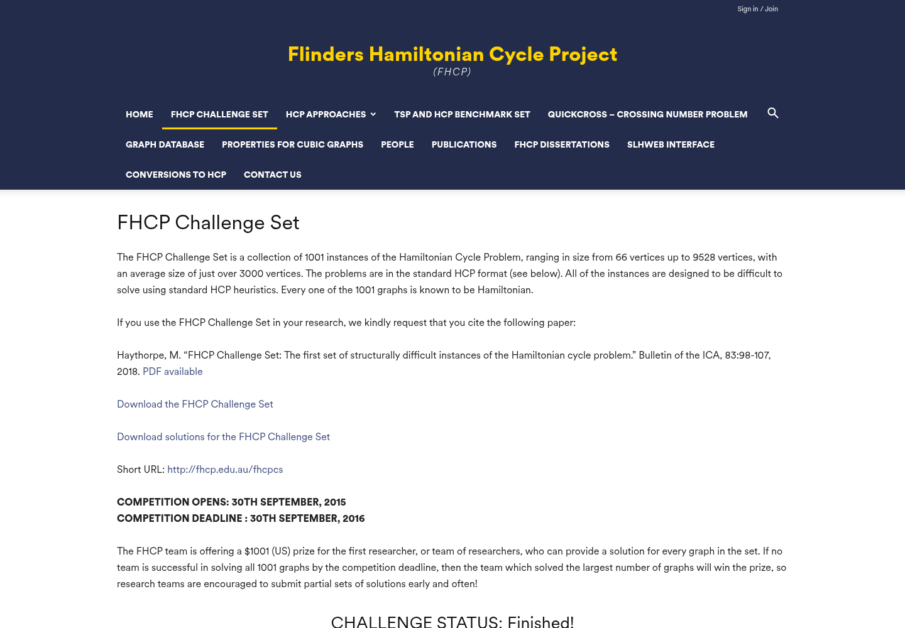
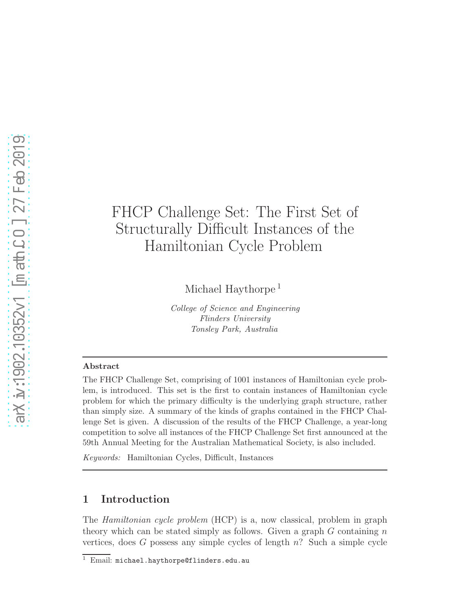
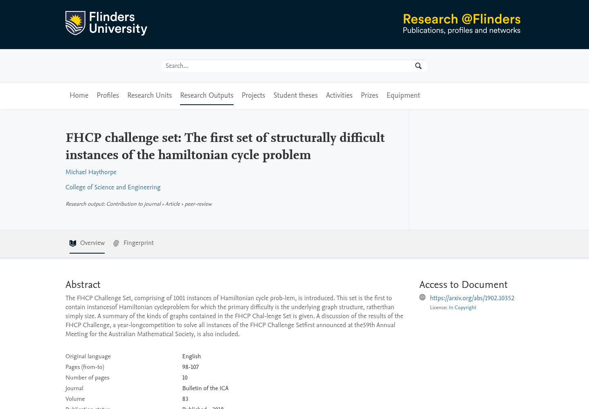
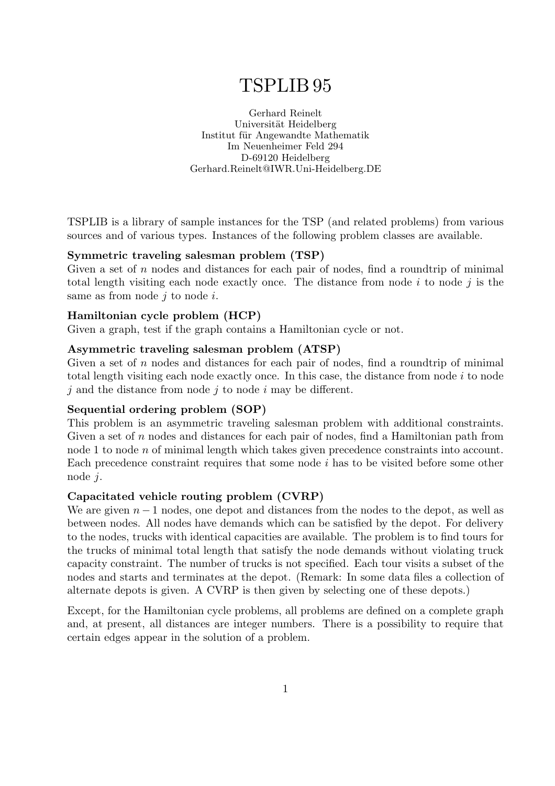
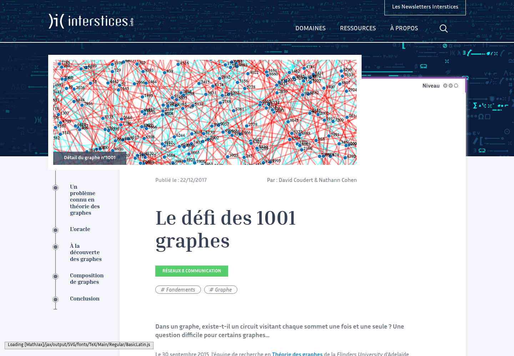
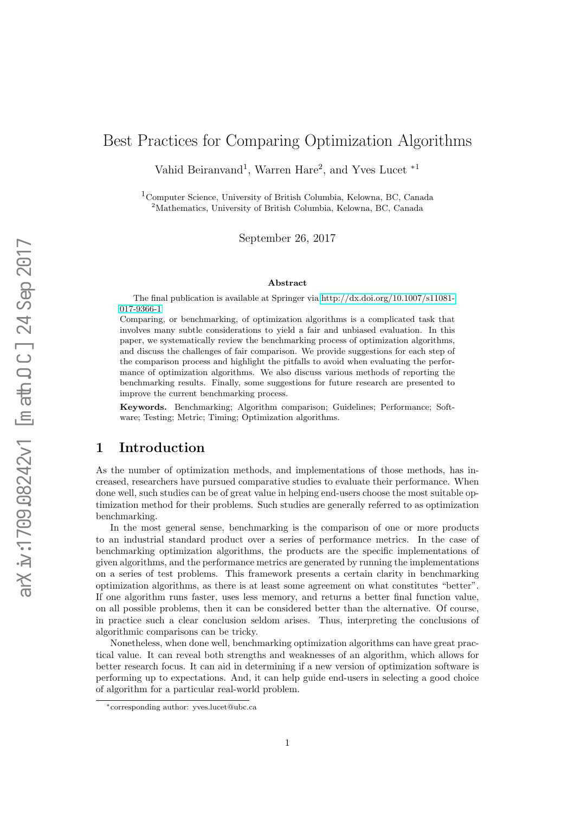

# Formatos y criterios del FHCP Challenge

## Identificación

- **Responsable:** Diego Eduardo Zapata Aguilar · @ZapataFrame
- **Issue:** [#4 · Investigar formatos y criterios del FHCP Challenge](https://github.com/ZapataFrame/FHCP-Challenge/issues/4)
- **Hito:** M1 — Research
- **Fecha de consulta y captura:** 2026-10-30
- **Alcance:** investigación documental para preparar M2, M3 y M6. Las recomendaciones son propuestas para revisión del equipo. No hay parser, solvers ni resultados experimentales propios.

## Desarrollo

### 1. Procedencia y fuentes

El FHCP Challenge Set de Flinders University reúne **1001 grafos hamiltonianos**, de **66 a 9528 vértices**. El concurso se celebró entre el 30 de septiembre de 2015 y el 30 de septiembre de 2016 y está finalizado. El portal conserva las instancias y las soluciones de referencia [@flindersFhcpChallenge].

| Recurso | Enlace primario consultado | Utilidad y alcance |
| --- | --- | --- |
| Portal del dataset | [FHCP Challenge Set](https://sites.flinders.edu.au/flinders-hamiltonian-cycle-project/fhcp-challenge-set/) | Descargas, ejemplos HCP/TOUR y reglas históricas. |
| Instancias | [FHCPCS.7z](https://sites.flinders.edu.au/flinders-hamiltonian-cycle-project/wp-content/uploads/sites/18/2020/01/FHCPCS.7z) | Archivo enlazado por el portal; preservar sus bytes en la ingesta futura. |
| Soluciones | [FHCPCS_sols.7z](https://sites.flinders.edu.au/flinders-hamiltonian-cycle-project/wp-content/uploads/sites/18/2020/01/FHCPCS_sols.7z) | Certificados de referencia; no son salidas de nuestros algoritmos. |
| Artículo del conjunto | [Haythorpe, versión arXiv v1](https://arxiv.org/abs/1902.10352v1) | Construcción, familias y resultados [@haythorpe2018Fhcp]. |
| Registro editorial | [Research @ Flinders](https://researchnow.flinders.edu.au/en/publications/fhcp-challenge-set-the-first-set-of-structurally-difficult-instan/) | Confirma revista, volumen, páginas y año [@flinders2018FhcpRecord]. |
| Especificación relacionada | [TSPLIB 95, manual oficial](https://comopt.ifi.uni-heidelberg.de/software/TSPLIB95/tsp/tsp95.pdf) | Semántica de encabezados y secciones [@reineltTsplib95]. |
| Experiencia de los ganadores | [Le défi des 1001 graphes](https://interstices.info/le-defi-des-1001-graphes/) | Método y tiempos publicados para algunas instancias [@cohenCoudert2017Challenge]. |
| Metodología de comparación | [Beiranvand, Hare y Lucet](https://arxiv.org/abs/1709.08242v1) | Fundamento de recomendaciones experimentales [@beiranvand2017BestPractices]. |

Haythorpe se cita como *Bulletin of the ICA*, **83, 98–107, 2018**; su depósito arXiv v1 es del **27 de febrero de 2019**. Son fechas distintas del mismo trabajo, no estudios independientes. La institución lo identifica como artículo revisado por pares; no debe usarse el encabezado editorial provisional del HTML de arXiv para cambiar la revista [@flinders2018FhcpRecord; @haythorpe2018Fhcp].

### 2. Dificultad estructural

Haythorpe distingue grafos de la literatura, modificaciones, conversiones desde otros problemas y combinaciones. Las candidatas se probaron con Concorde, LKH y Snakes and Ladders Heuristic (SLH); se incluyeron si al menos dos encontraban dificultades. Las etiquetas se aleatorizaron tras construir los grafos. Tener pocos ciclos no basta para predecir dificultad. Destaca dieciséis instancias no resueltas por los concursantes, relacionadas con Sted4, Sted5, Sted6 y combinaciones [@haythorpe2018Fhcp, secciones 2–3].

**Implicación propuesta:** estratificar por tamaño y estructura, sin llamar «fácil» a una instancia solo por ser pequeña. No deducir la familia de su número. Los grafos no hamiltonianos empleados antes de algunas modificaciones no convierten al conjunto publicado en un dataset con casos negativos.

### 3. Formatos publicados e identificadores

El ejemplo oficial usa **HCP con lista de aristas** y un archivo separado **TOUR**. La tabla combina ese perfil con el manual TSPLIB [@flindersFhcpChallenge, Formats; @reineltTsplib95, secciones 1.1–1.2].

| Campo/sección | Instancia HCP | Solución TOUR |
| --- | --- | --- |
| `NAME` | Nombre descriptivo. | Nombre del tour. |
| `COMMENT` | Texto informativo. | Texto informativo. |
| `TYPE` | `HCP`. | `TOUR`. |
| `DIMENSION` | Número de vértices. | Dimensión del problema. |
| `EDGE_DATA_FORMAT` | `EDGE_LIST` en el ejemplo FHCP. | No se exige en ese ejemplo. |
| Datos | `EDGE_DATA_SECTION`, pares de extremos. | `TOUR_SECTION`, orden de visita. |
| Terminación FHCP | `-1` y `EOF`. | `-1` y `EOF`. |

Ejemplo didáctico propio para comprobar lectura y cierre, **fuera del Challenge Set**:

```text
NAME : triangle-example
COMMENT : Synthetic documentation example
TYPE : HCP
DIMENSION : 3
EDGE_DATA_FORMAT : EDGE_LIST
EDGE_DATA_SECTION
1 2
2 3
1 3
-1
EOF
```

Su certificado propuesto es:

```text
NAME : triangle-example-tour
COMMENT : Synthetic documentation example
TYPE : TOUR
DIMENSION : 3
TOUR_SECTION
1
2
3
-1
EOF
```

El perfil FHCP muestra cada vértice una vez, con retorno implícito al origen. TSPLIB contempla además `ADJ_LIST` y colecciones de tours, con terminación más general; su `EOF` es opcional. La política de aceptación del proyecto queda para M2 [@reineltTsplib95, secciones 1.1.7, 1.1.11, 1.2.4, 1.2.7].

**Recomendaciones para M2/M3:**

- Identificar instancias por **archivo de origen + hash**, conservando `NAME` y `COMMENT`. Un título libre no garantiza unicidad ni identifica automáticamente el tour correspondiente.
- Conservar etiquetas externas y un mapeo reversible si se utilizan índices internos desde cero. Confirmar el universo con `DIMENSION` y los datos; no renumerar silenciosamente.
- Tratar los pares del perfil HCP como aristas no dirigidas, sin pesos; verificarlo durante la ingesta. No completar aristas ausentes como si fuera un TSP euclídeo.
- Declarar formatos admitidos; rechazar explícitamente los restantes. Detectar campos incompatibles, dimensión inválida, truncamiento, extremos fuera del dominio, bucles y duplicados; no descartarlos sin diagnóstico.
- Separar parseo de validación: comprobar longitud, pertenencia, unicidad, cobertura, aristas consecutivas y **arista del último vértice al primero**. Una permutación o un buen fitness no demuestra un ciclo.
- Usar certificados para validar factibilidad, sin exigir igualdad literal: rotaciones, inversión y otros ciclos válidos pueden ser soluciones legítimas.

Estas recomendaciones siguen los invariantes de `AGENTS.md` y la skill local `fhcp-graphs`. No establecen un contrato aprobado ni implican implementación.

### 4. Lista preliminar trazable de instancias

**Propuesta para M2, pendiente de aprobación:** comenzar con los identificadores públicos siguientes. Los números y tamaños se publican en el relato de los ganadores. Se inspeccionaron además seis archivos del paquete oficial; sus nombres numerados y dimensiones coinciden con la tabla. No se comprobó isomorfismo con las visualizaciones de los participantes [@cohenCoudert2017Challenge, «L’oracle» y «La famille du 1001»].

| Identificador público / miembro inspeccionado | Vértices | Uso propuesto | Localizador |
| --- | ---: | --- | --- |
| n.º 1 / `graph1.hcp` | 66 | Primera carga real y comprobación con certificado. | Tabla «L’oracle», fila 1. |
| n.º 2 / `graph2.hcp` | 70 | Segunda entrada para evitar depender de un caso. | Misma tabla, fila 2. |
| n.º 8 / `graph8.hcp` | 108 | Explorar dificultad en tamaño pequeño. | Misma tabla, fila 8. |
| n.º 12 / `graph12.hcp` | 132 | Contrastar tamaño con dificultad estructural. | Misma tabla, fila 12 y comentario posterior. |
| n.º 1000 / `graph1000.hcp` | 9058 | Prueba de escala tras validar recursos. | Párrafo de «L’oracle» y anexo. |
| n.º 1001 / `graph1001.hcp` | 9528 | Caso grande compuesto; escala posterior. | «La famille du 1001». |

La inspección documental registró **1001 miembros `.hcp`** en el paquete de **14 957 114 bytes**, SHA-256 `2f86aaf525977d1e45f1270c06d8153f3d84d32bd391b4058764c3c85db04f79`. En las seis entradas se observó `TYPE: HCP`, `EDGE_DATA_FORMAT: EDGE_LIST`, etiquetas de 1 a n y terminación `-1`/`EOF`. Sus n coinciden con los publicados. Los encabezados no identifican familias. El [registro de inspección](evidence/fhcp-archive-inspection.json) conserva fecha UTC, hashes individuales y número de aristas; no son resultados de un solver ni una ingesta implementada. Los archivos se examinaron en una copia temporal; la conservación permanente del dataset queda para M2.

Para ampliar cobertura, proponer **Sted6 (4620), Sted5 (5544) y Sted4 (6930)**, identificados en la sección 3 de Haythorpe. La correspondencia exacta con los archivos debe comprobarse en M2 [@haythorpe2018Fhcp].

Antes de congelar el subconjunto, M2 deberá:

1. Vincular cada identificador público o nombre estructural al miembro exacto del archivo oficial; registrar `NAME`, n, m, hash y certificado. Si no se demuestra la relación, dejarla pendiente.
2. Inventariar grados, densidad y familias documentadas; ampliar candidatos si no cubren estructuras diferentes. Esta lista intencional no representa estadísticamente los 1001 grafos.
3. Separar casos sintéticos del validador, instancias de ajuste y evaluación final. Mantener negativos sintéticos fuera de las estadísticas FHCP.
4. Estimar costo en un piloto posterior y acordar tamaños viables. No excluir casos porque den malos resultados; documentar exclusiones y presupuestos antes del lote final.

### 5. Reglas históricas y referencias comparables

Se priorizó resolver más grafos; en empate, la recepción más temprana. Contaba la última presentación, que debía conservar soluciones anteriores, con tours en el formato indicado y envío comprimido. No se publicó allí un presupuesto uniforme por instancia ni equipo común de ejecución [@flindersFhcpChallenge, Competition rules].

| Referencia | Dato publicado | Condiciones disponibles | Límite |
| --- | --- | --- | --- |
| Concurso 2015–2016 | Cohen y Coudert: **985/1001**. | Ventana de un año; no equivale a tiempo CPU. Hardware, semillas y límite uniforme por instancia: no especificados en las fuentes consultadas. | Cobertura acumulada histórica; no probabilidad de éxito por corrida. |
| Relato de los ganadores | Oráculo con programación lineal entera, reducción y descomposición; intervención humana. | Tiempos para algunos grafos; sin configuración reproducible completa de hardware, software y límites. | No es ejecución automática homogénea comparable directamente con nuestras seis metaheurísticas. |
| Concorde, LKH y SLH | Usados en la selección por dificultad. | El artículo del conjunto no ofrece una matriz reproducible de tiempos, versiones, semillas y presupuesto. | Candidatos a baseline futuro; no hay ranking temporal universal. |
| Soluciones oficiales | Certificados de factibilidad. | Archivo enlazado por el portal. | Un tour no documenta algoritmo ni tiempo de obtención. |

Fuentes: [@haythorpe2018Fhcp, secciones 2–3; @cohenCoudert2017Challenge, «L’oracle» y «Conclusion»; @flindersFhcpChallenge].

#### Referencias temporales para las instancias candidatas

Tiempos publicados por Cohen y Coudert, no mediciones del proyecto. Su oráculo usa programación lineal entera; el relato identifica SageMath y CPLEX sin precisar versiones. La tabla separa el oráculo inicial de las mejoras estructurales posteriores [@cohenCoudert2017Challenge, «L’oracle», «La famille du 1001» y «Conclusion»].

| Instancia candidata | Oráculo inicial | Mejora estructural posterior | Localizador |
| --- | ---: | --- | --- |
| `graph1.hcp` | 0.76 s | Sin tiempo individual publicado. | «L’oracle», fila 1. |
| `graph2.hcp` | 0.01 s | Sin tiempo individual publicado. | Misma tabla, fila 2. |
| `graph8.hcp` | 1574.00 s | Sin tiempo individual publicado. | Misma tabla, fila 8. |
| `graph12.hcp` | 89631.00 s | Menos de 1 s con sus métodos estructurales; no atribuirlo al oráculo inicial. | Misma tabla, fila 12 y párrafo posterior. |
| `graph1000.hcp` | 5 min (≈300 s; conversión del tiempo narrado). | Sin tiempo individual posterior publicado. | Párrafo de «L’oracle». |
| `graph1001.hcp` | Sin tiempo publicado. | Descomposición en bloques descrita, sin tiempo total publicado. | «La famille du 1001». |

No se especifican hardware, repeticiones ni alcance del cronometraje en esos datos. No permiten calcular una aceleración reproducible frente a nuestros algoritmos; en particular, los tiempos de `graph12.hcp` corresponden a procedimientos distintos.

985/1001 ≈ **98.40 %** es una proporción calculada del resultado histórico. No es una medición propia ni demuestra superioridad sobre experimentos con otro subconjunto y presupuesto. Los dieciséis casos resistentes no son grafos demostrados no hamiltonianos. El relato menciona diez segundos para consultas particulares durante eliminación de aristas; ese valor **no es un presupuesto general del concurso** [@cohenCoudert2017Challenge, «Les sommets de degré 2»].

### 6. Criterios propuestos de benchmarking para M6

Beiranvand, Hare y Lucet distinguen eficiencia, fiabilidad y calidad de salida. Recomiendan explicitar el reloj utilizado, repetir métodos no deterministas y conservar cada ejecución. Su revisión respalda separar ajuste, condiciones de parada y análisis [@beiranvand2017BestPractices, secciones 3–5]. Lo siguiente es una **adaptación propuesta**, no un reglamento FHCP.

Para instancia i y algoritmo a, realizar R intentos predefinidos. Sea S el número que entrega un ciclo aceptado por el validador independiente dentro del presupuesto:

**Tasa de éxito por instancia = S / R.**

Incluir en R timeouts, candidatos inválidos y errores, distinguiendo sus cantidades. Un fallo de infraestructura no debe desaparecer: documentar causa y repetición por separado, sin reemplazar selectivamente el intento original. Informar también cobertura de instancias con al menos un éxito sobre el subconjunto fijado; cobertura y tasa por repetición responden preguntas diferentes.

| Aspecto | Propuesta de registro/análisis |
| --- | --- |
| Presupuesto | Límite de búsqueda por intento, máximo de evaluaciones si procede y criterio de parada antes del lote. Valores pendientes del piloto y M2/M6. |
| Tiempo | Reloj monótono; separar carga, búsqueda, validación y total. Medir tiempo al primer ciclo válido y duración de todos los intentos. |
| Timeouts | Registrar presupuesto consumido y falta de éxito; no asignar cero ni presentar la media de éxitos como tiempo general. Tratar el tiempo hasta solución como censurado si no se alcanza. |
| Repeticiones | Publicar semillas y cantidad de intentos antes de ejecutar. Igual cantidad por algoritmo e instancia; la misma semilla no asegura trayectorias equivalentes entre algoritmos. |
| Variabilidad | S/R, dispersión de duraciones y tiempos condicionados al éxito con su cantidad de observaciones; evitar decidir por una corrida afortunada. |
| Iteraciones | Definirlas por algoritmo: generación GA y paso SA tienen costos distintos. Añadir evaluaciones y tiempo. |
| Entorno | CPU/modelo, RAM, sistema, runtime/compilador, dependencias, hilos y carga concurrente. |
| Trazabilidad | ID de corrida, archivo/hash, algoritmo/variante, parámetros, semilla, presupuesto, commit/cambios locales, candidato, validación y terminación. |
| Comparación externa | Tablas bibliográficas y propias separadas; señalar datos ausentes. Para comparar velocidad, ejecutar referencias bajo condiciones controladas o limitar la conclusión. |

No introducir precisión, recall o F1 sin definir población, etiquetas y predicciones. Agotar una búsqueda en un conjunto hamiltoniano no demuestra un caso negativo. Esta entrega no sustituye al issue #6 ni establece equivalencia entre esas métricas y S/R.

### 7. Conservación de procedencia en una ingesta futura

**Procedimiento propuesto para M2:**

1. Descargar del portal y conservar archivos comprimidos originales en un directorio de `data/raw/` identificado por fecha y hash. No sobrescribir una descarga aunque la URL siga igual.
2. Registrar URL solicitada/final, fecha/hora UTC, tamaño, SHA-256 y cabeceras HTTP relevantes. `Last-Modified` y el año de una ruta web no prueban una versión científica del dataset. Referenciar artículo y portal.
3. Inventariar miembros y comprobar que las rutas no salgan del destino. Extraer a un directorio nuevo; conservar nombres y hashes de miembros utilizados. No modificar finales de línea ni encabezados originales.
4. Crear inventario del subconjunto y relación instancia/certificado; guardar transformaciones y mapeos en `data/processed/`, con versión del procedimiento. Validar certificados contra sus grafos aunque sean oficiales.
5. Separar certificados y entradas del solver. Usar los primeros como oráculo; no suministrarlos como resultado o punto inicial del experimento principal sin declarar esa información.
6. Guardar cada experimento en una ruta nueva de `experiments/results/` y configuraciones en `experiments/configs/`; no reutilizar IDs para sustituir evidencia.

El manifiesto futuro debería contener `source_url`, `retrieved_at_utc`, `archive_sha256`, `archive_member`, `instance_sha256`, `name`, `dimension`, `edge_count`, `format`, `external_labels`, `solution_member` y `transform_version`. Son campos propuestos, no un esquema implementado. Antes de versionar el dataset completo, revisar almacenamiento de archivos grandes y permisos de redistribución; la descarga pública no implica una licencia inventada.

### 8. Método de investigación y límites

Se partió de los enlaces proporcionados y se siguieron descargas y referencias primarias hacia TSPLIB y el relato de participantes. La búsqueda complementaria usó «TSPLIB95 HCP EDGE_DATA_SECTION TOUR_SECTION», «Le défi des 1001 graphes» y «Best practices for comparing optimization algorithms». Se incluyeron fuentes accesibles, con autor o entidad identificable y relación directa con el issue. No se presenta como revisión sistemática exhaustiva.

Se contrastaron metadatos entre arXiv y Flinders, se consultaron secciones pertinentes y se conservaron capturas identificativas. El enlace de reimpresión desde FHCP devolvió 404; se utilizó arXiv, enlazado por la institución. AlphaXiv no aportó evidencia adicional verificable y no se cita como otro estudio. Algunos enlaces antiguos de TSPLIB no respondieron; el manual se localizó desde su índice oficial actual.

Para evaluar las fuentes se distinguió autoridad institucional sobre formatos, publicación académica sobre construcción/metodología y relato de participantes sobre su experiencia. Haythorpe creó el conjunto; Cohen y Coudert participaron en el concurso: su interés intelectual se hace explícito, sin tratar sus textos como evaluación independiente universal. No se verificaron índices Scopus/WoS ni auditorías editoriales exhaustivas y no se atribuye a esos controles un resultado favorable.

Se empleó IA para apoyar la búsqueda, organización y verificación documental. Las capturas identifican las fuentes y no sustituyen la revisión humana. La inspección temporal del dataset no implementa la ingesta; no se ejecutaron benchmarks ni se eligieron stack, parámetros o protocolo definitivo.

## Conclusiones

La entrega prepara M2/M3/M6 con formatos, procedencia, candidatos identificables y límites de comparación. M2 debe acordar representación, correspondencia de certificados/familias, subconjunto y presupuesto; M3 debe implementar y probar parser/validador; M6 debe producir evidencia experimental. El concurso contextualiza la dificultad, pero no permite afirmar rendimiento equivalente sin controlar condiciones.

## Referencias

[Bibliografía compartida](references.bib), bloque del issue #4:

- [@flindersFhcpChallenge]
- [@haythorpe2018Fhcp]
- [@flinders2018FhcpRecord]
- [@reineltTsplib95]
- [@cohenCoudert2017Challenge]
- [@beiranvand2017BestPractices]

## Anexo de referencias

Fecha de captura de todas las fichas: **2026-10-30**. URL y metadatos completos en el `.bib` compartido.

### flindersFhcpChallenge

- **Descripción:** encabezado del portal oficial, entidad responsable, descripción y descargas.



### haythorpe2018Fhcp

- **Descripción:** primera página arXiv v1, título, autor y afiliación; año editorial contrastado con la ficha siguiente.



### flinders2018FhcpRecord

- **Descripción:** ficha oficial de Flinders con título, autor y datos editoriales.



### reineltTsplib95

- **Descripción:** primera página del manual oficial, título, autor e institución.



### cohenCoudert2017Challenge

- **Descripción:** encabezado de Interstices con título, autores y fecha.



### beiranvand2017BestPractices

- **Descripción:** primera página del artículo metodológico, autores, afiliaciones y DOI final.


