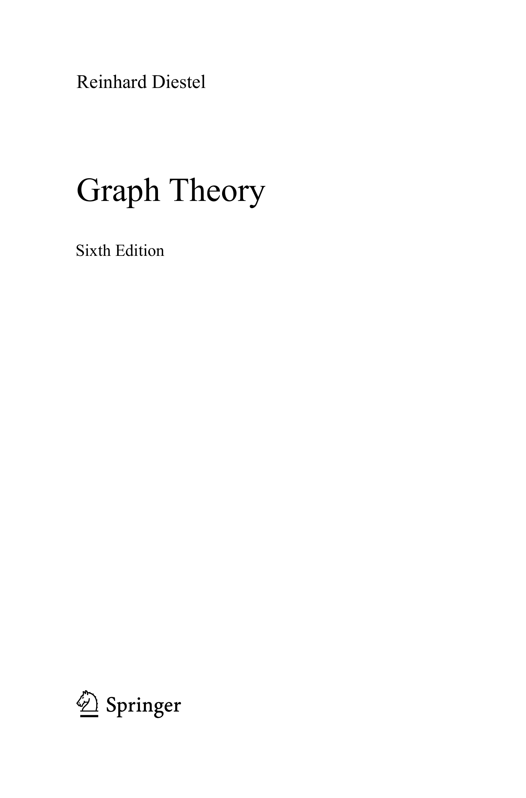
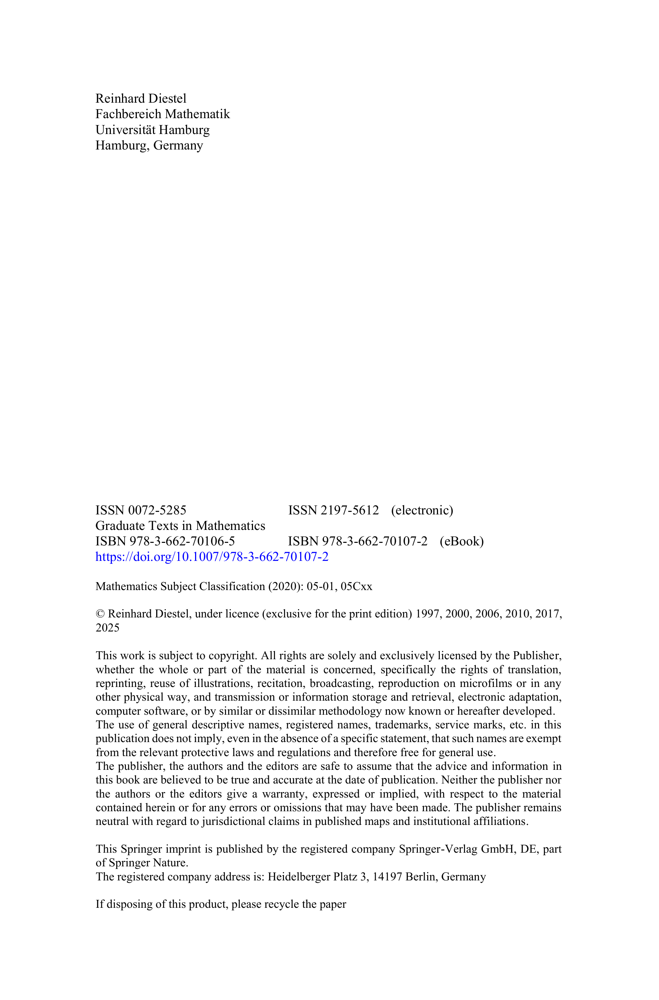
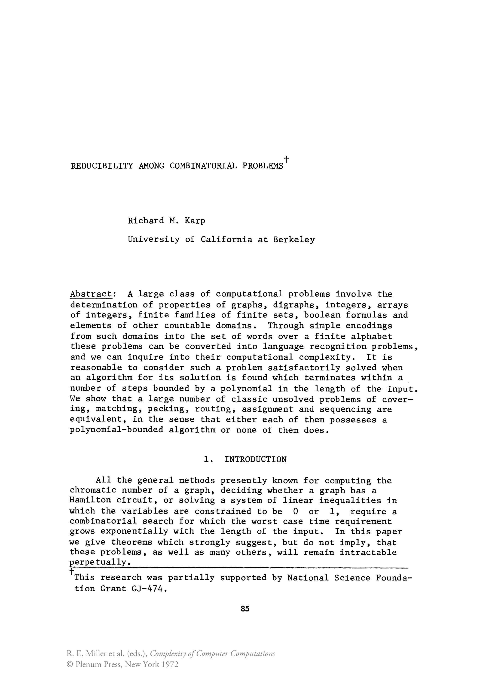
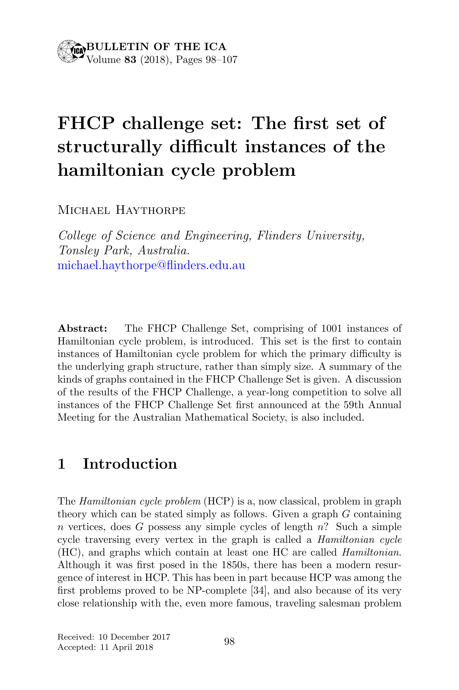

# Teoría de grafos y ciclos hamiltonianos

## Identificación

- **Responsable:** César Euresti · @cesar-upv
- **Issue:** [#1 · Investigar teoría de grafos y ciclos hamiltonianos](https://github.com/ZapataFrame/FHCP-Challenge/issues/1)

## Desarrollo

### 1. Planteamiento del problema

El problema del ciclo hamiltoniano consiste en determinar si un grafo contiene un ciclo simple que visite todos sus vértices [@haythorpe2018Fhcp, p. 98]. En su formulación constructiva, el objetivo es obtener una secuencia de vértices que certifique la existencia de ese ciclo.

La formulación requiere distinguir la cobertura de los vértices de la existencia de las aristas que los conectan en el orden propuesto. Esta distinción fundamenta tanto la representación de las soluciones candidatas como la verificación de su factibilidad.

### 2. Definiciones y notación

Se consideran grafos finitos, simples y no dirigidos. Las definiciones y los ejemplos siguientes se restringen a esta clase de grafos.

| Concepto | Definición |
| --- | --- |
| **Grafo** | $G=(V,E)$, con $V$ el conjunto de vértices y $E\subseteq\{\{u,v\}:u,v\in V,\ u\ne v\}$ el de aristas. |
| **Vértice** | Un elemento $v\in V$. |
| **Arista** | Un par no ordenado $\{u,v\}\in E$; une dos vértices distintos. |
| **Camino simple** | Secuencia $(v_0,\ldots,v_k)$ de vértices distintos, con $\{v_i,v_{i+1}\}\in E$ para $0\le i<k$; tiene longitud $k$. |
| **Ciclo simple** | Secuencia cerrada $(v_0,\ldots,v_{k-1},v_0)$, con $k\ge3$, vértices distintos antes del cierre y todas las aristas consecutivas presentes; su longitud es $k$. |
| **Ciclo hamiltoniano** | Ciclo simple que contiene todos los vértices de $G$. Un grafo es hamiltoniano si contiene alguno. |

Las definiciones de grafo, vértice y arista siguen a Diestel, §1.1, pp. 2–3; camino y ciclo, §1.3, pp. 6–8; y ciclo hamiltoniano, cap. 10, p. 323 [@diestel2025GraphTheory6]. Aquí «camino» y «ciclo» significan simples. La longitud cuenta **aristas**, no posiciones del arreglo.

Un camino hamiltoniano contiene todos los vértices, sin exigir cierre [@diestel2025GraphTheory6, cap. 10, p. 323].

Se escribe $n=|V|$ y $m=|E|$. En un ciclo hamiltoniano $C$, $|V(C)|=|E(C)|=n$; el grafo anfitrión puede tener $m>n$. El retorno al origen añade una arista, sin añadir un vértice distinto. Un recorrido euleriano cerrado exige recorrer cada arista exactamente una vez; la condición hamiltoniana concierne a los vértices [@diestel2025GraphTheory6, cap. 10, p. 323].

### 3. Condiciones para que una ruta sea solución

Para exponer la comprobación, se escribe el candidato como una lista de $n$ posiciones con cierre implícito:

$$
\pi=(\pi_0,\pi_1,\ldots,\pi_{n-1}).
$$

La definición anterior se traduce en las siguientes condiciones, todas necesarias y, conjuntamente, suficientes para $n\ge3$ [@haythorpe2018Fhcp, p. 98]:

1. **Tamaño:** la lista tiene exactamente $n$ elementos.
2. **Pertenencia:** cada $\pi_i$ pertenece a $V$.
3. **Visita única y cobertura:** no se repiten elementos y $\{\pi_0,\ldots,\pi_{n-1}\}=V$.
4. **Adyacencia interna:** $\{\pi_i,\pi_{i+1}\}\in E$ para cada $0\le i<n-1$.
5. **Cierre:** $\{\pi_{n-1},\pi_0\}\in E$.

**Justificación de la longitud.** Las posiciones consecutivas determinan $n-1$ aristas; el cierre aporta la restante. La visita única impide repetir vértices antes del retorno y, en un grafo simple con $n\ge3$, repetir aristas. Se obtiene así un ciclo con $n$ vértices distintos y $n$ aristas. Recíprocamente, ordenar los vértices de un ciclo hamiltoniano produce una lista que satisface las cinco condiciones.

Una **permutación de $V$** satisface las tres primeras condiciones, pero puede fallar en las dos últimas. Por tanto, preservar una permutación durante cruza, mutación o actualización de partículas conserva la legalidad de la representación, sin garantizar la factibilidad de la solución. La comprobación final debe verificar todas las condiciones anteriores de manera independiente del valor del fitness.

También puede escribirse el ciclo con cierre explícito, $(\pi_0,\ldots,\pi_{n-1},\pi_0)$: aparecen $n+1$ posiciones, $n$ vértices distintos y $n$ aristas. Esa repetición final del origen es legítima. La verificación debe especificar qué convención utiliza para interpretar la longitud de la lista y la repetición del vértice inicial. Bajo la definición de ciclo simple adoptada, los grafos con $n<3$ no admiten un ciclo hamiltoniano.

### 4. Ejemplos conceptuales verificables

Los siguientes grafos y rutas son ejemplos de elaboración propia que ilustran las condiciones de validez. Su finalidad es conceptual; no constituyen mediciones experimentales.

#### 4.1 Un mismo grafo, diferentes candidatos

Sea $G$ definido por:

$$
V=\{1,2,3,4,5\},
$$

$$
E=\big\{\{1,2\},\{2,3\},\{3,4\},\{4,5\},
\{1,5\},\{1,3\},\{2,4\}\big\}.
$$

Aquí $n=5$ y $m=7$. Todas las listas de la tabla usan cierre implícito.

| Caso | Lista candidata | Comprobación | Conclusión |
| --- | --- | --- | --- |
| Ciclo válido | $(1,2,3,4,5)$ | Visita los cinco vértices una vez; están $12$, $23$, $34$, $45$ y el cierre $51$. | Es un ciclo hamiltoniano de cinco aristas. |
| Sentido inverso válido | $(1,5,4,3,2)$ | Están $15$, $54$, $43$, $32$ y el cierre $21$. | Representa el mismo ciclo sin orientación. |
| Repetición | $(1,2,4,2,3)$ | Tiene cinco posiciones y todas sus aristas, incluido $31$, existen; repite $2$ y omite $5$. | Es inválida aunque pase las comprobaciones de aristas. |
| Vértice faltante | $(1,2,4,5)$ | Las aristas $12$, $24$, $45$ y $51$ existen, pero falta $3$. | Es un ciclo de longitud cuatro, no hamiltoniano en $G$. |
| Vértice ajeno | $(1,2,3,4,6)$ | $6\notin V$; se rechaza por pertenencia antes de consultar su adyacencia. | No es una permutación de $V$. |
| Arista interna inexistente | $(1,2,4,3,5)$ | Es una permutación y $51$ cierra, pero $\{3,5\}\notin E$. Las otras aristas internas existen. | La permutación no forma un ciclo de $G$. |
| Cierre inválido | $(2,1,3,4,5)$ | Es una permutación con aristas internas $21$, $13$, $34$, $45$; falta $\{5,2\}$. | Es un camino hamiltoniano, pero ese orden no cierra un ciclo. |

En la tabla, $uv$ abrevia la arista no dirigida $\{u,v\}$. El último caso muestra que revisar únicamente los pares internos acepta un falso positivo. El caso de repetición muestra que revisar todas las aristas tampoco basta. Además, rechazar esos candidatos **no** implica rechazar el grafo: la primera fila ya exhibe un ciclo hamiltoniano en él.

#### 4.2 Un grafo sin ciclo hamiltoniano y una prueba de inexistencia

Sea $H$ con los mismos cinco vértices y solamente las aristas $12$, $23$, $34$, $45$. La ruta $(1,2,3,4,5)$ es un camino hamiltoniano, pero falta $51$. Para demostrar que **ningún otro orden** forma un ciclo, se observa que $1$ y $5$ tienen grado uno. Cada vértice de un ciclo simple necesita dos vecinos distintos en él. Por ello, $H$ no tiene ciclo hamiltoniano. Es una prueba estructural, independiente de cuántos intentos realice un algoritmo. La condición necesaria de grado mínimo dos se recoge en Diestel, §10.1, p. 323 [@diestel2025GraphTheory6].

Tener grado mínimo dos y ser conexo no basta. Como contraejemplo propio, considérense dos triángulos, con vértices $\{1,2,3\}$ y $\{3,4,5\}$, que solo comparten el vértice $3$. Todos los grados son al menos dos y el grafo es conexo. Si hubiera un ciclo hamiltoniano, eliminar $3$ de ese ciclo dejaría un camino que conectara los cuatro vértices restantes. Eso es imposible: al quitar $3$, no hay aristas entre $\{1,2\}$ y $\{4,5\}$. Esta deducción ilustra por qué una comprobación local favorable no certifica la existencia global de un ciclo.

### 5. Dificultad computacional y alcance de las conclusiones

El **problema de decisión** pregunta si $G$ contiene un ciclo hamiltoniano; Karp incluye las variantes dirigida y no dirigida entre los problemas completos para NP [@karp1972Reducibility, p. 94]. La NP-completitud combina pertenencia a NP, con certificados positivos verificables en tiempo polinómico, y NP-dureza: todo problema de NP se reduce a este en tiempo polinómico. No demuestra que cada instancia requiera tiempo exponencial ni descarta un algoritmo polinómico general; este implicaría $P=NP$ [@karp1972Reducibility, p. 86].

La formulación constructiva exige además **obtener** el ciclo. Un procedimiento general que siempre lo encuentre, o certifique su inexistencia, permitiría responder la pregunta de decisión. Por ello, ese problema de búsqueda general es al menos tan difícil como el de decisión; esta es una consecuencia de la formulación de Karp, no una garantía de dificultad uniforme para todos los grafos [@karp1972Reducibility].

Una ilustración combinatoria propia ayuda a entender la búsqueda por permutaciones. Sin fijar un origen hay $n!$ listas candidatas. Fijando un vértice inicial quedan $(n-1)!$; identificando además ambos sentidos en grafos no dirigidos, hay $(n-1)!/2$ órdenes cíclicos para $n\ge3$. Este conteo se refiere a órdenes candidatos: muchos pueden contener pares que no son aristas del grafo. Describe la enumeración ingenua, no una cota inferior para todos los algoritmos.

La verificación de una lista requiere revisar sus $n$ vértices y sus $n$ pares cíclicos. **Si** la pertenencia y la adyacencia se consultan en tiempo constante, y se usa una estructura de marcas para detectar repetidos, el trabajo de esa verificación es $O(n)$, con $O(n)$ memoria auxiliar. Esta cota se deduce de las operaciones descritas y excluye el costo de cargar o construir la representación del grafo. Una búsqueda lineal en listas de vecinos tendría otro costo.

Para interpretar una ejecución, deben distinguirse estas situaciones:

| Evidencia disponible | Afirmación justificada |
| --- | --- |
| Lista que pasa un validador independiente | Se encontró un ciclo hamiltoniano; el grafo es hamiltoniano. |
| Lista rechazada | Ese candidato es inválido; por sí solo no determina si existe otro válido. |
| Presupuesto agotado sin certificado válido | No se encontró un ciclo dentro de ese presupuesto. |
| Prueba matemática de inexistencia o búsqueda exacta completa correctamente justificada | Se demostró que el grafo no es hamiltoniano. |

Las distinciones de la tabla se deducen de la pregunta de existencia: un testigo basta para responder afirmativamente, mientras que el fracaso de una exploración parcial no descarta los candidatos sin explorar. Un fitness favorable, un ciclo parcial o un camino hamiltoniano tampoco sustituyen ese testigo.

### 6. Implicaciones específicas para el FHCP Challenge

Haythorpe presenta el conjunto como 1001 instancias conocidas como hamiltonianas, seleccionadas por dificultad estructural, no únicamente por tamaño [@haythorpe2018Fhcp, pp. 99–100]. Así, no resolver una instancia del conjunto indica una limitación de la búsqueda ejecutada, no un descubrimiento de no hamiltonicidad. La clasificación NP-completa corresponde al problema general de decisión; el reto práctico del dataset consiste en construir un ciclo cuya existencia ya se conoce.

En la evaluación de metaheurísticas, estas propiedades permiten separar la legalidad de la representación, la factibilidad del candidato y el desempeño de la búsqueda. Preservar permutaciones mantiene la cobertura y la unicidad; comprobar las aristas internas y el cierre determina si la ruta constituye un ciclo del grafo.

Por tanto, un éxito de búsqueda requiere un ciclo completo validado. Los intentos que agotan su presupuesto sin obtenerlo expresan una limitación del procedimiento bajo esas condiciones. Esta interpretación evita equiparar una solución parcial o un valor favorable del fitness con un certificado de hamiltonicidad.

## Conclusiones

Un ciclo hamiltoniano requiere cobertura de todos los vértices, visita única, aristas consecutivas presentes y cierre válido. Sus $n$ aristas pertenecen a un grafo que puede contener más de $n$ aristas. Una permutación solo resuelve la parte de cobertura y unicidad; por eso la representación y la validación cumplen funciones diferentes.

El problema general es NP-completo en su versión de decisión, pero un ciclo propuesto puede verificarse en tiempo polinómico. Los ejemplos muestran tanto candidatos inválidos en un grafo hamiltoniano como un grafo cuya no hamiltonicidad se demuestra por estructura. Esa diferencia impide interpretar el agotamiento de una heurística como una prueba de inexistencia.

En el FHCP Challenge Set, donde la existencia de ciclos hamiltonianos es conocida, la evaluación se centra en la capacidad de construirlos y verificarlos bajo un presupuesto de búsqueda. La separación entre representación, factibilidad y evidencia permite interpretar los resultados sin atribuir al fracaso de una heurística una conclusión sobre la inexistencia de soluciones.

## Referencias

[Bibliografía compartida](references.bib). Los localizadores del desarrollo corresponden a la paginación impresa de las fuentes, no al número de página de sus visores PDF.

- [@diestel2025GraphTheory6] Reinhard Diestel, *Graph Theory*, 6.ª ed., Graduate Texts in Mathematics, vol. 173, Springer, 2025. [DOI y ficha editorial](https://doi.org/10.1007/978-3-662-70107-2). Texto consultable del autor: [capítulo 1](https://www.math.uni-hamburg.de/home/diestel/books/graph.theory/preview/Ch1.pdf) y [capítulo 10](https://www.math.uni-hamburg.de/home/diestel/books/graph.theory/preview/Ch10.pdf).
- [@karp1972Reducibility] Richard M. Karp, “Reducibility among Combinatorial Problems”, en *Complexity of Computer Computations*, pp. 85–103, Plenum Press, 1972. [DOI y ficha editorial](https://doi.org/10.1007/978-1-4684-2001-2_9). [Texto original alojado en George Washington University](https://www2.seas.gwu.edu/~simhaweb/champalg/tsp/papers/KarpOriginal.pdf).
- [@haythorpe2018Fhcp] Michael Haythorpe, “FHCP challenge set: The first set of structurally difficult instances of the hamiltonian cycle problem”, *Bulletin of the Institute of Combinatorics and its Applications*, vol. 83, pp. 98–107, 2018. [Reimpresión de la revista](https://bica.the-ica.org/Volumes/83/Reprints/BICA2017-32-Main-Reprint.pdf). La fecha de publicación es 2018; el [depósito posterior en arXiv](https://arxiv.org/abs/1902.10352) es de 2019.

## Anexo de referencias

Las capturas son rasterizaciones PNG a **300 ppp** de páginas completas de los PDF enlazados. No se reconstruyó ni se alteró su contenido. A continuación se identifica la página del archivo fuente contando desde uno; las imágenes permiten ampliar los datos bibliográficos.

### diestel2025GraphTheory6

- **Fecha de captura:** 2026-10-30.
- **Fuente:** [páginas preliminares distribuidas por Springer](https://link.springer.com/content/pdf/bfm:978-3-662-70107-2/1).
- **Descripción:** portada interior, página 3 del PDF, con autor, título y sexta edición; página editorial, página 4 del PDF, con ISBN, DOI y año 2025. Se incluyen ambas para distinguir esta edición de las anteriores.

### karp1972Reducibility

- **Fecha de captura:** 2026-10-30.
- **Fuente:** [vista previa editorial de Springer](https://page-one.springer.com/pdf/preview/10.1007/978-1-4684-2001-2_9).
- **Descripción:** primera página de la contribución, p. 85, página 1 del PDF de vista previa, con título, autor y afiliación. El año, las páginas y el DOI se cotejaron con la ficha editorial enlazada en Referencias; el contenido se consultó también en el texto original allí enlazado.

### haythorpe2018Fhcp

- **Fecha de captura:** 2026-10-30.
- **Fuente:** [reimpresión del Bulletin of the ICA](https://bica.the-ica.org/Volumes/83/Reprints/BICA2017-32-Main-Reprint.pdf).
- **Descripción:** primera página del artículo, p. 98, página 2 del PDF después de la cubierta de la revista. Incluye título, autor, volumen 83, año 2018, intervalo de páginas y fechas de recepción y aceptación.

