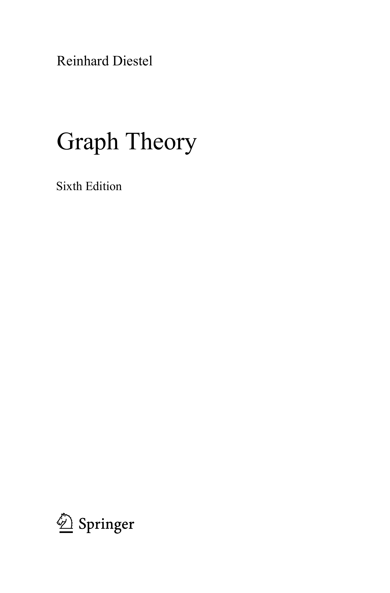
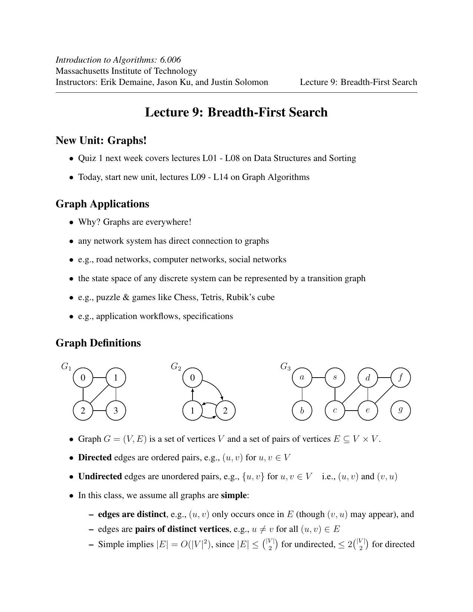
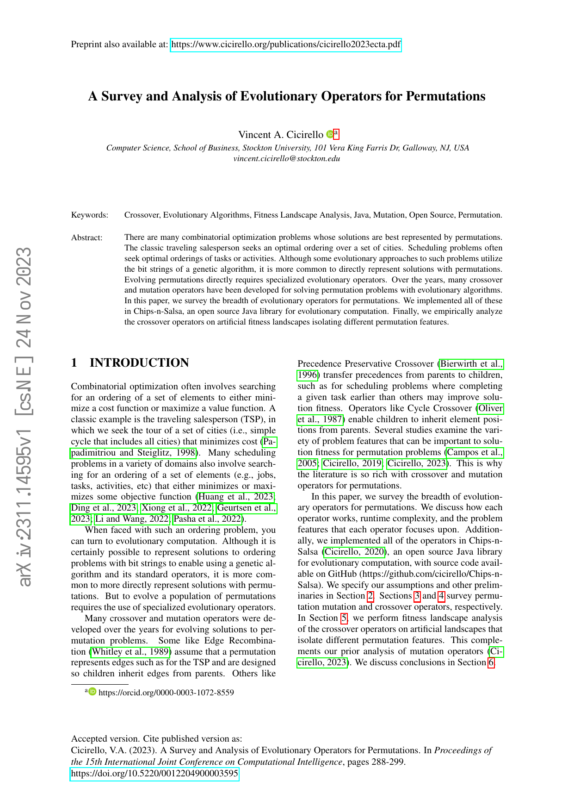
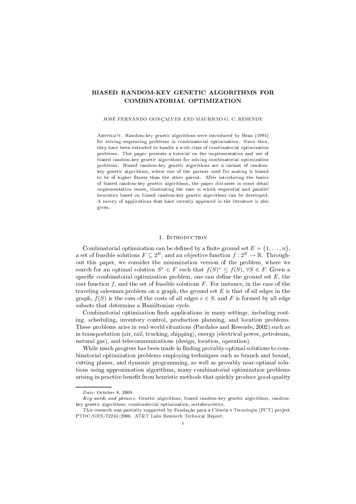

# Representación del espacio de búsqueda

## Identificación

- **Responsable:** Diego Eduardo Zapata Aguilar · @ZapataFrame
- **Issue:** [#3 · Investigar la representación del espacio de búsqueda](https://github.com/ZapataFrame/FHCP-Challenge/issues/3)
- **Hito:** M1 — Research
- **Dependencia:** [#1](https://github.com/ZapataFrame/FHCP-Challenge/issues/1), cerrado con la [PR #10](https://github.com/ZapataFrame/FHCP-Challenge/pull/10); se incorpora su [fundamentación de grafos](graph-theory.md).
- **Fecha de consulta:** 2026-10-31.
- **Alcance:** propuesta documental para los contratos de M2. No establece decisiones aprobadas, implementaciones ni resultados experimentales.

## Desarrollo

### 1. Del problema matemático a la representación

Se adopta la notación del issue #1: grafo finito, simple y no dirigido $G=(V,E)$, con $n=|V|$ y $m=|E|$. Una arista es un par no ordenado de vértices distintos; un ciclo hamiltoniano visita todos los vértices una vez y vuelve al origen, utilizando exactamente $n$ aristas. El grafo anfitrión puede tener más de $n$ aristas. Estas definiciones siguen a Diestel, §§1.1 y 1.3 y cap. 10 [@diestel2025GraphTheory6], y se desarrollan en [graph-theory.md](graph-theory.md#2-definiciones-y-notación).

Conviene separar tres objetos:

| Objeto | Contenido | Pregunta que resuelve |
| --- | --- | --- |
| Grafo | Vértices y aristas originales, junto con sus identificadores. | ¿Existe la arista entre dos vértices? |
| Candidato | Un orden propuesto de visita, directamente o tras decodificar otra codificación. | ¿En qué orden se intenta recorrer el grafo? |
| Estado del algoritmo | Población, claves, intercambios, memoria u otros datos específicos. | ¿Cómo se produce el siguiente candidato? |

Compartir un formato de candidato no exige que todas las metaheurísticas tengan idéntico estado interno. La legalidad de una codificación y la factibilidad de su ruta son propiedades distintas. En la caracterización de ciclos se supone $n\ge3$; los casos menores se rechazan conforme a la definición del issue #1.

Sea $I=\{0,\ldots,n-1\}$ el conjunto de índices internos propuesto. El espacio de permutaciones es:

$$
\mathcal P_n=\{(p_0,\ldots,p_{n-1}):\{p_0,\ldots,p_{n-1}\}=I\}.
$$

Cada índice aparece una sola vez. Si $\lambda:I\to V$ es la biyección de decodificación, las soluciones factibles pertenecen al subconjunto:

$$
\mathcal H(G)=\{p\in\mathcal P_n:\{\lambda(p_i),\lambda(p_{(i+1)\bmod n})\}\in E\ \text{para todo }i\}.
$$

La fórmula expresa las condiciones de visita, adyacencia y cierre del issue #1. Preservar $\mathcal P_n$ evita candidatos con vértices repetidos o faltantes; no garantiza permanecer en $\mathcal H(G)$. Si una búsqueda no encuentra un elemento de este último conjunto dentro de su presupuesto, no demuestra que esté vacío.

### 2. Codificaciones candidatas del grafo

Las notas del MIT describen listas de adyacencia, almacenamiento proporcional a $n+m$ y tablas hash para consultar vecinos; en un grafo no dirigido cada arista se registra en ambos sentidos [@mit2020GraphRepresentations, p. 2]. A partir de esas operaciones se compara el costo de las siguientes estructuras. Son cotas analíticas, no mediciones del repositorio.

Se supone acceso constante a un arreglo por índice. $d(u)$ es el grado de $u$; una consulta pregunta si $v$ pertenece a sus vecinos. Se cuentan las dos incidencias de cada arista no dirigida.

| Representación | Almacenamiento | Consultar arista $(u,v)$ | Enumerar vecinos de $u$ | Limitación principal |
| --- | --- | --- | --- | --- |
| Lista de aristas sin índice auxiliar | $O(n+m)$ palabras, incluyendo el conjunto de vértices. | $O(m)$ por recorrido. | $O(m)$ por filtrado. | Adecuada como entrada/intercambio; costosa para consultas repetidas. |
| Listas de vecinos sin ordenar | $\Theta(n+m)$ palabras. | $O(1+d(u))$. | $O(1+d(u))$. | La consulta individual requiere buscar en una lista. |
| Listas de vecinos ordenadas, también almacenables en CSR | $\Theta(n+m)$ palabras. | $O(1+\log(1+d(u)))$. | $O(1+d(u))$. | Ordenación inicial y actualización menos cómoda. |
| Conjuntos hash de vecinos | $\Theta(n+m)$ entradas, más sobrecarga de la tabla. | $O(1)$ esperado; no garantizado en el peor caso. | $O(1+d(u))$. | Mayor sobrecarga; no confiar en su orden de iteración. |
| Matriz de adyacencia | $\Theta(n^2)$ celdas. | $O(1)$. | $O(n)$ al recorrer la fila. | Reserva espacio también para pares sin arista. |
| Matriz de bits por filas | $n\lceil n/w\rceil$ palabras de $w$ bits. | $O(1)$ con acceso a palabra y máscara. | $O(n)$ mediante inspección bit a bit. | Exige empaquetado real; un arreglo de objetos booleanos no garantiza este costo. |

**CSR** agrupa los vecinos en un arreglo contiguo y utiliza otro de desplazamientos para localizar cada fila. Su consulta solo tiene la cota de búsqueda binaria indicada si las filas están ordenadas. Construir listas requiere $O(n+m)$; ordenarlas añade $O(\sum_u d(u)\log(1+d(u)))$. Inicializar una matriz densa requiere $O(n^2)$, además de incorporar las aristas. Estas cotas se deducen de contar las operaciones de construcción y búsqueda.

La matriz de bits usa aproximadamente $n^2/8$ bytes de contenido, más redondeo por fila y metadatos. Una matriz de un byte por celda utiliza aproximadamente $n^2$ bytes. El tamaño real depende del lenguaje y sus estructuras; aún no se ha elegido el stack. La ventaja de los bits debe contrastarse con el costo de recorrer vecinos y con los recursos de las instancias seleccionadas.

**Propuesta para M2:** mantener el grafo compartido e inmutable durante cada búsqueda y encapsular al menos las operaciones `has_edge(u, v)` y `neighbors(u)`. Comparar listas ordenadas o conjuntos de vecinos con una matriz de bits antes de fijar el contrato. No copiar el grafo dentro de cada individuo: con una población de $P$ candidatos de longitud $n$, las rutas añaden $O(Pn)$ posiciones; la representación del grafo se conserva una sola vez.

La elección debe considerar las consultas reales del algoritmo. Comprobar repetidamente pares cíclicos favorece la consulta de arista; construir rutas mediante vecinos favorece su enumeración. El [estudio del formato FHCP](fhcp-challenge.md#3-formatos-publicados-e-identificadores) define la procedencia de entrada; un archivo `EDGE_LIST` no obliga a usar una lista de aristas como estructura interna.

### 3. Codificaciones candidatas de las rutas

La revisión de Larrañaga y colaboradores identifica representaciones binarias, por camino, adyacencia, ordinales y matriciales [@larranaga1999Representations, resumen editorial]. Aquí se comparan alternativas concretas y sus implicaciones para el problema; no se extrapolan resultados de TSP a FHCP.

| Codificación | Significado | Tamaño y decodificación | Restricciones y límites |
| --- | --- | --- | --- |
| Permutación por camino | $p_i$ es el vértice visitado en la posición $i$. | $n$ índices; lectura $O(n)$. | Unicidad y cobertura explícitas; las aristas se verifican aparte. |
| Vector de sucesores | $s[u]$ indica el siguiente vértice después de $u$. | $n$ índices; recorrido $O(n)$ si se detectan retornos y repetidos. | Un sucesor y un predecesor por vértice pueden formar varios ciclos disjuntos. |
| Código ordinal | En cada paso se elige una posición de la lista de vértices aún disponibles. | $n$ enteros de dominios decrecientes; decodificación $O(n^2)$ con arreglos y eliminación por desplazamiento. | El valor es una posición entre los restantes, no un identificador original; un cambio temprano altera elecciones posteriores. |
| Claves reales (*random keys*) | Una clave por vértice; el orden de sus claves define la visita. | $n$ claves; ordenar por comparación cuesta $O(n\log n)$. | Muchas claves representan el mismo orden; requiere desempate determinista y control de valores no finitos. |
| Selección binaria de aristas | Un bit por arista candidata del grafo. | $m$ bits si solo se codifican aristas existentes; comprobar grados y conectividad requiere trabajo adicional. | Grado dos en todos los vértices no evita subciclos; un cruce genérico puede romper grados. |

Para el código ordinal, si quedan $r$ vértices se admite un entero entre $0$ y $r-1$ y se elimina el elegido. Esta construcción garantiza visita única con valores válidos, pero no aristas. En el vector de sucesores `s = [1,2,0,4,5,3]`, cada índice tiene un sucesor y un predecesor; sin embargo, se forman los ciclos separados `0→1→2→0` y `3→4→5→3`. Es un contraejemplo propio de por qué la legalidad local no basta.

Gonçalves y Resende explican la separación entre claves reales y decodificador; ordenar las claves permite obtener una secuencia [@goncalvesResende2009RandomKeys, §2, p. 2]. En un grafo incompleto, ordenar por sí solo solo produce una permutación. Para garantizar además un ciclo haría falta un decodificador específico cuya completitud y manejo de bloqueos se justificaran; esta entrega no presupone que exista.

**Propuesta:** usar la permutación por camino como candidato común de intercambio y validación. Es directamente interpretable y conserva la distinción entre codificación y factibilidad. Las claves reales o secuencias de intercambios pueden ser estados internos alternativos, con conversión explícita al formato común. Esta preferencia prima claridad y verificabilidad; no constituye evidencia de mejor rendimiento.

### 4. Índices, identificadores y cierre: propuesta reversible

Se propone que los candidatos contengan índices enteros desde cero y que el cargador mantenga dos estructuras inversas:

- `external_labels[i]`: etiqueta original del índice interno `i`, es decir, $\lambda(i)$.
- `index_by_label[label]`: índice de la etiqueta original, es decir, $\lambda^{-1}(label)$.

Debe cumplirse `index_by_label[external_labels[i]] = i`. El orden de `external_labels` se debe fijar y conservar junto a la instancia; no depender de la iteración de un conjunto o tabla hash. Ordenar las etiquetas puede ser una opción si su tipo y orden están definidos; conservar un inventario explícito permite otros tipos. No asumir que toda etiqueta original equivale a `i + 1`.

Se propone una lista de **exactamente $n$ posiciones con cierre implícito**. El par final es siempre $(p_{n-1},p_0)$. Una lista de $n+1$ elementos que repita el origen no cumple esta propuesta; un adaptador de entrada/salida podría normalizarla de forma explícita, pero el validador no debería aceptar ambas convenciones accidentalmente. Es compatible con la exposición del [issue #1](graph-theory.md#3-condiciones-para-que-una-ruta-sea-solución).

#### 4.1 Ejemplo de codificación y decodificación

Se reutiliza el grafo del §4.1 de `graph-theory.md`: vértices $\{1,2,3,4,5\}$ y aristas $12,23,34,45,15,13,24$. Para mostrar etiquetas no consecutivas se lo renombra mediante $j\mapsto10j$; esto preserva exactamente sus aristas. Es un ejemplo conceptual, ajeno al dataset FHCP.

```text
external_labels = [10, 20, 30, 40, 50]
index_by_label = {10:0, 20:1, 30:2, 40:3, 50:4}
external_edges = [(10,20), (20,30), (30,40), (40,50),
                  (10,50), (10,30), (20,40)]
internal_edges = [(0,1), (1,2), (2,3), (3,4), (0,4), (0,2), (1,3)]
```

Una ruta externa `[10,20,30,40,50]` se codifica como `p = [0,1,2,3,4]`. Para decodificar se aplica `external_labels` a cada elemento y se recupera la misma lista externa. Se verifican también las aristas del grafo: `0–1`, `1–2`, `2–3`, `3–4` y el cierre `4–0`, equivalente a `50–10`. Mostrar el recorrido cerrado como `10→20→30→40→50→10` no añade una sexta posición al candidato interno.

Las listas de vecinos internas de ese ejemplo son:

```text
neighbors(0) = [1,2,4]
neighbors(1) = [0,2,3]
neighbors(2) = [0,1,3]
neighbors(3) = [1,2,4]
neighbors(4) = [0,3]
```

El mapeo y su inverso requieren $O(n)$ entradas; un diccionario ofrece búsqueda esperada constante. Convertir una ruta requiere $O(n)$ operaciones bajo ese supuesto. El mapeo no cambia la adyacencia ni elimina la necesidad de comprobar el cierre.

#### 4.2 Simetrías y comparación de candidatos

En un grafo no dirigido, rotar una lista o invertir su orientación representa el mismo ciclo geométrico. Como deducción combinatoria, hay $n!$ listas; fijar un origen elimina las $n$ rotaciones y equiparar ambos sentidos deja $(n-1)!/2$ órdenes cíclicos para $n\ge3$. No todos son factibles en $G$; no es una cota inferior para cualquier algoritmo.

Para comparar o almacenar rutas se puede rotar hasta que el menor índice aparezca primero y elegir el menor orden lexicográfico entre ese recorrido y su inverso. Por ejemplo, `[3,4,0,1,2]` y `[0,4,3,2,1]` se normalizan a `[0,1,2,3,4]`. El costo de construir esa forma es $O(n)$.

**Pregunta para M2:** ¿se aplica esta normalización solo al registro y a la detección de duplicados, o también durante la búsqueda? Alterar posiciones en cada paso puede interferir con el estado de un operador o una partícula. La equivalencia de ciclos no justifica modificar sus datos auxiliares sin adaptar el algoritmo.

### 5. Operadores: preservar permutaciones no equivale a preservar ciclos

Cicirello distingue operadores orientados a posiciones, orden y adyacencias, y explicita que sus costos dependen de representar la permutación como arreglo y de modificarla en sitio [@cicirello2023PermutationOperators, §§2–4]. Se resumen las familias pertinentes; elegir variantes y parámetros para cada metaheurística corresponde a sus propios issues y a M2.

| Operador | Propiedad de representación | Costo sobre arreglos y límite |
| --- | --- | --- |
| Intercambio (*swap*) | Intercambia dos elementos; conserva el mismo conjunto. | $O(1)$ en sitio; puede romper adyacencias. |
| Inserción | Extrae un elemento y lo reubica. | $O(n)$ por desplazamientos; conserva visita única. |
| Inversión de segmento | Invierte un bloque sin cambiar sus elementos. | $O(n)$; en grafos no dirigidos conserva los pares internos del bloque, pero puede invalidar las uniones de sus extremos. |
| Order Crossover (OX) | Copia un bloque y completa con elementos no usados del otro padre. | $O(n)$ con marcas; conserva la permutación. |
| Partially Matched Crossover (PMX) | Usa correspondencias entre segmentos para resolver conflictos. | $O(n)$ con estructuras auxiliares apropiadas; no aplicar solo el corte y pegado. |
| Cycle Crossover (CX) | Transfiere posiciones mediante ciclos de correspondencia entre padres. | $O(n)$ con índices auxiliares; sus «ciclos» no son certificados hamiltonianos. |
| Recombinación de aristas (ER) | Favorece adyacencias presentes en los padres. | Requiere controlar vértices usados y completar bloqueos; no garantiza un ciclo del grafo. |

Las cotas de los cruces suponen padres de igual tamaño y dominio y estructuras auxiliares que eviten búsquedas lineales repetidas. Copiar un candidato antes de un intercambio añade $O(n)$; evaluar o validar el resultado tiene otro costo. Las garantías de las operaciones descritas se razonan sobre una entrada que ya sea una permutación.

#### 5.1 Ejemplo propio de OX con padres factibles

Se toma el grafo interno del §4.1 y dos padres que sí son ciclos válidos:

```text
parent_a = [0,1,2,3,4]
parent_b = [0,2,1,3,4]
```

Para una variante de OX, se conserva de `parent_a` el intervalo de posiciones `[0,2)`: `[0,1,_,_,_]`. Se recorre `parent_b` desde la posición 2 con retorno circular: `1,3,4,0,2`; se omiten los valores ya copiados y se rellenan las posiciones libres desde la posición 2. Se obtiene:

```text
child = [0,1,3,4,2]
```

El hijo contiene los cinco índices una vez, pero falta la arista `4–2`. Por tanto, **incluso padres factibles y un cruce que preserva permutaciones pueden producir un candidato no factible**. La descripción fija el recorrido y los límites del ejemplo; otras variantes deben declararse antes de comparar implementaciones.

Asimismo, invertir las posiciones 2 y 3 del padre `[0,1,2,3,4]` produce `[0,1,3,2,4]`: conserva la permutación y el cierre `4–0`, pero introduce el par inexistente `2–4`.

#### 5.2 Reparación y sus límites

Un cruce genérico por corte y pegado puede producir duplicados. Una reparación conceptual para listas de longitud $n$ consiste en conservar la primera aparición de cada índice válido, marcar las posiciones restantes y llenarlas con los índices faltantes en orden creciente. Si se retuvieron $k$ índices distintos, quedan exactamente $n-k$ posiciones y $n-k$ índices faltantes: la sustitución uno a uno reconstruye una permutación. Con marcas y recorrido del dominio cuesta $O(n)$.

Por ejemplo, `[0,1,3,1,2]` se repara como `[0,1,3,4,2]`, pero sigue faltando `4–2`. Reparar cobertura no repara necesariamente aristas. Reparar la factibilidad puede requerir búsqueda adicional, fallar o agotar su presupuesto; no debe describirse como una operación que siempre encuentra un ciclo.

**Propuesta:** preferir operadores que conserven la permutación por construcción. Si se utiliza reparación, registrar su política, costo y posibles sesgos. Rechazar tamaños o tipos inválidos en la interfaz; no ocultar errores de programación mediante reparaciones silenciosas.

#### 5.3 Adaptación de representaciones continuas y constructivas

Un decodificador de claves puede ordenar los pares `(clave, índice)` y usar el índice para desempatar. Ejemplo propio:

```text
keys = [0.40, 0.10, 0.80, 0.20, 0.60]
decoded_path = [1,3,0,4,2]
```

Se obtiene una permutación, no un ciclo garantizado. Cambiar una clave puede alterar varias posiciones; modificar valores sin cambiar su orden puede no alterar el candidato. El decodificador debe definir cómo rechaza valores no finitos y cómo resuelve empates [@goncalvesResende2009RandomKeys, §2; deducción sobre el orden de las claves].

DE o PSO necesitan una adaptación discreta explícita: claves con decodificador, secuencias de intercambios u otra variante justificada. Redondear coordenadas reales para usarlas como identificadores puede producir repetidos y faltantes. Las reglas de actualización, límites numéricos y estados auxiliares quedan abiertas; ordenar claves no valida una adaptación completa de DE o PSO.

Para una construcción mediante vecinos, como la que puede usar ACO, una lista de vértices no visitados conserva visita única mientras se añade un elemento nuevo. Puede terminar en un callejón sin salida o sin arista de retorno. Reinicio, retroceso o entrega de un intento fallido son políticas por definir; no devolver un prefijo como si fuera un ciclo completo. Estas observaciones delimitan el contrato del candidato, sin establecer implementaciones de las seis metaheurísticas.

### 6. Invariantes y validador independiente

La interfaz propuesta distingue:

1. **Legalidad:** longitud $n$, índices enteros en $I$, unicidad y cobertura.
2. **Factibilidad:** todas las aristas consecutivas y la arista de cierre existen en el grafo original.
3. **Evidencia de búsqueda:** solo un candidato que satisface ambas puede declararse solución; su tiempo y presupuesto se documentarán en los hitos correspondientes.

El siguiente pseudocódigo concreta las condiciones del issue #1, sin consultar fitness ni confiar en el operador. `graph.vertex_count` es $n$ y `graph.has_edge(u,v)` comprueba el grafo; `path` es la secuencia candidata. `reject` termina con un motivo y `accept` devuelve validez.

```text
validate_cycle(graph, path):
    n = graph.vertex_count
    if n < 3: reject("cycle_requires_at_least_three_vertices")
    if length(path) != n: reject("invalid_length")
    seen = array(n, false)
    for vertex in path:
        if not is_integer(vertex): reject("invalid_vertex_type")
        if vertex < 0 or vertex >= n: reject("unknown_vertex")
        if seen[vertex]: reject("repeated_vertex")
        seen[vertex] = true
    for i in 0 .. n-1:
        u = path[i]
        v = path[(i + 1) mod n]
        if not graph.has_edge(u, v): reject("missing_edge", u, v)
    accept()
```

`length`, `array` e `is_integer` designan operaciones abstractas; no es código ejecutable. Tras longitud, pertenencia y unicidad, la cobertura completa se deduce porque existen exactamente $n$ índices posibles. El caso $n<3$ sigue la definición de ciclo simple del issue #1. No se utiliza un valor numérico de fitness como atajo para aceptar.

La memoria auxiliar es $O(n)$. La comprobación toma $O(n)$ con consulta constante de arista, o tiempo esperado $O(n)$ con hashing apropiado. Con listas sin ordenar, consultar una vez por cada vértice de una permutación cuesta a lo sumo $O(n+\sum_u d(u))=O(n+m)$. Estas cotas excluyen la carga y construcción del grafo.

#### Casos que deberá cubrir la implementación futura

Se conserva el mismo grafo interno de cinco vértices en todos los casos siguientes:

| Candidato | Resultado esperado | Razón |
| --- | --- | --- |
| `[0,1,2,3,4]` | Válido. | Todas las aristas y `4–0` presentes. |
| `[0,4,3,2,1]` | Válido. | Inversión del ciclo en un grafo no dirigido. |
| `[0,1,3,1,2]` | Inválido. | Repite 1 y omite 4, aunque todos sus pares cíclicos existen. |
| `[0,1,3,4]` | Inválido. | Falta 2; cuatro vértices no cubren el grafo. |
| `[0,1,2,3,5]` | Inválido. | 5 está fuera del dominio interno. |
| `[0,1,3,2,4]` | Inválido. | Falta `2–4`; el cierre sí existe. |
| `[1,0,2,3,4]` | Inválido. | Los pares internos existen; falta el cierre `4–1`. |
| `[0,1,2,3,4,0]` | Inválido bajo la propuesta. | Usa cierre explícito y seis posiciones; requeriría un adaptador declarado. |

Para operadores que declaren preservar permutaciones, M3–M5 deberán verificar legalidad con múltiples entradas y semillas, los extremos de segmentos y la ausencia de modificaciones no deseadas de los padres. Para claves: empates, límites y valores no finitos. Para reparaciones: duplicados, índices faltantes y rechazo de tamaño inválido. Son propiedades de pruebas futuras; esta investigación no las presenta como una implementación ya validada.

### 7. Síntesis para M2 y preguntas abiertas

La propuesta es mantener un grafo compartido, etiquetas reversibles y un candidato común de $n$ índices desde cero con cierre implícito; validar por separado legalidad y factibilidad. La estructura de adyacencia debe elegirse según consultas, memoria y stack. Las siguientes decisiones requieren acuerdo explícito:

| Pregunta | Alternativas o consecuencia |
| --- | --- |
| ¿Qué estructura de grafo se adopta? | Listas ordenadas/CSR, conjuntos, matriz o bits; medir recursos y consultas antes de fijarla. |
| ¿Cómo se determina el orden de las etiquetas? | Orden estable y mapeo persistido; especificar etiquetas y formatos admitidos. |
| ¿Se acepta el formato de ruta propuesto? | Fijar índices, tipos, cierre y adaptación de tours externos. |
| ¿Cuándo se normalizan simetrías? | Registro/deduplicación o búsqueda; adaptar estados si se cambian posiciones. |
| ¿Qué variantes y reparaciones se permiten? | Precisar cruces, desempates, límites, presupuesto y tratamiento de bloqueos. |
| ¿Qué estado comparte cada solver? | Candidato común con adaptadores; estado interno específico y aleatoriedad explícita. |
| ¿Qué evaluación guía candidatos no factibles? | Corresponde al issue #5 y a M2; el validador independiente sigue siendo obligatorio. |

El costo, la compatibilidad estructural y la claridad del contrato justifican estudiar estas opciones; la literatura consultada no demuestra cuál será superior en FHCP. La selección final deberá registrarse en `docs/decisions/` cuando sea aprobada, sin convertir este documento de investigación en una decisión formal anticipada.

### 8. Fuentes consultadas y límites

Se realizó una revisión documental acotada a representaciones y operadores, partiendo de la teoría integrada en el issue #1. Se buscaron las expresiones «permutation representation genetic algorithms path adjacency ordinal», «evolutionary operators for permutations» y «random keys sequencing» en fuentes académicas, arXiv y sitios de autores; los DOI se contrastaron con Crossref y fichas editoriales. Se priorizaron texto accesible, definiciones explícitas y pertinencia para el contrato de representación; no se pretende una revisión sistemática exhaustiva.

Se consultaron el libro de Diestel, notas institucionales del MIT, el artículo de Cicirello mediante su versión arXiv y el informe técnico de Gonçalves y Resende de 2009. La publicación posterior de estos últimos es de 2011; no se confunde con la versión consultada ni se cuenta como evidencia independiente. De Larrañaga y colaboradores se consultaron ficha y resumen editoriales, suficientes para identificar la taxonomía, pero no se atribuyen al texto completo resultados que no se pudieron leer. Las investigaciones de TSP y problemas de ordenamiento se usan para analizar codificación, sin inferir rendimiento FHCP.

Se utilizó IA para apoyar búsqueda y organización. Los ejemplos, pruebas de invariantes y costos derivados se presentan como razonamiento propio sobre las estructuras descritas. No se ejecutaron experimentos ni se implementaron contratos, parser, operadores o solvers del proyecto.

## Conclusiones

Una permutación hace explícitas visita única y cobertura, mientras que un validador independiente debe comprobar las aristas y el cierre. Separar grafo, candidato y estado de búsqueda permite comparar metaheurísticas sin imponerles la misma representación interna. El mapeo reversible y la convención de cierre evitan confundir etiquetas, posiciones y longitud del ciclo.

Se propone para discusión en M2 una ruta de $n$ índices desde cero con cierre implícito, junto con operadores o decodificadores que mantengan la legalidad. Las alternativas de almacenamiento, las simetrías y las políticas de reparación requieren acuerdos posteriores. Ninguna de estas propuestas implica factibilidad automática ni superioridad experimental.

## Referencias

[Bibliografía compartida](references.bib), entradas nuevas en el bloque del issue #3 y reutilización del libro del issue #1.

- [@diestel2025GraphTheory6] Reinhard Diestel, *Graph Theory*, 6.ª ed., Springer, 2025. [Vista previa del autor](https://diestel-graph-theory.com/basic.html).
- [@mit2020GraphRepresentations] Erik Demaine, Jason Ku y Justin Solomon, *Lecture 9: Breadth-First Search*, MIT 6.006, primavera de 2020. [Notas oficiales](https://ocw.mit.edu/courses/6-006-introduction-to-algorithms-spring-2020/resources/mit6_006s20_lec9/), p. 2.
- [@larranaga1999Representations] P. Larrañaga, C. M. H. Kuijpers, R. H. Murga, I. Inza y S. Dizdarevic, “Genetic Algorithms for the Travelling Salesman Problem: A Review of Representations and Operators”, *Artificial Intelligence Review*, 13, 129–170, 1999. [DOI y resumen editorial](https://doi.org/10.1023/A:1006529012972).
- [@cicirello2023PermutationOperators] Vincent A. Cicirello, “A Survey and Analysis of Evolutionary Operators for Permutations”, *Proceedings of the 15th International Joint Conference on Computational Intelligence*, 288–299, 2023. [Versión arXiv v1 consultada](https://arxiv.org/abs/2311.14595v1), §§2–4; [DOI editorial](https://doi.org/10.5220/0012204900003595).
- [@goncalvesResende2009RandomKeys] José Fernando Gonçalves y Mauricio G. C. Resende, *Biased Random-Key Genetic Algorithms for Combinatorial Optimization*, informe técnico de AT&T Labs Research, 2009. [Informe original](https://optimization-online.org/wp-content/uploads/2009/10/2423.pdf), §2. La [versión en revista](https://doi.org/10.1007/s10732-010-9143-1) apareció en *Journal of Heuristics*, 17, 487–525, 2011.

## Anexo de referencias

### diestel2025GraphTheory6

- **Fecha de captura:** 2026-10-30; imágenes existentes del issue #1, reutilizadas sin cambios. Consulta del contenido: 2026-10-31.
- **Descripción:** portada interior y página editorial de la sexta edición, con autor, ISBN, DOI y año. La procedencia y páginas están registradas en el [anexo de teoría](graph-theory.md#diestel2025graphtheory6).




### mit2020GraphRepresentations

- **Fecha de captura:** 2026-10-31.
- **Descripción:** primera página de las notas oficiales, con institución, curso, profesores y título. Las representaciones se desarrollan en la p. 2 del PDF.
- **Fuente:** [PDF de MIT OpenCourseWare](https://ocw.mit.edu/courses/6-006-introduction-to-algorithms-spring-2020/196a95604877d326c6586e60477b59d4_MIT6_006S20_lec9.pdf).



### larranaga1999Representations

- **Fecha de captura:** 2026-10-31.
- **Descripción:** ficha editorial con título, autores, revista, año y páginas. Se consultaron ficha y resumen; acceso al texto completo no disponible desde esa ficha.
- **Fuente:** [Springer Nature](https://link.springer.com/article/10.1023/A:1006529012972).


### cicirello2023PermutationOperators

- **Fecha de captura:** 2026-10-31.
- **Descripción:** primera página de la versión arXiv v1, con título, autor, afiliación e identificador. Metadatos de publicación contrastados con Crossref y arXiv.
- **Fuente:** [PDF arXiv v1](https://arxiv.org/pdf/2311.14595v1).



### goncalvesResende2009RandomKeys

- **Fecha de captura:** 2026-10-31.
- **Descripción:** primera página del informe, autores y fecha de versión del 8 de octubre de 2009. El portal registra su publicación el 9 de octubre; no se confunde con el año de la publicación posterior en revista.
- **Fuente:** [informe en Optimization Online](https://optimization-online.org/wp-content/uploads/2009/10/2423.pdf).


