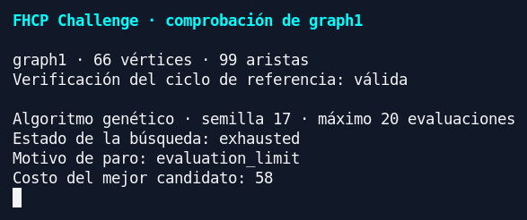
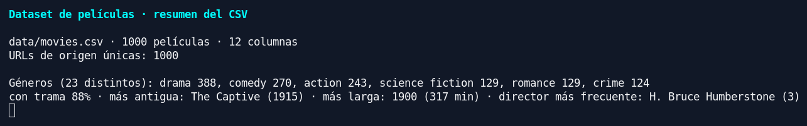
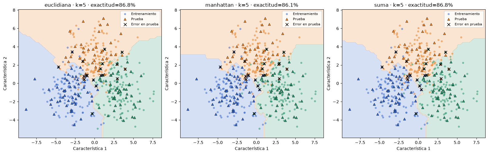

# Fundamentos de Inteligencia Artificial · Unidad 3

**Universidad Politécnica de Victoria**

- **Profesor** Said Polanco Martagón
- **Estudiante** César Euresti
- **Matrícula** 2430233

## Índice de prácticas

| N.º | Práctica | Contenido |
| --- | --- | --- |
| 1 | [FHCP Challenge](01-fhcp-challenge/README.md) | Búsqueda y validación de ciclos hamiltonianos. Incluye la [evaluación de César](01-fhcp-challenge/docs/experiments/cesar-evaluation.md). |
| 2 | [Dataset de películas](02-dataset-peliculas/README.md) | Rastreador de Wikipedia y [dataset de 1,000 películas](02-dataset-peliculas/data/movies.csv). |
| 3 | [K vecinos más cercanos](03-k-nn/README.md) | Implementación manual de KNN y comparación de tres distancias con datos sintéticos. |

La copia de FHCP corresponde a `main` en el commit `6fef0d6`. Las campañas que registran la revisión Git del equipo se ejecutan desde el repositorio original de FHCP.

## Capturas de las prácticas

### FHCP Challenge

### Dataset de películas

### K vecinos más cercanos

